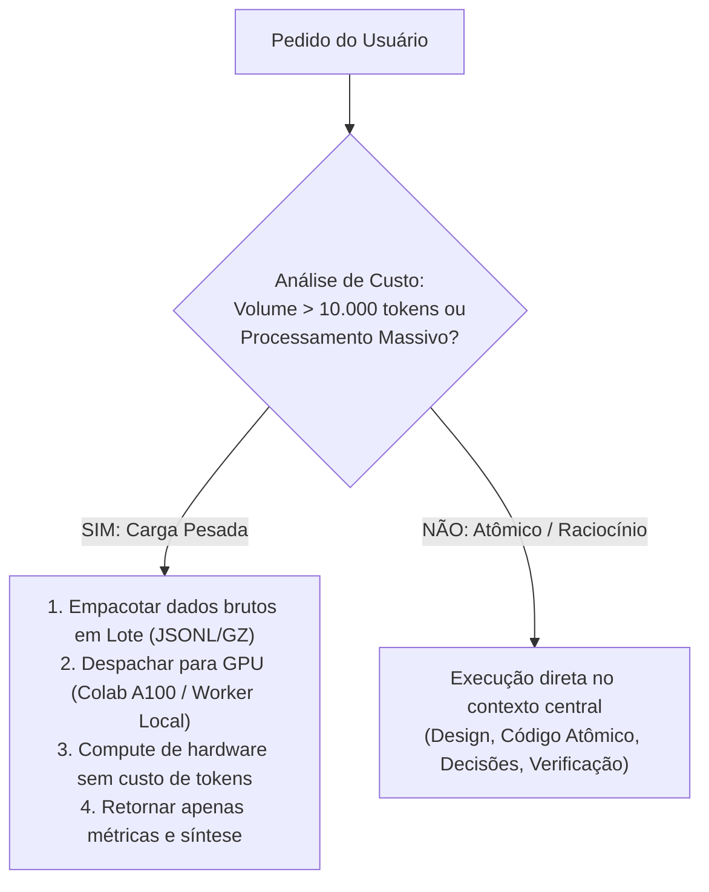

# 🛡️ Protocolo Soberano: GPU-First & Preservação Estrita de Créditos de IA (Zero-Token-Waste)

> **Mandato do Usuário:** Toda e qualquer tarefa computacionalmente pesada (análise de conversas em massa, mineração de textos longos, auditoria de grandes bases, vetorização em lote, geração de dados sintéticos e fine-tuning) DEVE ser transferida para a GPU (Google Colab Pro A100 ou hardware local acelerado).
> **Proibição Absoluta:** É terminantemente vedado queimar créditos de IA / tokens de contexto do modelo central ou disparar múltiplos subagentes de LLM para tarefas mecânicas que a GPU ou workers locais executam com custo zero de tokens.

---

## 🚦 1. Triage Obrigatória de Custo & Decisão (Para Todo Pedido)

Antes de executar qualquer comando ou plano, o agente DEVE classificar a solicitação:

### Casos Obrigatórios de Offload para GPU / Batch Engine:
1. **Auditoria de Conversas e Históricos:** Leitura de transcripts, mineração de logs de chat e extração massiva de conversas passadas.
2. **Grandes Datasets & Bancos de Dados:** Varredura de tabelas com milhares de itens, cruzamento de matrizes de questões, exportações massivas.
3. **Embeddings & Vetorização Semântica:** Geração de vetores 512-D/1536-D para RAG (sempre em GPU Colab A100 via PyTorch/CUDA).
4. **Visão Computacional & Biometria:** Detecção de objetos YOLOv8, extração facial InsightFace e processamento de imagens.
5. **Treinamento e SFT:** Adaptação LoRA BF16, quantização QLoRA e benchmarks.

---

## ⚡ 2. Papel do Agente Antigravity

- **O Antigravity é o Arquiteto / Maestro:** Não o operário de força bruta.
- Ele cria o script, formata o lote, aciona o worker na GPU, valida o status e consome a saída condensada.
- Ele reporta com clareza a **economia de tokens** obtida por meio do processamento na GPU.
