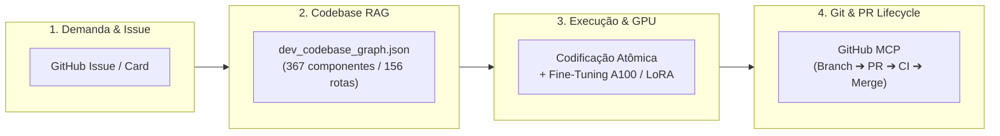

# 🚀 Protocolo Mestre de Desenvolvimento Conjunto (Developer Workflow v3.0)

Este documento define o sistema operacional de desenvolvimento para a dupla **Engenheiro Humano + Antigravity (Córtex de IA)** no ecossistema Áquila Pro.

---

## 🎯 1. Os 4 Pilares do Workflow de Desenvolvimento

---

## 🛠️ 2. Regras Operacionais para o Agente

### A. Rastreamento e Gestão de Tarefas (Zero Fricção)
1. **GitHub Issues Nativo:** Toda demanda complexa deve gerar ou vincular uma Issue no repositório `andrejrunb/-quila-pro-v-1.0.0` via ferramenta `call_mcp_tool(ServerName='github', ToolName='create_issue')`.
2. **Atualização Atômica:** O commit deve referenciar a issue correspondente (ex: `fix(portals): resolve #5`).

### B. Inspeção RAG da Codebase Antes de Escrever Código
1. **Zero Adivinhação de Rotas:** Antes de adicionar ou alterar botões de navegação, consultar o grafo gerado por `scripts/dev_codebase_rag_indexer.py` (`apps/electron/src/database/dev_codebase_graph.json`).
2. **Verificação de Impacto:** Certificar que o destino do `onNavigate(...)` existe no `App.tsx` e no portal correspondente.

### C. Ciclo de Vida Git via GitHub MCP (Branch Protection Compliant)
Como a branch principal `clean-release-v1` possui proteção de branch:
1. **Criar Feature/Fix Branch:** `call_mcp_tool(ServerName='github', ToolName='create_branch')` ou branch local.
2. **Commits Semânticos:** Testar tipagem (`tsc --noEmit`) e suíte de testes (`jest`) antes de comitar.
3. **Abertura de PR Automatizada:** Disparar `call_mcp_tool(ServerName='github', ToolName='create_pull_request')`.
4. **Monitoramento de Status:** Verificar aprovação via `call_mcp_tool(ServerName='github', ToolName='get_pull_request_status')`.

### D. Aceleração por GPU & Daemons Contínuos
1. **Processamento Pesado:** Treinamento LoRA BF16, geração sintética de questões e OCR massivo de provas NUNCA rodam na CPU local; são despachados para a GPU A100-80GB (Colab Pro via notebook `colab/aquila_a100_neural_engine.ipynb`).
2. **Vigilância dos Daemons:** Garantir que o radar de exames (`task-28237`) e o orquestrador contínuo (`task-28958`) sigam operantes em background.
