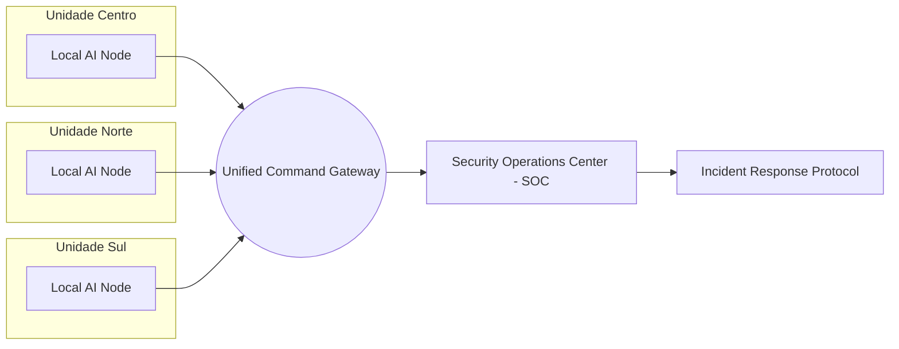

# Unified Command SOC (Multi-Site)

A arquitetura de Comando Unificado (Phase 195) permite que uma única central monitore múltiplas unidades escolares simultaneamente.

## 🛰️ Topologia de Rede

## 📊 Capacidades Centralizadas
- **Visão Eagle Eye:** Global Map com status real de cada nó.
- **Sincronização Delta:** Apenas metadados de eventos são enviados para o SOC, economizando banda.
- **Intervenção Remota:** Acionamento de alarmes e fechaduras em qualquer unidade via gateway central.

---
Vincular a: [[00_Index|Início]] | [[10_Architecture/Architecture_Overview|Arquitetura]]
