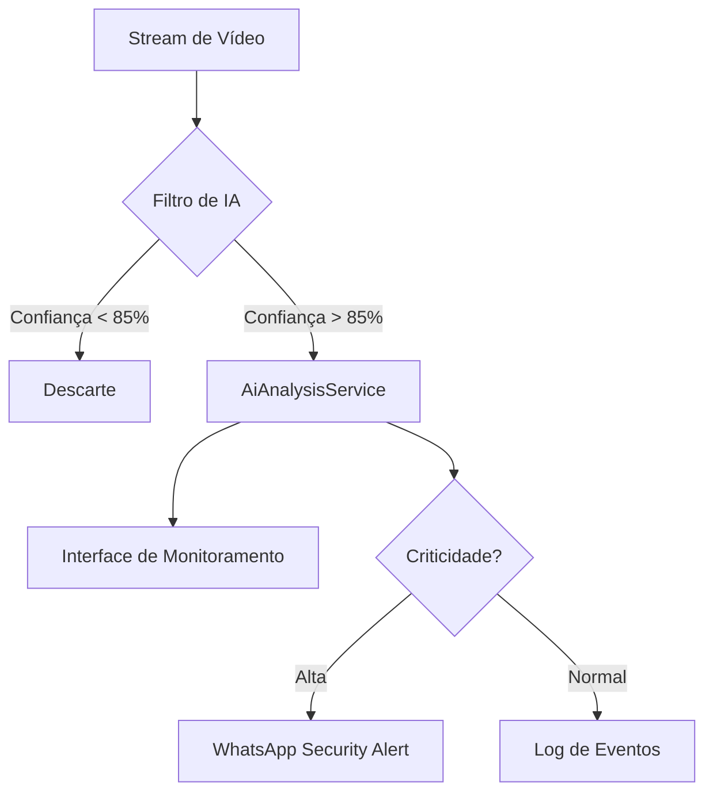

# Visão Computacional Avançada (Advanced Vision)

O módulo de Advanced Vision (Fases 116-120) é responsável pela análise semântica de vídeo em tempo real para detecção de ameaças críticas.

## 🧠 Arquitetura de Análise

## 🚨 Tipos de Eventos Gerenciados

1. **Weapon Detection:** Detecção de objetos metálicos com assinatura de armas de fogo.
2. **Crowd Analysis:** Identificação de aglomerações anômalas em horários de saída/entrada.
3. **Fall Detection:** Alertas de queda para segurança de alunos e funcionários.

## 🛠️ Stack Técnica
- **Motor:** IPC Bridge com modelo OpenCV/TensorFlow local.
- **Notificação:** Integration com Evolution API via `whatsapp:send-security-alert`.

---
Vincular a: [[00_Index|Início]] | [[10_Architecture/Architecture_Overview|Arquitetura]]
