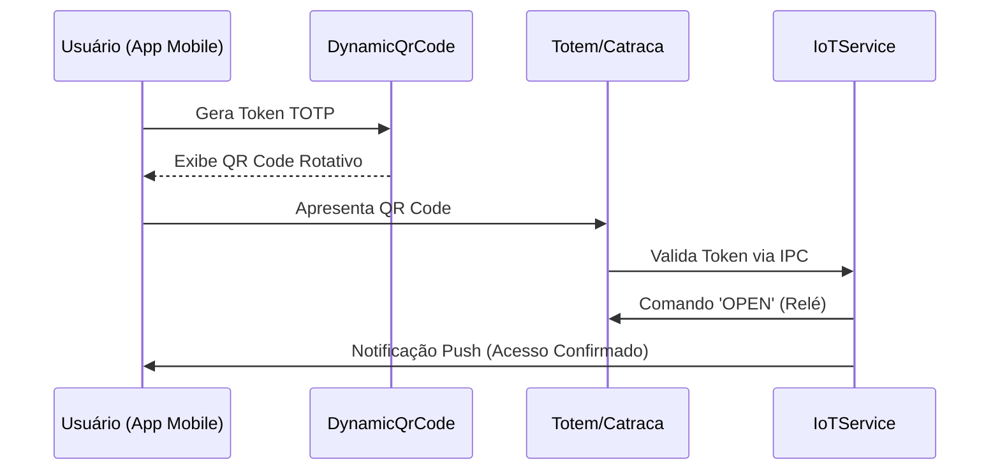

# Hardware Hub & Protocolos IoT

O Hardware Hub centraliza a comunicação do Áquila Pro com dispositivos físicos (catracas, fechaduras e sensores).

## 🏢 Fluxo de Acesso IoT

## 🛡️ Segurança de Acesso
- **TOTP:** Os tokens expiram a cada 30 segundos para evitar clonagem de QR Codes.
- **Offline First:** O `IoTService` mantém um cache local de tokens autorizados para falhas de rede.

## 📟 Dispositivos Suportados
- **Catracas:** Protocolo TCP/IP (SDK Proprietário).
- **Fechaduras:** Relés acionados via barramento serial/USB.

---
Vincular a: [[00_Index|Início]] | [[20_Services/Camera_Engine|Serviços]]
