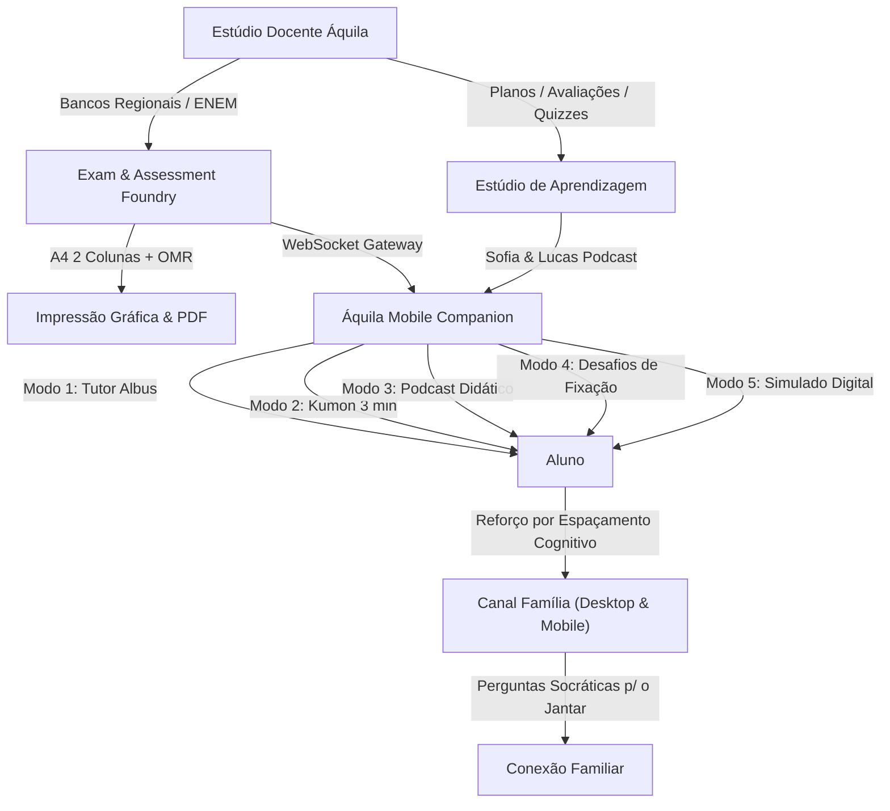

# 🦅 Áquila Pro — Sovereign School OS & AI Ecosystem v2.1

> **A Plataforma Educacional de Inteligência de Apoio, Neuroaprendizagem e Gestão Escolar**  
> Desenvolvida com arquitetura *Offline-First*, governança *Human-in-the-Loop* e em conformidade com as diretrizes da **LGPD (Art. 14 e 16)** e **LDB (Art. 12, VII)**, sujeita a validação por [RIPD/DPIA Institucional](docs/compliance/RIPD_DPIA_Biometria_Menores.md).

---

## 🎯 Escopo da Versão e Estágio de Maturidade

Para garantir máxima estabilidade e conformidade na implantação em escolas-piloto, as funcionalidades do ecossistema estão categorizadas em três níveis operacionais:

| Nível Operacional | Módulos e Recursos | Status no Piloto |
| :--- | :--- | :---: |
| **🟢 Núcleo do Piloto (Core)** | Diário de Classe Digital, Chamada Assistida (RFID/Lista/Validação Humana), Notificações Escolares (WhatsApp/Push), Boletins, Correção Óptica OMR Controlada e Relatórios Pedagógicos. | **Ativo por Padrão** |
| **🟡 Módulos Experimentais (Labs)** | Percepção Passiva por Sinais RF (RuView CSI), Geofencing de Aproximação de Pais, Agentes Autônomos de Marketing e Compilador iOS via SwiftPM sem Mac. | **Desativado por Padrão** *(Requer Feature Flag explícita)* |
| **🔵 Planejamento / Roadmap** | Aceleração On-Device em larga escala via NPUs de 26 TOPS e federação de dados multi-campus descentralizada. | **Em Validação Técnica** |

---

## 🌟 Visão Geral

O **Áquila Pro** é um ecossistema educacional desenhado para prover autonomia e reduzir a dependência de plataformas proprietárias em nuvens estrangeiras, unindo em uma suíte integrada:
1. **Desktop School OS (Electron + Vite + React):** Cockpits operacionais para Direção, Coordenação, Professores, Alunos e Famílias.
2. **Mobile Companion (Expo React Native):** Apoio ao estudo individual, podcasts didáticos, desafios de fixação e simulados no bolso do aluno e dos pais.
3. **Hardware Edge Local:** Processamento local de telemetria, integridade de dados via hash criptográfico SHA-256 e perímetro seguro sem envio de biometria ou dados crus de menores para nuvens públicas.
4. **GPU Offload (Google Colab / On-Premise):** Suporte opcional para treinamento de embeddings conceituais e calibração de bancos de questões.

---

## 🏛️ Arquitetura dos Módulos Principais



---

## 🚀 Funcionalidades Chave (Núcleo do Piloto)

### 1. 🖨️ Áquila Exam & Assessment Foundry
- **Diagramação A4 em 2 Colunas:** Padrão gráfico de avaliações alinhado ao formato oficial de exames nacionais (INEP/ENEM).
- **Folha de Respostas OMR (Cartão de Respostas):** Leitura óptica automatizada de gabaritos com tolerância calibrada de alinhamento.
- **Banco Regional de Questões:** Itens catalogados por área do conhecimento e matriz de habilidades da BNCC.
- **QR Codes de Aprofundamento:** Links opcionais em avaliações impressas para simulações científicas interativas e áudios didáticos no aplicativo.

### 2. 🎙️ Estúdio Didático & Fixação Cognitiva
- **Diálogos de Revisão Contextualizada:** Resumos conceituais gerados com base nos planos de aula do professor.
- **Micro-Doses de Estudo:** Atividades rápidas focadas na resolução de dúvidas conceituais imediatas.
- **Desafios Interativos de Fixação:** Exercícios práticos com validação imediata e feedback pedagógico passo a passo.

### 3. 🧠 Apoio ao Ciclo de Aprendizagem & Canal Família
- **Espaçamento Distribuído:** Recomendações de revisão periódica baseadas no modelo teórico da curva do esquecimento (Ebbinghaus), auxiliando o estudante a consolidar a memória de longo prazo.
- **Perguntas Socráticas para o Cotidiano:** Sugestões semanais para que responsáveis conversem com os alunos sobre os temas abordados em aula, estimulando a autoexplicação.
- **Canal Direto de Notificações:** Envio de comunicados, avisos de faltas e comunicados escolares via WhatsApp e notificações Push aos responsáveis cadastrados.

---

## ⚙️ Como Executar o Ecossistema

### Pré-requisitos
- **Node.js:** v20+ LTS
- **pnpm:** v10+ ou v12+
- **Python:** 3.10+ (para módulos auxiliares de processamento)

### 1. Instalação de Dependências
```bash
pnpm install
```

### 2. Executar o Desktop School OS (Electron + Vite)
```bash
# Terminal 1: Interface Vite Renderer
pnpm --filter aquila-pro-school-os run dev:renderer

# Terminal 2: Processo Principal Electron
pnpm --filter aquila-pro-school-os run dev:electron
```

### 3. Executar o Portal Web
```bash
pnpm --filter @aquila/web run dev
```

### 4. Compilação para Produção
```bash
# Compilar Web SaaS (Next.js 16 com Turbopack)
pnpm --filter @aquila/web run build

# Compilar Desktop Renderer & Main Process
pnpm --filter aquila-pro-school-os run build
```

---

## 🛡️ Governança, Privacidade e Diretrizes Legais

- **LGPD (Art. 14 — Crianças e Adolescentes):** A coleta de dados e processamento de informações cadastrais ou biométricas é restrita ao melhor interesse do estudante, condicionada a termo de consentimento explícito dos responsáveis legais ou base legal de segurança física/acesso escolar. A instituição disponibiliza alternativas não-biométricas (RFID/crachá) sem distinção ou prejuízo ao estudante.
- **LGPD (Art. 16 — Eliminação de Dados):** Rotina formal de purga definitiva de dados sensíveis mediante término de vínculo ou revogação de consentimento. Os registros de auditoria utilizam hash de integridade SHA-256 para verificação técnica contra adulterações locais. *(Nota técnica: o hash SHA-256 assegura integridade criptográfica do registro, não substituindo assinatura qualificada com certificado digital ICP-Brasil quando exigida por normas notariais específicas).*
- **LDB (Art. 12, VII — Frequência Escolar):** O sistema oferece ferramentas de apoio ao monitoramento de presença e sinalização preventiva de infrequência para auxílio à coordenação pedagógica, sem substituir as obrigações regimentais, legais e documentais próprias da secretaria da instituição de ensino.
- **Documentação de Conformidade:** Consulte o [RIPD / DPIA Institucional para Biometria de Menores](docs/compliance/RIPD_DPIA_Biometria_Menores.md).

---

## 📄 Licença

Distribuído sob a licença **MIT**. Consulte o arquivo [`LICENSE`](LICENSE) para mais detalhes.
