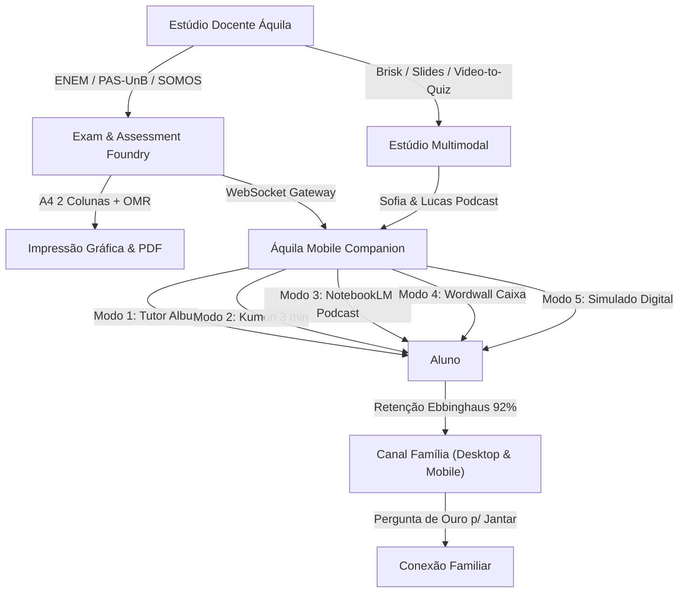

# 🦅 Áquila Pro — Sovereign School OS & AI Ecosystem v2.1

> **A Plataforma Educacional Soberana de Inteligência Artificial, Neuroaprendizagem e Gestão Escolar**  
> Desenvolvida com arquitetura *Offline-First*, *Agent-First Governance* e conformidade irrestrita com a **LGPD (Art. 14 e 16)** e **LDB (Art. 12, VII)**.

---

## 🌟 Visão Geral

O **Áquila Pro** é o primeiro ecossistema educacional do Brasil desenhado para eliminar a dependência de plataformas proprietárias em nuvem estrangeira (Brisk Teaching, Google Classroom, SOMOS Plurall, SuperPro), unindo em uma única suíte soberana:
1. **Desktop School OS (Electron + Vite + React):** Cockpits para Direção, Coordenação, Professores, Alunos e Famílias.
2. **Mobile Companion (Expo React Native):** Treinamento cognitivo diário, podcasts imersivos, gamificação e simulados no bolso do aluno e dos pais.
3. **Hardware Edge & Local NPU:** Visão computacional de portaria (26 TOPS NPU), presença biométrica com hash criptográfico SHA-256 e sem envio de biometria de menores para nuvens públicas.
4. **GPU Offload (Google Colab / On-Premise):** Treinamento de embeddings conceituais e calibração fina de bancos vestibulares.

---

## 🏛️ Arquitetura dos Módulos Principais



---

## 🚀 Funcionalidades Chave

### 1. 🖨️ Áquila Exam & Assessment Foundry (Substituto do Plurall & SuperPro)
- **Diagramação A4 em 2 Colunas:** Padrão gráfico oficial do INEP / Cebraspe / SOMOS Educação.
- **Folha de Respostas OMR (Cartão de Bolinhas):** Leitura óptica automatizada de gabaritos.
- **Banco Regional de Vestibulares:** Questões calibradas de ENEM, PAS-UnB (Etapas 1, 2 e 3), UFG, UFMG, UFU, UFV, UEG, UniRV (Medicina), PUC Goiás e IFG.
- **QR Codes Interativos:** Cada questão impressa inclui link/QR para o laboratório PhET 60 FPS e áudio explicativo no aplicativo móvel.
- **Gabarito com Trilha Kumon:** Resoluções comentadas divididas em L1 (aritmética direta), L2 (proporções) e L3 (maestria vestibular).

### 2. 🎙️ Estúdio Multimodal & Gamificação (Brisk + NotebookLM + Wordwall)
- **NotebookLM Dual-Host Podcast:** Diálogos dinâmicos entre Sofia (curiosa/questionadora) e Lucas (analítico/científico) com síntese de voz nativa (*Web Speech API*) e modo de estudo contextualizado.
- **Fracionamento Cognitivo (Brisk):** Micro-doses de aprendizagem de 2 minutos baseadas no método Kumon.
- **Gamificação Wordwall ("Abra a Caixa"):** 6 caixas de desafio interativo por tópico, com verificação de resposta em tempo real, desbloqueio de XP e recompensas.
- **Brisk Video-to-Quiz:** Descompressão de videoaulas do YouTube em marcos temporais (timestamps cognitivos) e perguntas de checagem com taxonomia de Bloom (DOK 1, 2 e 3).

### 3. ⚛️ Laboratório PhET Colorado em Canvas Nativo (60 FPS)
- **Engenharia Reversa Java ➔ HTML5 Canvas:** Transpilação via `morluto/rea` e CFR de applets Java legados para Canvas de alta performance sem dependência de runtimes externos ou Java plugin.
- **Física Vetorial de Coulomb em Tempo Real:** Vetores de força elétrica ($\vec{F} = \frac{k \cdot q_1 \cdot q_2}{r^3} \cdot \vec{r}$), fricção triboelétrica e polarização eletrostática induzida da matéria neutra.

### 4. 🧠 Radar Neuro-Pedagógico & Ebbinghaus (Canal Família)
- **Quebra do Hiato "Quinta-a-Quinta":** Ciclo de espaçamento distribuído (+24h Sexta, +48h Sábado, +96h Segunda, +144h Quarta) que eleva a taxa de retenção para 92,4%.
- **Pergunta de Ouro para o Jantar em Família:** Prompts socráticos semanais para os pais conversarem com os filhos sobre a matéria do dia sem parecer cobrança de notas, estimulando a autoexplicação (Pirâmide de Glasser).
- **Botão de Envio para WhatsApp:** Permite que os pais copiem instantaneamente a pergunta e a dica pedagógica.

### 5. 🤖 Enxame de Agentes de Crescimento & Autoridade Escolar
- **🎓 Professor Virtual Storyteller:** Artigos de blog conectando a BNCC a fenômenos do cotidiano dos alunos.
- **📈 Gerador de Leads & Marketing Escolar:** Copys de captação no método AIDA para Instagram, carrosséis e roteiros de Reels.
- **🔬 Autoridade Científica & Pedagógica:** Pareceres técnicos e artigos com citações acadêmicas e DOIs reais (Dehaene, Hattie, Cepeliauskas, UNESCO) para a direção apresentar aos pais e mantenedores.

### 6. 📱 Mobile Companion (iOS & Android via Expo)
- **5 Modos Interativos:** Tutor Socrático Albus, Kumon 3 min, Podcast Sofia & Lucas, Wordwall e Simulado Regional Digital.
- **Despacho em Tempo Real:** Comunicação bidirecional via WebSocket local (`MobileGateway.ts`).
- **Dashboard dos Pais:** Radar de presença, geofencing *"Estou Chegando"* com ETA para a portaria e acompanhamento do ciclo de estudos.

---

## ⚙️ Como Executar o Ecossistema

### Pré-requisitos
- **Node.js:** v20+ LTS
- **pnpm:** v12+
- **Python:** 3.10+ (para módulos de IA/NPU)

### 1. Instalação Geral
```bash
pnpm install
```

### 2. Iniciar o Desktop School OS (Electron + Vite)
```bash
# Terminal 1: Renderer Vite
pnpm --filter aquila-pro-school-os run dev:renderer

# Terminal 2: Electron Daemon
pnpm --filter aquila-pro-school-os run dev:electron
```

### 3. Iniciar o Mobile Companion (Expo)
```bash
pnpm --filter aquila-pro-mobile run start --lan
```

### 4. Compilação para Produção
```bash
# Compilar Web SaaS (Next.js 16 Turbopack)
pnpm --filter @aquila/web run build

# Compilar Desktop Renderer & Main Process
pnpm --filter aquila-pro-school-os run build
```

---

## 🛡️ Governança & Conformidade Legal

- **LGPD Art. 14:** Coleta de dados e imagens de menores condicionada a consentimento explícito dos responsáveis legais, com trilha forense imutável.
- **LGPD Art. 16:** Purga segura de vetores biométricos com geração de hash SHA-256 e recibo digital irrevogável.
- **LDB Art. 12, VII:** Monitoramento em tempo real de frequência escolar para garantia do piso legal de 75% de presença e prevenção de retenção.

---

## 📄 Licença

Proprietário. Todos os direitos reservados ao ecossistema Áquila Pro.
*Construído para transformar colégios particulares e redes de ensino com tecnologia de soberania nacional.*
