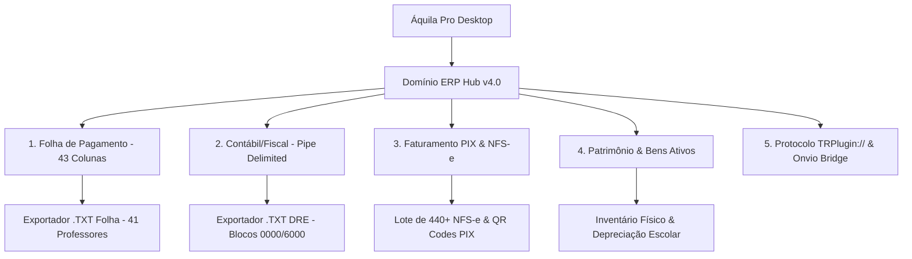

# 🏢 Integração Thomson Reuters Domínio Web & Onvio Cloud ERP

> [!NOTE] Escopo Operacional
> O módulo **Domínio Web / Onvio ERP Hub (v4.0)** realiza a ponte direta entre a gestão financeira/pedagógica do Áquila Pro e os sistemas contábeis da **Thomson Reuters**, eliminando a digitação manual de folha de pagamento e lançamentos contábeis.

---

## 📄 1. Layout Posicional da Folha de Pagamento (43 Colunas)

Estruturado para importação direta no módulo **Domínio Folha (Folha de Salários)**:
* **Colunas Obrigatórias:** Código da Empresa (4), Matrícula do Colaborador (10), Competência MM/AAAA (6), Código da Rubrica (4), Tipo (Vencimento/Desconto), Quantidade/Horas (8 c/ 2 decimais), Valor da Rubrica (12 c/ 2 decimais).
* **Rubricas Padronizadas:**
  * `0001`: Salário Base / Horas-Aula Docente.
  * `0015`: DSR Horista (Descanso Semanal Remunerado).
  * `8066`: Desconto de INSS Retido na Fonte.
  * `8080`: Desconto de Vale Transporte / Alimentação.
* **Corpo Docente Mapeado:** 41 professores reais do Colégio Visão com vínculo por disciplina e carga horária semanal.

---

## 📊 2. Layout Contábil e Fiscal (Pipe-Delimited)

Em conformidade com o validador de importação do **Domínio Contábil**:
* **Bloco `0000`:** Identificação da Instituição Escolar, CNPJ e Período Contábil.
* **Bloco `0150`:** Plano de Contas Referencial (Ativo Circulante, Contas a Receber Mensalidades, Receita de Serviços Educacionais).
* **Bloco `3000`:** Centros de Custos Departamentais (Ensino Médio, Fundamental II, Coordenação, TI, Infraestrutura).
* **Blocos `6000` e `6100`:** Lançamentos Contábeis de Partida Dobrada (Débito: Caixa/Banco / Crédito: Receita com Mensalidades).
* **Demonstração do Resultado (DRE):** Apuração automática de receita bruta, deduções fiscais e margem operacional líquida.

---

## ⚡ 3. Faturamento PIX & Emissão de NFS-e em Lote

* **Geração em Lote:** Emissão consolidada de cobranças para os **440+ alunos reais** do Colégio Visão.
* **PIX Dinâmico:** Geração de *payloads* EMV com QR Code e chave Copia-e-Cola autenticada com conciliação automática.
* **NFS-e Sincronizada:** Layout padrão ABRASF para envio automático aos servidores da Prefeitura Municipal.

---

## 🏛️ 4. Gestão Patrimonial Escolar (Domínio Patrimônio)

Mapeamento dos 5 ativos estruturais do Colégio Visão:
1. Hub Áquila Edge NPU (Servidor de Borda de Alta Disponibilidade).
2. Laboratório de Ciências e Robótica STEAM.
3. Câmeras de Reconhecimento Facial (Portaria Sul e Corredores).
4. Mobiliário e Carteiras Escolares Ergonômicas.
5. Sistema Fotovoltaico de Energia Solar do Campus.

---

## 🔌 5. Protocolo Nativo TRPlugin:// & Onvio Cloud

* **Deep-Linking `TRPlugin://`:** Dispara a abertura do aplicativo cliente nativo da Thomson Reuters na máquina local com passagem de tokens de sessão.
* **Onvio Cloud Sync:** Rotina de sincronização por API/RPA para escritórios de contabilidade que utilizam a versão nuvem do Domínio.

---

## 🔗 Conexões no Vault
* [[10_Architecture/Architecture_Overview|Arquitetura do Áquila Pro]]
* [[40_Legal_LGPD/LGPD_Compliance|Privacidade e Criptografia LGPD]]
* [[30_Operacoes_RH/Dominio_Folha_Pagamento_Docente|Folha de Pagamento Docente]]
