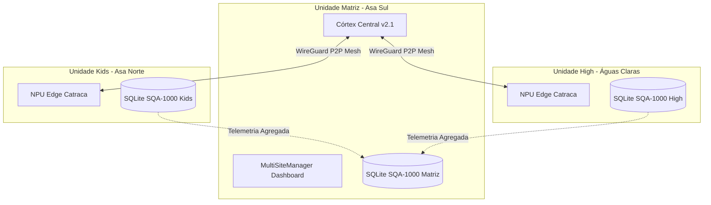

# Áquila Pro — Gestão Multi-Unidade & Sincronização Mesh Federada

## 🏢 Visão Geral

A arquitetura **Multi-Unidade (Tenant Federado)** do Áquila Pro permite que redes de ensino (ex: Colégio Visão com Unidade Matriz Asa Sul, Filial Asa Norte, Filial Águas Claras e Filial Sudoeste) operem com total autonomia local em cada campus escolar, mantendo uma visão executiva consolidada em tempo real na matriz.

---

## 🔒 Princípio de Isolamento Biométrico Soberano (LGPD Art. 11)

1. **Embeddings Faciais 100% Locais**: Os vetores biométricos (512 dimensões) de alunos e responsáveis são armazenados **exclusivamente no hardware da unidade onde estão matriculados**.
2. **Zero Replicação Cross-Site de Dados Sensíveis**: Caso um aluno da Unidade Matriz visite a Unidade Kids, a autorização ocorre via token temporário assinado criptograficamente (SHA-256), sem transmitir o banco de biometria bruta.
3. **Sincronismo Apenas de Metadados**: O que viaja no túnel P2P Mesh:
   - Indicadores consolidados de frequência e evasão.
   - Calendário letivo unificado e períodos de avaliação.
   - Conciliação contábil e status de mensalidades PIX.
   - Alertas táticos de segurança perimetral entre portarias.

---

## 🎛️ Painel de Controle Multi-Site (`MultiSiteManager.tsx`)

O cockpit administrativo central disponibiliza:
- **Faixa de KPIs Executivos (4 Colunas)**:
  - Total de Alunos da Rede: 2.590 matrículas consolidadas.
  - Unidades Ativas: 3/3 nós operacionais com túnel WireGuard ativo.
  - Latência Mesh P2P: ~12 ms média entre os nós escolares.
  - Soberania LGPD: Nível 10 com isolamento estrito de biometria.
- **Alternador Rápido de Unidade**: Permite que a diretoria geral alterne a visão gerencial instantaneamente entre qualquer unidade da rede.
- **Cadastro Seguro de Novas Unidades**: Registro com código INEP MEC, endereço e endpoint WireGuard.
