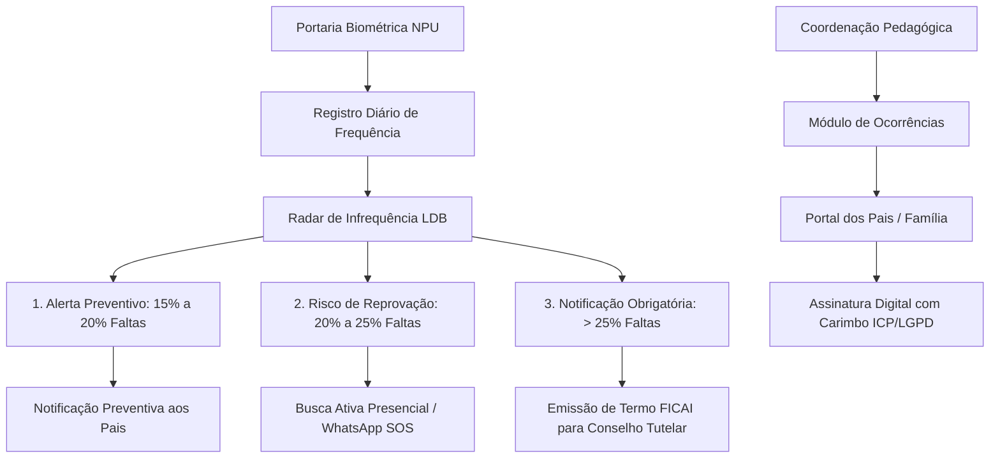

# 🛡️ Radar de Infrequência LDB Art. 12 VII & Ocorrências Familiares

> [!IMPORTANT] Marco Regulatório Obrigatório
> Conforme a **Lei Federal nº 13.803/2019**, que alterou o **Art. 12, inciso VII da LDB (Lei 9.394/1996)**, as escolas têm a obrigação legal de:
> *"notificar ao Conselho Tutelar do Município a relação dos alunos que apresentem quantidade de faltas acima de 30% (trinta por cento) do percentual permitido em lei"*.
> No Áquila Pro, este fluxo foi totalmente automatizado e integrado ao padrão SigaWeb (Activesoft).

---

## 🚨 1. Radar de Infrequência LDB Art. 12 VII

* **Cálculo Legal:** A LDB estabelece frequência mínima obrigatória de **75% das horas letivas** para aprovação (limite de 25% de faltas).
* **Níveis de Alerta Automatizados:**
  1. **Alerta Preventivo Amarelo (15% a 20% de Faltas):**
     - O sistema detecta o início do desvio de assiduidade e notifica os pais preventivamente.
  2. **Risco Iminente de Reprovação Laranja (20% a 25% de Faltas):**
     - Alerta crítico para o coordenador com acionamento do botão **"WhatsApp SOS Evasão"** com mensagem formatada para os responsáveis.
  3. **Infração LDB Vermelho (> 25% de Faltas):**
     - Geração automática da **Ficha de Comunicação de Aluno Infrequente (FICAI)** e do **Ofício Notificação ao Conselho Tutelar (`TutelaryCouncilReport`)**, com fundamentação expressa no Art. 56, II do ECA (Lei 8.069/1990) e Art. 12, VII da LDB (Lei 9.394/1996), discriminação das tentativas prévias de contato com a família e carimbo temporal criptográfico SHA-256 ICP-Brasil.

---

## 📝 2. Módulo de Ocorrências com Ciência Familiar

Inspirado no fluxo operacional do SigaWeb e JR Sistemas:
* **Tipificação de Ocorrências:**
  * `Pedagógica`: Não realização de atividades, relatórios pendentes, material esquecido.
  * `Atraso`: Entradas após o fechamento dos portões na portaria biométrica.
  * `Celular`: Uso indevido de dispositivos móveis em horário de aula/prova.
  * `Uniforme`: Descumprimento das normas de vestimenta institucional.
  * `Disciplinar`: Conflitos em sala ou corredores.
  * `Mérito Acadêmico`: Destaque em olimpíadas, simulados ENEM e atitudes colaborativas.
* **Níveis de Gravidade:** Leve (Informativo), Média (Advertência Verbal), Grave (Convocação Presencial) e Mérito (Reconhecimento Positivo).

---

## ✍️ 3. Assinatura Digital no Portal da Família

* **Eliminação de Papel:** Em vez de enviar bilhetes físicos que os alunos podem perder, a ocorrência aparece instantaneamente no [Portal dos Pais](file:///c:/aquila/apps/electron/src/ui/portals/ParentPortal.tsx).
* **Botão "Dar Ciência / Assinar Digitalmente":**
  * O responsável legal lê o relato circunstanciado e a providência adotada pela coordenação.
  * Ao clicar no botão, o sistema registra:
    * Nome completo do responsável.
    * Data e horário exatos da assinatura.
    * Hash criptográfico da confirmação (`ICP-BR-SHA256`).
* **Sincronização em Tempo Real:** A coordenação visualiza imediatamente o status atualizado de *Pendente* para *Ciência Confirmada*.

---

## 🔗 Conexões no Vault
* [[40_Legal_LGPD/LGPD_Compliance|Privacidade e Auditoria LGPD]]
* [[50_Pedagogia_IA/Teachy_Brisk_AI_Studio|Estúdio Docente de IA]]
* [[20_Servicos_Core/Dominio_Web_Onvio_ERP|Integração ERP Domínio Web]]
