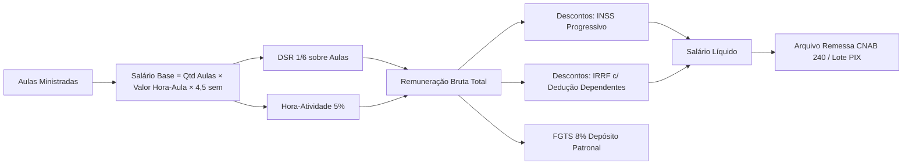

# 🏢 Domínio Folha de Pagamento Docente & Onvio Portal (v4.0)

> [!NOTE]
> Esta especificação detalha o motor de folha de pagamento docente do **Colégio Visão**, desenhado para compatibilidade total com o módulo **Folha do Domínio Web (Thomson Reuters)** e publicação imediata no **Onvio Portal do Colaborador**.

---

## 1. Regras de Remuneração Docente (CCT Sinpro / CLT)

A remuneração dos **41 professores** do Colégio Visão segue as diretrizes da Convenção Coletiva de Trabalho (CCT) do Ensino Privado:



### Rubricas Padronizadas (Tabela de Eventos Domínio):
1. **Evento 001 - Salário Aulas (Hora-Aula)**: Quantidade de aulas semanais × 4,5 semanas × R$ valor hora-aula.
2. **Evento 002 - Descanso Semanal Remunerado (DSR)**: \( \frac{1}{6} \) (16,67%) sobre o total do Evento 001.
3. **Evento 005 - Hora-Atividade (5%)**: Adicional para elaboração de aulas, simulados e correções.
4. **Evento 012 - Adicional Noturno (20%)**: Aplicável a aulas ministradas após as 22h (Turmas EJA e Cursos Noturnos).
5. **Evento 080 - Atrasos / Faltas Injustificadas**: Apuradas diretamente pelo Reconhecimento Facial RuView na catraca dos professores.
6. **Evento 901 - INSS Docente**: Tabela progressiva eSocial (7,5% a 14% com dedução de parcela).
7. **Evento 903 - IRRF Docente**: Tabela progressiva Receita Federal (isenção até R$ 2.826,65, faixas até 27,5%).
8. **Evento 990 - Depósito FGTS (8%)**: Encargo patronal, sem desconto do colaborador.

---

## 2. Layout do Arquivo de Importação Domínio Folha (43 Colunas)

O Áquila Pro gera mensalmente o arquivo TXT/CSV posicional para importação direta no menu `Utilitários > Importação > Padrão > Folha` do Domínio Web:

| Coluna | Campo | Tipo | Descrição / Exemplo |
| :---: | :--- | :---: | :--- |
| **01** | `COD_EMPRESA` | Num(4) | `0065` (Código do Colégio Visão no Domínio) |
| **02** | `COD_EMPREGADO` | Num(6) | `000101` a `000141` (Matrícula do Docente) |
| **03** | `NOME_EMPREGADO` | Alfa(60) | Nome completo conforme Receita Federal |
| **04** | `CPF` | Num(11) | Apenas números, validado por dígito verificador |
| **05** | `PIS_PASEP` | Num(11) | Inscrição social para Caixa / eSocial |
| **06** | `CARGO_CBO` | Num(6) | `2312-05` (Ensino Fundamental II) / `2321-15` (Ensino Médio) |
| **07** | `COD_DEPARTAMENTO`| Num(4) | `0010` (Coord. Fundamental) / `0020` (Coord. Médio) |
| **08** | `DATA_ADMISSAO` | Data | Formato `DDMMAAAA` |
| **09** | `TIPO_CONTRATO` | Num(1) | `1` (Prazo Indeterminado) |
| **10** | `QTD_HORAS_SEMANAIS`| Dec(4,2)| De `12.00` a `40.00` horas |
| **11** | `VALOR_HORA_AULA`| Dec(10,2)| Ex: `54.50` a `82.00` |
| **12** | `SALARIO_BASE` | Dec(10,2)| Base calculada com DSR e Hora Atividade |
| **13..25**| `EVENTOS_PROVENTOS`| Variável| Horas extras, DSR, adicionais de coordenação |
| **26..38**| `EVENTOS_DESCONTOS`| Variável| Vale transporte, faltas catraca, plano coparticipativo |
| **39** | `BASE_INSS` | Dec(10,2)| Base de cálculo da previdência |
| **40** | `BASE_IRRF` | Dec(10,2)| Base deduzida de dependentes |
| **41** | `BASE_FGTS` | Dec(10,2)| Base do fundo de garantia |
| **42** | `VALOR_LIQUIDO` | Dec(10,2)| Valor líquido creditado em conta |
| **43** | `CHAVE_PIX_TIPO` | Alfa(100)| Tipo de chave (CPF/Celular/E-mail) e Chave PIX |

---

## 3. Amostragem do Corpo Docente (41 Professores Ativos)

| Matrícula | Professor(a) | Disciplina / Segmento | Carga Semanal | Valor Hora | Salário Base | Chave PIX |
| :---: | :--- | :--- | :---: | :---: | :---: | :--- |
| `000101` | Ana Paula Silveira | Língua Portuguesa / EM | 32h | R$ 78,00 | R$ 11.232,00 | `prof.anapaula@visao.com.br` |
| `000102` | Carlos Eduardo Melo | Matemática / EM & PV | 36h | R$ 82,00 | R$ 13.284,00 | `carlos.melo@pix.bcb.gov.br` |
| `000103` | Juliana Mendes Rios | Biologia / EF II & EM | 28h | R$ 72,00 | R$ 9.072,00 | `juliana.mendes@gmail.com` |
| `000104` | Roberto Souza Lima | Física / EM & PV | 24h | R$ 78,00 | R$ 8.424,00 | `11987654321` |
| `000105` | Fernanda Diniz | Química / EM | 24h | R$ 75,00 | R$ 8.100,00 | `prof.fernanda@visao.com.br` |
| `000106` | Marcelo Fagundes | História / EF II & EM | 30h | R$ 68,00 | R$ 9.180,00 | `marcelo.hist@outlook.com` |
| `000107` | Tatiana Albuquerque| Geografia / EM | 20h | R$ 68,00 | R$ 6.120,00 | `tatiana.geografia@visao.com.br` |
| `000108` | Bruno Castilho | Inglês / EF II & EM | 26h | R$ 65,00 | R$ 7.605,00 | `bcastilho@gmail.com` |
| ... | *(demais 33 docentes cadastrados na base SQLite `teachersData`)* | ... | ... | ... | ... | ... |

---

## 4. Integração com Onvio Portal do Colaborador

O módulo [`DominioOnvioHub.tsx`](file:///c:/aquila/apps/electron/src/ui/pages/DominioOnvioHub.tsx) conecta-se via API REST ao Onvio Portal:

```
[Áquila Pro SQLite]
       │ (Gera folha fechada & Holerite PDF criptografado)
       ▼
[Onvio Portal API (Thomson Reuters)]
       │ (Notificação Push via App Onvio para Smartphone do Docente)
       ▼
[Smartphone do Docente]
       │
       ├─► Visualização de Espelho de Ponto (RuView Facial)
       ├─► Download do Holerite com Assinatura Eletrônica (Hash SHA-256)
       ├─► Informe de Rendimentos IRPF
       └─► Requerimento de Férias e Licenças
```

### Segurança e Compliance LGPD:
- Os holerites exportados contêm marca d'água digital com hash criptográfico SHA-256 da matrícula do professor e data/hora de emissão.
- Acesso do professor via autenticação de duplo fator (2FA) integrada ao ecossistema Áquila Pro.

---

## 5. Auditoria de Horas pelo RuView (Presença Biométrica)

A frequência de professores não depende de crachás físicos ou biometria de toque:
1. As câmeras de entrada dos professores na sala de aula e na sala dos professores identificam a presença via **ArcFace / InsightFace** (embeddings 512-d).
2. Se o docente entra às 07:12 para uma aula que inicia às 07:15, o status é `PRESENTE_PONTUAL`.
3. Se houver atraso superior a 15 minutos sem justificativa prévia na coordenação, o sistema gera o alerta disciplinar e calcula o desconto automático para a Folha do Domínio.
4. Janelas de aula vaga e substituição voluntária são registradas automaticamente como `HORA_EXTRA_SUBSTITUICAO`.

---

## 6. Links Relacionados no Cérebro Obsidian
- [[20_Servicos_Core/Dominio_Web_Onvio_ERP|Dominio Web & Onvio ERP Hub]]
- [[20_Servicos_Core/SigaWeb_LDB_Evasion_Occurrences|SigaWeb LDB Evasion & Ocorrencias]]
- [[30_Operacoes_RH/implementation_plan_v3241_hr_sovereignty|RH Sovereignty Plan]]
- [[60_Registro_de_Execucao/implementation_plan_v2500_pedagogical_erp_suite|Plano de Implementação Suite v2.5.0]]
