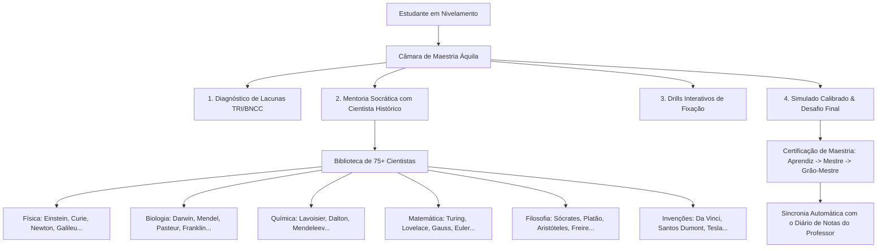

# 🏛️ Câmara de Maestria & Mentoria Histórica Socrática

> [!NOTE] Fundamentação Pedagógica
> A **Câmara de Maestria** é o ambiente de nivelamento autônomo onde o estudante desenvolve fluência conceitual profunda antes de avançar para tópicos subsequentes. O suporte pedagógico é conduzido por **75+ cientistas e pensadores de domínio público**, que empregam o método socrático para guiar a reflexão sem entregar respostas prontas.

---

## 🔬 1. Pilares da Câmara de Maestria

### 1.1 Método Socrático Heurístico
- A IA assume a persona de um cientista histórico com fidelidade conceitual e contextual de sua época.
- Em vez de resolver o problema pelo estudante, formula perguntas que provocam o raciocínio abdutivo e dedutivo.
- Apresenta analogias históricas reais (ex: Santos Dumont explicando sustentação de aeromodelos; Marie Curie abordando emissão radioativa; Alan Turing analisando fita e transições de estado).

### 1.2 Níveis de Proficiência Áquila
- **Nível 1 — Aprendiz:** compreensão dos conceitos elementares e vocabulário técnico.
- **Nível 2 — Praticante:** aplicação em situações-problema padrão.
- **Nível 3 — Mestre:** resolução de problemas complexos de nível ENEM/Vestibular com justificativa.
- **Nível 4 — Grão-Mestre:** capacidade de conectar o conceito a outras áreas do conhecimento e propor soluções inovadoras.

---

*Documento homologado pelo Córtex Central Áquila Pro.*
