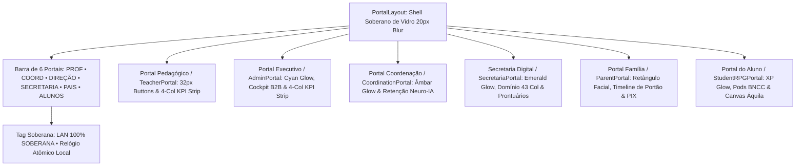

# 🎨 Harmonização de Layout, Formatação & Elite Design System dos Portais Soberanos

> [!NOTE] Padrão Visual Stitch & Elite (v3.2.0 Soberano)
> Todos os 6 Portais Soberanos do ecossistema Áquila Pro foram alinhados sob a especificação do **Elite Design System** e os tokens de design do **Stitch**, garantindo consistência visual de 100%, ergonomia de comando e conformidade absoluta com o paradigma Agent-First.

---

## 🏛️ 1. Matriz de Padronização Visual entre Portais

| Portal | Tema / Cor de Destaque | Identificador / Badge | Ações Rápidas (Botões 32px) | Grid de Telemetria (4 Colunas) |
| :--- | :--- | :--- | :--- | :--- |
| **TeacherPortal** (PROF) | `#3B82F6` (Azul Elétrico) | `COCKPIT DOCENTE` | Slides, Arena, Canvas, Estúdio IA, Fábrica, Mapa Sala | Turmas Hoje, Alunos Ativos, Frequência, Pendências |
| **AdminPortal** (DIREÇÃO) | `#00F0FF` (Ciano Stitch) | `SOVEREIGN EXECUTIVE COCKPIT` | Mapa Salas IA, Nova Matrícula, Financeiro, Relatórios | Total Alunos, Frequência Média, Faturamento, Segurança |
| **CoordinationPortal** (COORD) | `#F59E0B` (Âmbar Dourado) | `COCKPIT COORDENAÇÃO` | Grade Urânia IA, Mapa Salas, Calendário, Laudos | Frequência Hoje, Alunos em Risco, Ocorrências, Média |
| **SecretariaPortal** (SECRETARIA)| `#10B981` (Esmeralda) | `SECRETARIA DIGITAL & DOMÍNIO ERP` | Nova Matrícula, Boletins em Lote, Folha 43 Col, LDB | Matrículas Ativas, Edge Central, Domínio Contábil, Tutelar |
| **ParentPortal** (PAIS) | `#0EA5E9` (Azul Céu) | `CONEXÃO FAMÍLIA` | Boletim A4, PIX Dinâmico, Justificar Falta, Ocorrências | Frequência LDB, Média Global, Conquistas BNCC, Financeiro |
| **StudentRPGPortal** (ALUNOS) | `#8B5CF6` (Roxo Real) | `JORNADA ÉPICA RPG` | Arena PvP, Câmara ENEM, Canvas Áquila, Redação 1000 | Nível Albus, Sequência Dias, Foco Neuro, Moedas 💎 |

---

## 💎 2. Pilares de Engenharia do Layout Refatorado

### A. Botões de Ação Uniformes (32px Standard)
- Todos os botões primários e secundários de todos os portais compartilham altura exata de `32px`, raio de borda `6px`, padding horizontal de `12px` e tipografia `12px font-weight: 600`.
- Eliminação definitiva de desalinhamentos verticais e botões gigantescos herdados de bibliotecas genéricas.

### B. Shell Soberano (`PortalLayout.tsx` & `.css`)
- **Filtro de Desfoque de Vidro**: Efeito de profundidade com gradiente radial e `backdrop-filter: blur(20px)`.
- **Alternador de 6 Portais**: Adicionado o atalho `SECRETARIA` com cor `#10B981` junto aos 5 existentes.
- **Tag de Integridade Local**: Badge animado com pulso verde esmeralda `LAN 100% SOBERANA • SQLITE WAL` e relógio com sincronização local em tempo real.

### C. Secretaria Digital Refatorada (`SecretariaPortal.tsx` & `.css`)
- Substituição do layout legado por uma arquitetura `.sec-cockpit` Stitch-native.
- Grid de 4 KPIs com telemetria do SQA-1000 e status do motor de persistência.
- Barra de busca com foco em anel esmeralda e cofre de prontuários com cartões de documentos em grid responsivo.

---

## 🔗 Conexões no Vault
- [[00_Obsidian_Brain_Index|Índice Geral do Cérebro]]
- [[50_Roadmap/Proximos_Passos_Sprints_4_5_6|Planejamento Estratégico — Sprints 4, 5 e 6]]
- [[50_Pedagogia_IA/Chamada_Inteligente_Facial_LDB|Chamada Facial & Radar LDB]]
- [[50_Pedagogia_IA/Gerador_Avaliacoes_TRI_Caderno_A4|Gerador de Avaliações TRI & Caderno A4]]
- [[20_Servicos_Core/Dominio_Web_Onvio_ERP|Domínio Web & Onvio ERP Hub]]
