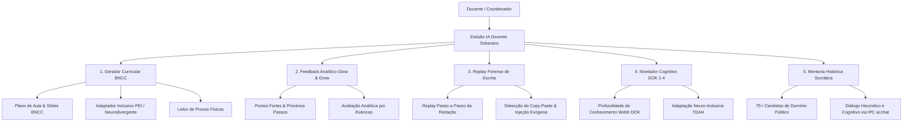

# 🧠 Estúdio Docente de IA — Co-Piloto Pedagógico Soberano

> [!NOTE] Arquitetura Soberana & Independente
> O **Estúdio Docente de IA** consolida em uma interface local nativa do Áquila Pro as capacidades essenciais de planejamento pedagógico, feedback formativo analítico e auditoria de escrita com suporte à matriz curricular BNCC e à biblioteca de **75+ Mentores Históricos de Domínio Público**.

---

## 🧰 1. Estações de Trabalho do Estúdio

### 1.1 Gerador Curricular BNCC & Adaptação Inclusiva (PEI)
- Estruturação de aulas por competências gerais e habilidades específicas da BNCC.
- Geração de roteiros de aula, apresentações visuais e atividades escalonadas.
- **Adaptação PEI (Plano Educacional Individualizado):** reescrita neurocompatível com simplificação sintática, aumento de espaçamento visual e âncoras cognitivas para estudantes com TEA, TDAH ou dislexia.

### 1.2 Feedback Formativo Analítico (Glow & Grow)
- Diagnóstico de produções textuais e resoluções com destaque para:
  - **Glow (Pontos de Força):** repertório legítimo, rigor de cálculo e argumentação coerente.
  - **Grow (Oportunidades de Evolução):** sugestões pontuais de aprofundamento e revisão estrutural.

### 1.3 Inspetor Forense de Escrita & Replay Temporal
- Rastreamento dos eventos de digitação do estudante ao longo do tempo.
- **Detecção de Fraude / Copy-Paste:** identifica inserções abruptas de blocos inteiros de texto exógeno sem histórico de digitação incremental.
- **Replay de Escrita:** reprodução cronológica da construção textual pelo aluno.

### 1.4 Nivelador Cognitivo DOK (Depth of Knowledge — Norman Webb)
- Transposição dinâmica de enunciados e problemas entre os 4 níveis de complexidade:
  - **DOK 1 (Recall / Recuperação):** identificação direta, fórmulas básicas e vocabulário.
  - **DOK 2 (Skills & Concepts):** aplicação guiada e comparação de métodos.
  - **DOK 3 (Strategic Thinking):** justificativa de hipóteses, deduções e resolução com múltiplas etapas.
  - **DOK 4 (Extended Thinking):** projetos interdisciplinares e conexões contextuais de longo prazo.

### 1.5 Mentoria Histórica Socrática (75+ Figuras de Domínio Público)
- Catálogo nativo com cientistas e pensadores de renome histórico universal livres de direitos autorais:
  - **Física & Cosmos:** Galileu, Newton, Einstein, Marie Curie, Maxwell, Bohr, Kepler, Faraday, Copérnico, Feynman, Fermi, Oppenheimer, Boltzmann, etc.
  - **Biologia & Medicina:** Darwin, Mendel, Pasteur, Fleming, Rosalind Franklin, Hipócrates, Oswaldo Cruz, Carlos Chagas, Vesalius, etc.
  - **Química & Matéria:** Lavoisier, Mendeleev, Dalton, Boyle, Rutherford, Linus Pauling, Avogadro, etc.
  - **Matemática & Computação:** Turing, Ada Lovelace, Euler, Gauss, Pitágoras, Euclides, Arquimedes, Descartes, Boole, Von Neumann, Gödel, etc.
  - **Humanidades & Filosofia:** Sócrates, Platão, Aristóteles, Maquiavel, Kant, Paulo Freire, Machado de Assis, Adam Smith, etc.
  - **Engenharia & Invenções:** Leonardo da Vinci, Santos Dumont, Nikola Tesla, Thomas Edison, Graham Bell, Arquimedes, Gutenberg, etc.
- Comunicação assíncrona com o Córtex Local via IPC `ai:chat`.

---

*Documento homologado pelo Córtex Central Áquila Pro.*
