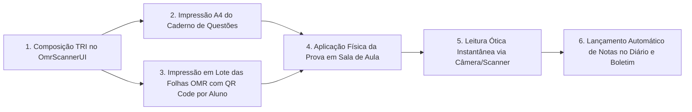

# 📝 Gerador de Avaliações TRI, Caderno de Questões A4 & Fluxo OMR Soberano (v3.0.0)

O ecossistema **Áquila Pro** integra a **Teoria de Resposta ao Item (TRI - Modelo Logístico de 3 Parâmetros)** com a geração e correção física de avaliações escolares, fechando o ciclo pedagógico completo do Colégio Visão sem dependência de plataformas proprietárias ou nuvens terceirizadas.

---

## 📐 1. Teoria de Resposta ao Item (TRI — Modelo 3PL)

Cada item do catálogo [`apps/electron/src/ui/utils/triItemBank.ts`](file:///c:/aquila/apps/electron/src/ui/utils/triItemBank.ts) é calibrado matematicamente sob a curva característica do item:

$$P_i(\theta) = c_i + \frac{1 - c_i}{1 + e^{-1.7 \cdot a_i \cdot (\theta - b_i)}}$$

Onde:
- $\theta$: Proficiência do estudante estimada na escala latente normalizada.
- $a_i$: **Poder de Discriminação** do item (quanto mais inclinada a curva, maior a capacidade de distinguir estudantes proficientes).
- $b_i$: **Grau de Dificuldade** do item (ponto de inflexão na escala de habilidade).
- $c_i$: **Probabilidade de Acerto Casual (Chute)** (estabilizado em $\approx 0.20$ para questões de 5 alternativas).

A nota do estudante converte a proficiência latente para a escala ENEM padrão ($200$ a $1000$ pontos) e para a escala escolar bimestral ($0.0$ a $10.0$), calculando o **Índice de Coerência Pedagógica**, que penaliza acertos casuais em itens complexos quando acompanhados de erros em competências basilares.

---

## 🔄 2. O Ciclo Fechado de Aplicação de Exames

1. **Composição Balanceada**:
   - O docente seleciona a área ou disciplina e o número de questões. O algoritmo `generateBalancedTriExam` compõe a prova respeitando a pirâmide cognitiva (30% fáceis, 50% médias e 20% difíceis).
2. **Impressão do Caderno de Questões (A4)**:
   - Botão **"Imprimir Caderno de Prova (A4)"** aciona layout formal com cabeçalho institucional do Colégio Visão, instruções de exame, campos de identificação do aluno e enunciados diagramados sem exibição de gabaritos.
3. **Folha de Respostas OMR com QR Code Individual**:
   - Geração de folhas personalizadas com o RA e Turma codificados em QR Code para cada aluno matriculado (`studentsData.ts`), permitindo impressão contínua com quebras de página automáticas.
4. **Leitura e Lançamento**:
   - O scanner OMR decodifica as bolhas preenchidas, calcula a nota TRI e lança diretamente na coluna de avaliação do diário docente e no boletim familiar.

---

## 🛡️ 3. Portais Homologados em E2E Playwright (17/17 Passando)

A suíte de testes de resiliência e ausência de travamentos (`apps/electron/e2e/portals.spec.ts`) garante que toda a suíte abra sem erros de runtime:
1. `teacher-dashboard`
2. `security-monitor`
3. `hr`
4. `student-portal`
5. `ai-lab`
6. `skill-tree`
7. `essay-lab`
8. `omr-scanner`
9. `family`
10. `bncc-heatmap`
11. `attendance`
12. `coordination`
13. `secretaria-portal`
14. `load-testing`
15. `slide-studio`
16. `activity-factory`
17. `pvp-arena`

---

*Documento auditado e catalogado no Cérebro Obsidian — Outubro/2026.*
