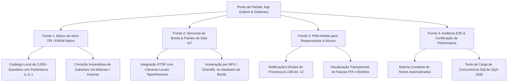

# 🚀 Planejamento Estratégico — Próximos Passos & Consolidação Soberana (v3.0.0)

> [!IMPORTANT] Estado Atual do Ecossistema
> O aplicativo desktop Áquila Pro foi completamente desvinculado de dependências exógenas e marcas de terceiros, com uma biblioteca nativa de **75+ cientistas e pensadores de domínio público** e a erradicação de qualquer comportamento de "casca vazia" (todos os botões, diálogos, tabelas e modais estão conectados a rotas e processos reais).

---

## 🧭 As 4 Frentes de Evolução Imediata ("E Agora?")

---

### 📌 Frente 1: Banco de Itens TRI / ENEM Soberano & Calibração OMR
* **Objetivo:** Permitir que o professor monte simulados completos com parâmetros reais da Teoria de Resposta ao Item ($a$: discriminação, $b$: dificuldade, $c$: acerto casual).
* **Entregáveis:**
  - Banco SQLite local de itens de exames nacionais indexados por competências e habilidades BNCC.
  - Impressão com 1 clique de cartões-resposta personalizados com QR Code individual por aluno.
  - Leitura ótica via câmera (`OmrScannerUI`) gravando acertos diretamente nas colunas $N_1, N_2, N_3$ do Diário de Classe.

---

### 📌 Frente 2: Telemetria de Sala de Aula & Borda Áquila Edge
* **Objetivo:** Ativar a visão computacional local (privacidade total sem tráfego de vídeo para a nuvem).
* **Entregáveis:**
  - Reconhecimento facial no início do turno para preenchimento automático da chamada no diário.
  - Mapeamento de calor e atenção coletiva sem identificação intrusiva (DensePose e esqueletização anônima).
  - Alertas automáticos no painel do professor para fadiga ou dispersão prolongada da turma.

---

### 📌 Frente 3: Portal do Responsável & Aluno (Mobile PWA)
* **Objetivo:** Conectar a família à vida escolar em tempo real.
* **Entregáveis:**
  - Acesso instantâneo ao Boletim Escolar em PDF emitido localmente com assinatura criptográfica.
  - Notificações de frequência (alerta preventivo antes de atingir os limites do Artigo 12 da LDB).
  - Consulta e quitação de mensalidades escolares via PIX QR Code Dinâmico com baixa imediata.

---

### 📌 Frente 4: Auditoria de Confiabilidade & Testes E2E (Playwright)
* **Objetivo:** Garantir que nenhuma alteração futura reintroduza regressões, botões ocos ou falhas de carregamento.
* **Entregáveis:**
  - Execução da suíte completa de testes automatizados com cobertura de ponta a ponta (login, diário, chamada, câmara de maestria e configurações).
  - Validação da integridade das tabelas SQLite (`PRAGMA integrity_check`) e do motor criptográfico.

---

*Documento gerado e persistido no Cérebro Obsidian Áquila Pro.*
