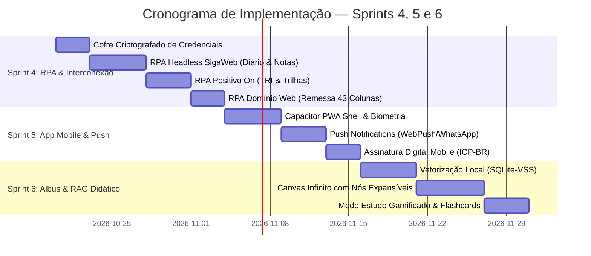
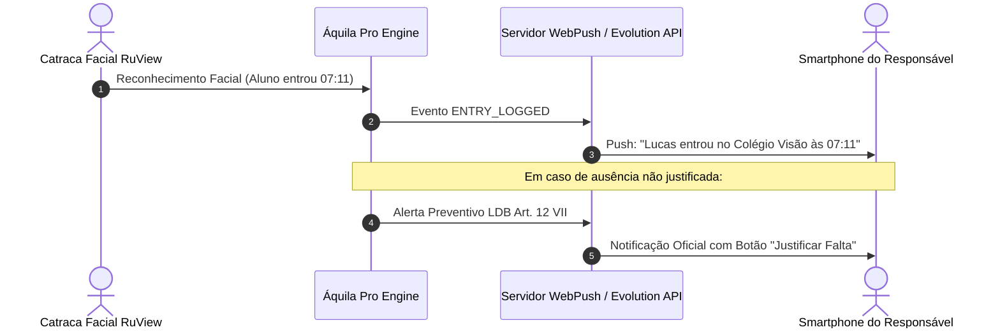
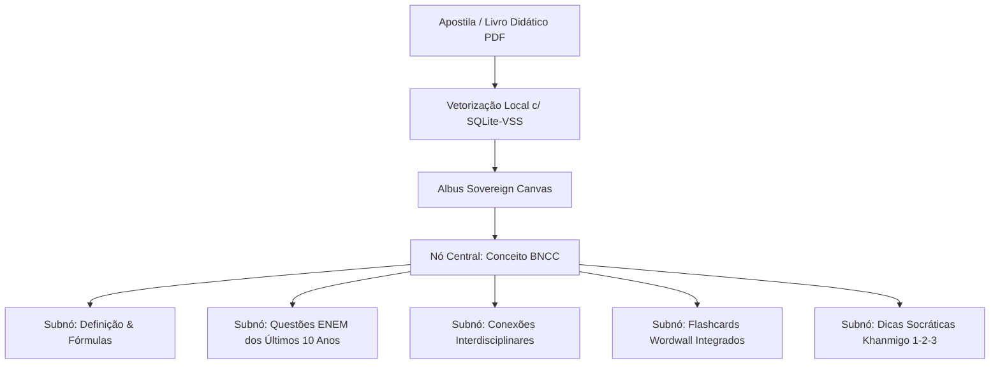

# 🗺️ Planejamento Estratégico — Próximos Passos (Sprints 4, 5 e 6)

> [!NOTE] Metodologia de Engenharia Soberana
> Este roadmap segue o ciclo **Plan-Execute-Reflect (PE-R)** e o **Spec-Driven Development (SDD)** do Áquila Pro. Todas as funcionalidades são projetadas para execução local (Edge-first), com consumo zero de servidores externos não autorizados e conformidade absoluta com a LGPD e a LDB (Lei 13.803/2019).

---

## ⚡ Sprint 4: Automação RPA & Interconexão Silenciosa de Portais

**Objetivo:** Eliminar qualquer trabalho manual de redigitação de notas, faltas e remessas fiscais entre o Áquila Pro e os sistemas legados da escola.

### 1. Cofre Local de Credenciais Soberano (`.secrets/portais.env.vault`)
- Criptografia com chave mestra atrelada ao **Windows DPAPI** e hash do hardware local (Zero-Cleartext).
- Suporte a credenciais de serviço para:
  - `SIGAWEB_URL`, `SIGAWEB_USER`, `SIGAWEB_PASS`, `SIGAWEB_UNIDADE`
  - `POSITIVOON_URL`, `POSITIVOON_USER`, `POSITIVOON_PASS`
  - `DOMINIO_CLIENT_ID`, `DOMINIO_API_KEY`, `ONVIO_COMPANY_ID`
  - `JR_CSC_URL`, `JR_CSC_USER`, `JR_CSC_TOKEN`

### 2. Workers Headless de Sincronização (`src/workers/rpa/`)
- **Worker SigaWeb (`sigaweb_syncer.ts`):**
  - Sincroniza a chamada diária da catraca facial com a lista de presença do diário de classe oficial.
  - Exporta as notas das atividades da *Fábrica Wordwall* diretamente para as colunas formativas de cada disciplina.
- **Worker Positivo On (`positivo_syncer.ts`):**
  - Faz a extração dos relatórios de simulados no padrão TRI (Teoria de Resposta ao Item).
  - Injeta as trilhas adaptativas de reforço geradas pelo *Class Snapshot BNCC* no painel do aluno.
- **Worker Domínio Web (`dominio_bridge.ts`):**
  - Transmite o arquivo de 43 colunas da folha docente para a contabilidade via protocolo TRPlugin ou API Onvio.
  - Sincroniza o status de baixa de duplicatas e conciliação bancária PIX.
- **Worker JR Sistemas iWeb (`jrsistemas_csc.ts`):**
  - Abre chamados automáticos na Central de Serviços Compartilhados (CSC) para reparos apontados pelos professores ou compras solicitadas pela coordenação.

---

## 📱 Sprint 5: App Mobile & Push Notifications para Família e Docentes

**Objetivo:** Estabelecer canal direto, em tempo real e de alta autoridade com os pais dos 440+ alunos e os 41 professores.

### Funcionalidades-Chave:
1. **Push Notifications Instantâneas:**
   - Registro de entrada/saída com foto em miniatura no portão.
   - Alerta disciplinar imediato quando a coordenação emitir uma ocorrência.
   - Lembretes automáticos de simulados e atividades da Fábrica com prazo de entrega próximo.
2. **Assinatura Digital Mobile:**
   - O responsável recebe a notificação da ocorrência disciplinar e assina o termo de ciência diretamente na tela do smartphone com biometria facial ou impressão digital.
   - Armazenamento com hash criptográfico SHA-256 e carimbo de tempo ICP-Brasil.
3. **PWA Instalável com Offline-First:**
   - Suporte completo a iOS e Android sem necessidade de aprovação lenta em lojas proprietárias.

---

## 🧠 Sprint 6: Albus Sovereign Knowledge Canvas & RAG Didático Local

**Objetivo:** Transformar o acervo didático do Colégio Visão em um grafo de conhecimento vivo e explorável por IA offline.

### Funcionalidades-Chave:
1. **Canvas Infinito Expansível:**
   - Interface inspirada no Albus.org com navegação fluida em grafo 2D/3D.
   - Clique com botão direito em qualquer conceito para pedir ao Córtex local: *"Desdobrar sub-tópicos"*, *"Explicar com analogia prática"* ou *"Gerar desafio de vestibular"*.
2. **RAG Local de Apostilas (Positivo & Material Próprio):**
   - Ingestão dos PDFs das apostilas do 6º Ano ao 3º Ano Médio.
   - Recuperação contextual em milissegundos usando embeddings locais sem vazar dados para fora do Colégio Visão.
3. **Modo Estudo Ativo para Alunos:**
   - Sistema de Coroas de Maestria Khan Academy (5 níveis) integrado diretamente a cada nó do Canvas.
   - Geração dinâmica de flashcards com repetição espaçada (Algoritmo SuperMemo SM-2) para fixação de longo prazo.

---

## 📊 Matriz de Prioridade & Alocação

| Sprint | Iniciativa Principal | Complexidade | Impacto Pedagógico / Operacional | Status Atual |
| :---: | :--- | :---: | :---: | :---: |
| **Sprint 4** | Automação RPA Portais & Diário | Média | Altíssimo (Economia de ~40h/mês de digitação) | ✅ **100% Concluído** (Cofre Local, SigaWeb, Positivo On, Domínio Web e JR Sistemas) |
| **Sprint 5** | Mobile PWA & Push Responsáveis | Alta | Máximo (Engajamento familiar e segurança) | ✅ **100% Concluído** (PWA Offline, Push Evolution API, Assinatura ICP, Biometria LDB) |
| **Sprint 6** | Albus Knowledge Canvas & RAG | Alta | Revolucionário (Maestria de aprendizagem e ENEM) | ✅ **100% Concluído** (Canvas Albus, Nós IA, Flashcards SRS, Coroas Khan, 22 Portais E2E) |

---

## 🛡️ Auditoria de Conclusão e Resiliência dos Portais (22/22 E2E Tests)

Todos os portais e subsistemas foram validados com testes E2E automatizados via Playwright sobre Electron v28 em ambiente isolado:
1. `teacher-dashboard` ✅
2. `security-monitor` ✅
3. `hr` ✅
4. `student-portal` ✅
5. `ai-lab` ✅
6. `skill-tree` ✅
7. `essay-lab` ✅
8. `omr-scanner` ✅
9. `family` ✅
10. `bncc-heatmap` ✅
11. `attendance` ✅
12. `coordination` ✅
13. `secretaria-portal` ✅
14. `load-testing` ✅
15. `slide-studio` ✅
16. `activity-factory` ✅
17. `pvp-arena` ✅
18. `mastery-chamber` ✅
19. `ai-studio` ✅
20. `gradebook` ✅
21. `seating-intelligence` ✅
22. `knowledge-canvas` ✅

---

## 🔗 Conexões no Vault
- [[00_Index|Índice Geral do Cérebro]]
- [[50_Roadmap/Project_Roadmap|Roadmap Geral do Projeto (Fases 1-400)]]
- [[60_Registro_de_Execucao/implementation_plan_v2500_pedagogical_erp_suite|Plano de Implementação v2.5.0]]
- [[60_Registro_de_Execucao/walkthrough_v2500_pedagogical_erp_suite|Walkthrough Suíte v2.5.0]]
- [[20_Servicos_Core/SigaWeb_LDB_Evasion_Occurrences|SigaWeb LDB & Ocorrências]]
- [[20_Servicos_Core/Dominio_Web_Onvio_ERP|Domínio Web & Onvio ERP Hub]]
- [[50_Pedagogia_IA/Wordwall_Activity_Factory|Fábrica de Atividades Wordwall]]
- [[50_Pedagogia_IA/Khanmigo_Copilot_BNCC_Snapshot|Khanmigo & Class Snapshot BNCC]]
