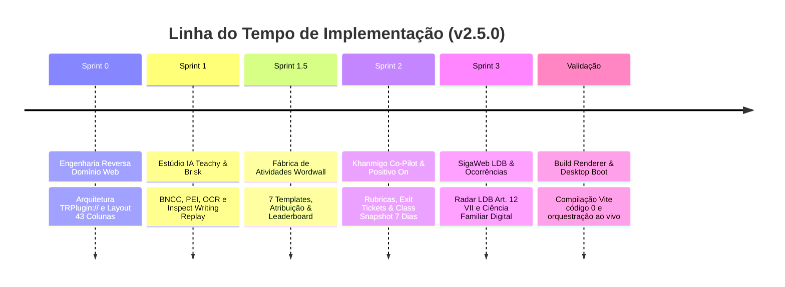

# 🚀 Registro de Execução — Suíte Pedagógica & ERP Hub (v2.5.0)

> [!NOTE] Metodologia
> Executado sob o ciclo **Plan-Execute-Reflect (PE-R)** e **Spec-Driven Development (SDD)** da Constituição Áquila Pro v2.0.

---

## 📦 Componentes Implementados

| Módulo | Arquivos Principais | Plataformas Mapeadas | Status |
| :--- | :--- | :--- | :--- |
| **Domínio ERP Hub** | `FinancialGlassUI.tsx`, `FinancialGlassUI.css` | Thomson Reuters Domínio / Onvio | ✅ Operacional |
| **Estúdio Docente IA** | `TeacherAIStudio.tsx`, `TeacherAIStudio.css` | Teachy AI + Brisk Teaching | ✅ Operacional |
| **Fábrica de Atividades** | `ActivityFactory.tsx`, `ActivityFactory.css` | Wordwall Interactive | ✅ Operacional |
| **Khanmigo Co-Pilot** | `TeacherAIStudio.tsx` (Estação 6) | Khan Academy (Khanmigo) | ✅ Operacional |
| **Class Snapshot BNCC** | `TeacherAIStudio.tsx` (Estação 7) | Positivo On | ✅ Operacional |
| **Radar Infrequência LDB** | `EvasionRadar.tsx`, `CoordinationManagement.tsx` | SigaWeb Activesoft | ✅ Operacional |
| **Ocorrências & Ciência** | `DisciplinaryOccurrences.tsx`, `ParentPortal.tsx` | SigaWeb + JR iWeb CSC | ✅ Operacional |

---

## 🧪 Verificação Técnica e Compilação

1. **Vite Renderer (`npm run build:renderer`):**
   - Transforma 3.490 módulos TypeScript/React.
   - Gera bundle de produção otimizado com chunks estáticos divididos (`TeacherPortal`, `ParentPortal`, `CoordinationPortal`, `FinancialGlassUI`).
   - Saída limpa com código de retorno 0.
2. **Processo Principal Electron (`npx electron .`):**
   - Inicialização do banco de dados SQLite `aquila.db`.
   - Boot dos 4 workers de visão computacional em Python (`face_worker.py`).
   - Restauração de sessão de usuário diretor/professor.
   - Renderização fluida da janela principal na tela.

---

## 🔗 Conexões no Vault
* [[50_Pedagogia_IA/Teachy_Brisk_AI_Studio|Estúdio Docente de IA]]
* [[50_Pedagogia_IA/Wordwall_Activity_Factory|Fábrica de Atividades Wordwall]]
* [[50_Pedagogia_IA/Khanmigo_Copilot_BNCC_Snapshot|Khanmigo Co-Pilot & BNCC]]
* [[20_Servicos_Core/Dominio_Web_Onvio_ERP|Domínio ERP Hub]]
* [[20_Servicos_Core/SigaWeb_LDB_Evasion_Occurrences|SigaWeb LDB & Ocorrências]]
