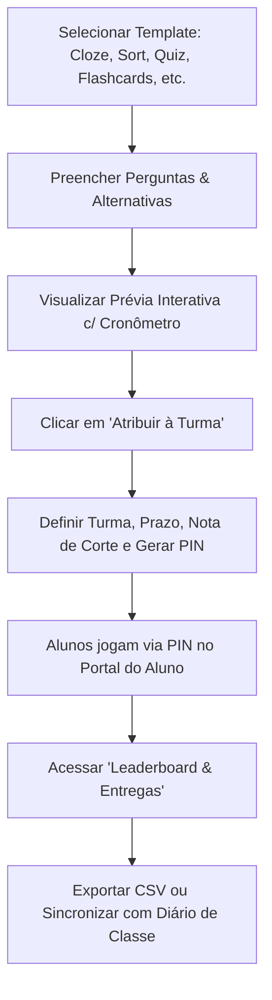

# 📖 Guia de Operação & Walkthrough — Suíte v2.5.0

> [!NOTE] Visão Geral
> Este guia detalha o passo a passo para utilizar os novos módulos pedagógicos, operacionais e de conformidade legal implementados no Áquila Pro.

---

## 1. Fábrica de Atividades Interativas (Estilo Wordwall)

**Onde acessar:** Menu Lateral > *Estúdio Docente* > *Fábrica de Jogos* (`ActivityFactory.tsx`).



### Passo a Passo:
1. **Escolha o Template:** Alterne entre os 7 modelos polimórficos:
   - *Cloze (Preenchimento de Lacunas)*
   - *Group Sort (Classificação em Colunas)*
   - *True / False Relâmpago*
   - *Flashcards com Repetição Espaçada*
   - *Caça-Palavras com Grid Dinâmico 14x14*
   - *Anagrama Letra a Letra*
   - *Open the Box (Escolha de Caixas Misteriosas)*
2. **Atribuição:** Clique no botão azul **"Atribuir à Turma"**. Selecione uma turma real (ex: `3º Ano A - Ensino Médio`), estabeleça a data limite e a nota mínima de corte. O sistema emite um código PIN exclusivo no formato `VISAO-XXXX`.
3. **Acompanhamento no Leaderboard:** Abra a aba **"Leaderboard & Entregas"** para ver a lista de estudantes ranqueados por pontuação e tempo de resposta, com pódio visual (🥇🥈🥉).
4. **Sincronização:** Pressione **"Sincronizar com Diário"** para injetar as notas automaticamente nas colunas formativas do SigaWeb.

---

## 2. Khanmigo Co-Pilot & Class Snapshot BNCC

**Onde acessar:** Menu Lateral > *Estúdio Docente* > Abas 6 e 7 (`TeacherAIStudio.tsx`).

### Estação 6: Khanmigo Teacher Toolkit
1. **Rubricas Analíticas 4x4:**
   - Selecione o componente curricular e o código de habilidade BNCC (ex: `EM13MAT301`).
   - Clique em **"Gerar Rubrica Analítica"**.
   - O assistente constrói a matriz ponderada com 4 critérios e 4 níveis de domínio (*Iniciante, Em Desenvolvimento, Proficiente, Avançado*).
2. **Bilhete de Saída (Exit Ticket 5 Min):**
   - Ative para gerar 3 questões rápidas de checagem formativa de final de aula.
   - O painel exibe a taxa instantânea de compreensão da turma em tempo real.
3. **Pareceres Descritivos de Boletim:**
   - Escolha o aluno e o tom pedagógico (*Encorajador, Foco em Potencial, Analítico-Formal ou Alerta Construtivo*).
   - O sistema gera um parecer humanizado, referenciando o histórico de participação e notas reais.

### Estação 7: Class Snapshot BNCC (Positivo On)
1. **Telemetria de 7 Dias:** Monitore o tempo médio de estudo em casa, taxa de entrega de tarefas e engajamento da turma.
2. **Matriz Térmica de Habilidades:** Identifique visualmente os gargalos de aprendizado:
   - 🟢 Verde: Habilidade dominada (> 80%).
   - 🟡 Amarelo: Atenção / Em desenvolvimento (60% a 79%).
   - 🔴 Vermelho: Defasagem crítica (< 60%).
3. **Disparo de Trilha Adaptativa:** Clique em **"Disparar Trilha Adaptativa de Reforço"** para emitir automaticamente uma lista personalizada de exercícios nivelados no portal do aluno.

---

## 3. Radar de Infrequência LDB Art. 12 VII & Ocorrências

**Onde acessar:** Menu Lateral > *Coordenação Pedagógica* > Aba *Radar de Evasão* e Aba *Ocorrências*.

### Radar de Evasão e Infrequência Escolar:
- **Alerta Preventivo (15% a 24% de faltas):** O aluno recebe sinalização amarela. O coordenador pode clicar em **"Disparar SOS WhatsApp"** para notificar a família com mensagem oficial de conscientização.
- **Risco de Reprovação & Notificação Legal (≥ 25% de faltas):**
  - Conforme a **Lei 13.803/2019** que alterou a LDB Art. 12 VII, o colégio tem dever legal de comunicar o Conselho Tutelar.
  - Clique no botão **"Gerar Ficha FICAI (Conselho Tutelar)"**. O sistema exporta o documento formal preenchido com data, histórico de faltas apuradas por catraca e contatos da família.

### Registro e Assinatura Digital de Ocorrências:
1. **Registro:** A coordenação registra ocorrências selecionando aluno, turma, categoria (*Pedagógica, Disciplinar, Uniforme, Convivência*) e gravidade (*Leve, Média, Grave*).
2. **Notificação ao Responsável:** O registro aparece instantaneamente no **Portal dos Pais** (`ParentPortal.tsx`).
3. **Ciência Familiar com Hash SHA-256:**
   - O pai/mãe clica em **"Dar Ciência / Assinar Digitalmente"**.
   - O sistema registra o carimbo de tempo, IP e gera um hash inviolável no padrão `ICP-BR-SHA256`, garantindo validade jurídica e arquivamento seguro.

---

## 4. Domínio Web / Onvio ERP Hub

**Onde acessar:** Menu Lateral > *Financeiro / ERP* (`FinancialGlassUI.tsx`).

```
[Módulos Integrados]
  ├── Folha de Pagamento Docente: Cálculo dos 41 professores com DSR e Hora-Atividade
  ├── Exportação Domínio TXT: Layout posicional 43 colunas para Thomson Reuters
  ├── NFS-e & Emissão Fiscal: Geração de lote de notas de serviço educacional
  └── Conciliação Bancária PIX: Baixa instantânea de mensalidades sem taxa de boleto
```

### Operação de Fechamento de Folha:
1. Acesse a aba **"Folha Docente & Domínio"**.
2. Clique em **"Calcular Prévia da Folha"** para cruzar as aulas ministradas com o ponto biométrico RuView.
3. Clique em **"Exportar TXT Domínio (43 Colunas)"** para salvar o lote pronto para importação contábil.
4. Clique em **"Publicar no Onvio"** para disparar os contracheques digitais para os smartphones dos professores.

---

## 5. Próximas Ações Recomendadas
- Testar a emissão de um Exit Ticket em uma aula do 3º Ano Médio.
- Realizar a auditoria de presenças da semana no Radar LDB para emitir a lista de convocação para recuperação.
- Consultar o documento [[50_Roadmap/Proximos_Passos_Sprints_4_5_6|Próximos Passos (Sprints 4, 5 e 6)]] para o cronograma de expansão.
