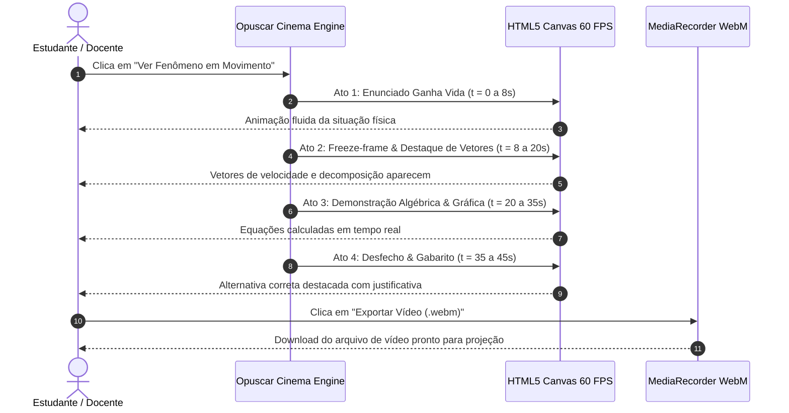

# 🎬 Áquila Pro — Especificação Técnica: Motor Opuscar para Exatas (Physics & Math Cinema)

**Diretoria Pedagógica & Córtex de Computação Visual**  
**Conceito:** Animação Dinâmica de Fenômenos Físicos e Matemáticos por Código (Canvas 2D / WebGL / SVG)  
**Inspiração:** Lemo-Opuscar (`lemomo-ai/lemo-opuscar`) adaptado para o currículo ENEM e BNCC

---

## 🎯 1. Problema Pedagógico & Proposta de Valor

### O Gargalo Cognitivo nas Ciências Exatas
Nas avaliações oficiais (ENEM, FUVEST, Unicamp, ITA), a imensa maioria dos erros em questões de Física e Matemática não decorre de fórmulas esquecidas, mas da **incapacidade de construir um modelo mental dinâmico** do fenômeno a partir de uma figura bidimensional estática:
1. *Cinemática:* O aluno vê a parábola desenhada, mas não percebe que a velocidade horizontal é constante enquanto a vertical zera no ponto mais alto.
2. *Eletrodinâmica:* O diagrama do circuito não transmite a ideia intuitiva de fluxo de elétrons livres e queda de potencial ôhmico.
3. *Dinâmica:* As forças são desenhadas como setas fixas, sem o aluno ver a reação do atrito dinâmico acelerando ou desacelerando o bloco.
4. *Óptica:* A refração da luz parece uma reta quebrada arbitrária, e não uma mudança de velocidade de fase no meio de propagação.

### A Abordagem Opuscar (Vídeo Gerado por Código)
Em vez de recorrer a modelos generativos de difusão de vídeo pesados (Sora/Runway), que alucinam grandezas físicas e custam centenas de dólares em nuvem, o Áquila Pro utiliza **animação paramétrica determinística**:
- **Equações Reais Integradas a 60 FPS:** O movimento é regido por integração numérica exata ($\Delta x = v \Delta t$, Runge-Kutta ou Euler).
- **HUD Científico Sobreposto:** Mostradores em tempo real de vetores ($\vec{v}, \vec{a}, \vec{F}$), cronômetros e conservação de energia ($E_c, E_p, E_{\text{mec}}$).
- **Exportação Universal de Vídeo:** Geração instantânea de arquivos `.webm` através de `HTMLCanvasElement.captureStream(60)` e `MediaRecorder` nativo no Electron, sem necessidade de dependências pesadas de FFmpeg do sistema operacional.

---

## 📐 2. Catálogo de Fenômenos Modelados (MVP Exatas)

| Código | Domínio | Fenômeno Modelado | Parâmetros Dinâmicos |
| :--- | :--- | :--- | :--- |
| **PHY-01** | Cinemática | Lançamento Oblíquo & Balística | $v_0$, ângulo $\theta$, gravidade $g$, altura $y_0$ |
| **PHY-02** | Eletrodinâmica | Circuito Elétrico R-L-C & Lei de Ohm | Resistência $R$, Tensão $U$, fluxo de elétrons ciano |
| **PHY-03** | Dinâmica | Plano Inclinado com Atrito | Ângulo $\alpha$, massa $m$, coeficiente de atrito $\mu$ |
| **PHY-04** | Óptica | Refração em Lente / Prisma (Snell) | Índice $n_1$, $n_2$, ângulo de incidência $\theta_i$ |
| **PHY-05** | Ondulatória | Onda Estacionária e Interferência | Frequência $f$, amplitude $A$, comprimento de onda $\lambda$ |
| **MAT-01** | Cálculo / Funções | Parábola & Derivada (Reta Tangente) | Coeficientes $a, b, c$, ponto $x_0$ e inclinação $f'(x_0)$ |

---

## 🎨 3. Estilos Visuais Opuscar

1. **Blueprint Científico (Padrão):**
   - Fundo: Azul escuro profundo (`#090d16`).
   - Grade: Malha milimetrada ciano fluorescente (`#00f0ff` com opacidade 15%).
   - Traços: Linhas técnicas vetoriais de 2px, setas cotadas e fontes monospace (`JetBrains Mono`).
2. **Quadro-Negro Analítico:**
   - Fundo: Ardósia escura texturizada (`#1e293b`).
   - Traço: Simulação de giz branco/amarelo, estilo aula clássica.
3. **Laboratório Quântico:**
   - Fundo: Espaço negro profundo (`#020617`).
   - Partículas neon e brilhos Gaussianos nos vetores de força.

---

## 🎬 4. Roteiro Cinematográfico em 4 Atos

