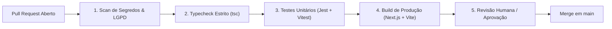

# 🦅 Áquila Pro — Política de Governança Git & Releases

> **Versão:** 1.0.0  
> **Data de Homologação:** 24/10/2026  
> **Status:** Ativo  
> **Classificação de Maturidade:** Release Candidate v2.1.0-rc.1 (Nota 6.8 / 10.0)

---

## 🎯 1. Princípios Fundamentais

1. **Fonte Única da Verdade (`main`):** Toda a arquitetura do Áquila Pro converge para o branch `main`. Não existem branches concorrentes de desenvolvimento.
2. **Releases por Tags Imutáveis:** Nenhuma branch viva deve ser tratada como número de versão. Versões de software são marcadas exclusivamente por **tags semânticas** assinadas (ex: `v2.1.0-rc.1`, `v2.1.0`).
3. **Isolamento de Mudanças:** Novas funcionalidades, refatorações e correções devem trafegar por branches de vida curta (`feat/...`, `fix/...`, `chore/...`), integradas via Pull Request com validação de CI obrigatória.
4. **Proibição de Force Push:** É estritamente vedado o uso de `git push --force` no branch `main`.

---

## 🌳 2. Taxonomia de Branches

| Branch / Padrão | Papel no Repositório | Política de Modificação |
|---|---|---|
| `main` | **Linha Principal / Baseline Oficial** | Protegida. Merge apenas via PR com CI verde e revisão registrada. |
| `clean-release-v1` | **Release Snapshot** | Sincronizado com `main`. Espelho estável para empacotamento desktop. |
| `feat/*` | Novas funcionalidades | Vida curta (1 a 3 dias). Rebase ou merge squash para `main`. |
| `fix/*` | Correção de defeitos | Vida curta. Merge após testes de regressão verdes. |
| `archive/*` | Branches históricas aposentadas | **Somente leitura**. Não recebe novos commits. |

### Histórico Arquivado
- `archive/master-2026-03`: Protocolo original entre agentes IA (Março/2026). Preservado em [`docs/archive/2026-03-communication-protocol.md`](file:///c:/aquila/docs/archive/2026-03-communication-protocol.md).
- `archive/production-baseline-v1`: Snapshot legado de v1.0.0 (commit `39d84c05`).

---

## 🛡️ 3. Critérios de Aceite para Merges em `main` (Quality Gates)

Nenhum código entra em `main` sem satisfazer **100%** dos seguintes critérios:



1. **Segurança & LGPD:**
   - Varredura de credenciais em texto plano (tokens, chaves privadas, JWT secrets).
   - Zero tráfego de dados de menores desprovidos de anonimização SHA-256 (Art. 14 e 16).
2. **Checagem de Tipos (TypeScript):**
   - `apps/mobile`: `tsc --noEmit` sem erros.
   - `apps/electron`: `build:electron` sem erros estáticos no código novo.
   - `apps/web`: Next.js Turbopack typecheck concluído.
3. **Bateria de Testes Automatizados:**
   - Web: Vitest com 100% de aprovação (mínimo de 10 testes).
   - Electron: Jest com 100% de aprovação nos fluxos críticos (OMR, Database 512, Security, AlertFlow, DropoutRisk).
4. **Builds de Produção Verificados:**
   - `@aquila/web`: `next build` com 20 rotas pré-renderizadas.
   - `aquila-pro-school-os`: Vite PWA gerando `dist/` com precache funcional.

---

## 🏷️ 4. Fluxo de Publicação e Versionamento Semântico

O versionamento segue estritamente a especificação **SemVer 2.0.0**:

- **MAJOR (`vX.0.0`):** Quebras de compatibilidade de banco de dados SQLite/Postgres ou protocolo IPC.
- **MINOR (`v2.X.0`):** Adição de novos portais, módulos pedagógicos ou fluxos mobile.
- **PATCH (`v2.1.X`):** Correções de bugs, ajustes de UI ou melhorias de performance.
- **PRÉ-RELEASE (`-rc.X`):** Versão candidata a homologação interna antes da implantação em escola piloto.

### Procedimento para Criar uma Release
```bash
# 1. Garantir que main está sincronizada e limpa
git checkout main
git pull origin main

# 2. Criar tag anotada e assinada
git tag -a v2.1.0-rc.1 -m "Release Candidate 2.1.0-rc.1: Ciclo Completo Pedagogico, OMR e Financeiro"

# 3. Enviar tag para o GitHub
git push origin v2.1.0-rc.1
```

---

## 📈 5. Trilha para Maturidade Enterprise (Escala 1 a 10)

| Estágio | Nota | Marco Técnico | Status |
|---|:---:|---|:---:|
| **MVP Funcional** | 5.0 | Telas desenhadas e mockadas | Concluído |
| **Integração E2E** | 6.5 | OMR ➔ Banco ➔ Diário ➔ Mobile conectados | Concluído (`v2.1.0-rc.1`) |
| **Governança & CI** | 7.5 | GitHub Actions rigoroso + Branches arquivadas | **Em homologação** |
| **Validação Piloto** | 8.5 | Testes Playwright E2E gravados + Piloto em 1 escola | Próximo Ciclo |
| **Enterprise Soberano** | 10.0 | SLA de 99.9%, auditoria externa e certificação ISO/LGPD | Roadmap 2027 |
