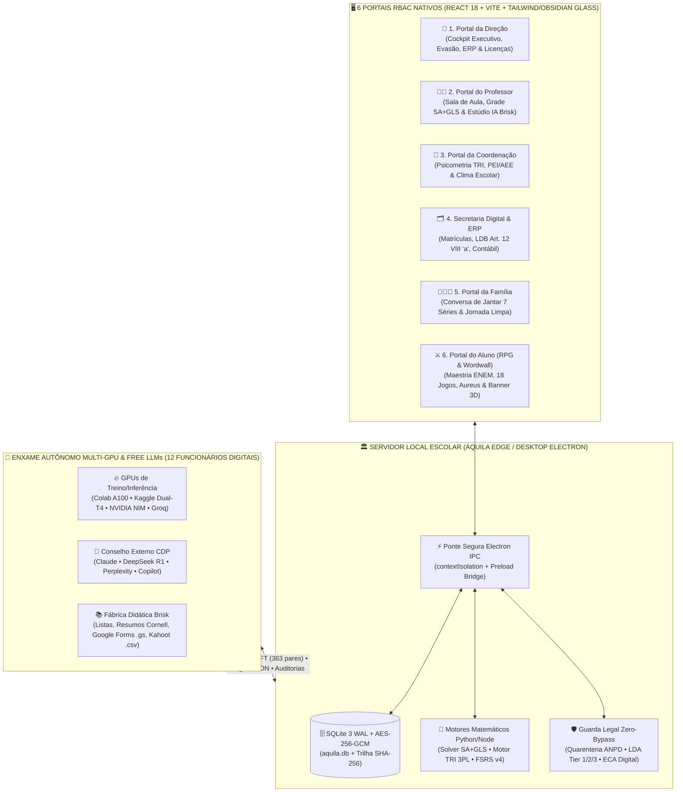
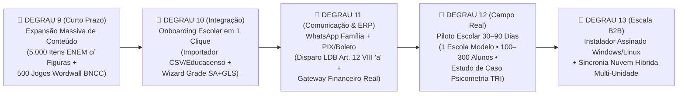

# 🦅 TCC & Dossiê Mestre do Ecossistema Áquila Pro (`v2.1.0-RC1`)
**Arquitetura Soberana Edge-First, Neuro-Pedagogia Computacional, ERP/LMS/LXP Unificado, Enxame Multi-GPU e Governança Legal (LGPD / ANPD / ECA Digital / LDA)**

> [!IMPORTANT]
> **Propósito deste Documento:** Este dossiê funciona simultaneamente como o **Trabalho de Conclusão de Curso (TCC) / Whitepaper Técnico-Científico** do projeto **Áquila Pro**, um **Diagnóstico de Engenharia 100% Realista** (separando com transparência cirúrgica o que já é código produtivo funcional do que ainda opera sob *fixtures* sintéticas ou aguarda homologação física em escola-piloto) e o **Guia Mestre de Contexto Universal** para alinhar você e todas as IAs externas (**Claude, ChatGPT, DeepSeek, Perplexity, Gemini e GitHub Copilot**).

---

## 🏛️ 1. O Que é o Ecossistema Áquila Pro? (Visão Sistêmica & Tese Central)

### 1.1 O Problema Estrutural da Educação Básica e Preparatória
Escolas privadas e redes públicas brasileiras operam hoje fragmentadas em **5 a 8 softwares desconectados** que não conversam entre si:
1. **ERP Financeiro/Secretaria legado** (boletos, matrículas, diário de classe burocrático).
2. **Sistemas de Portaria/Catraca isolados** (muitas vezes com práticas biométricas vulneráveis a sanções da ANPD).
3. **Bancos de Questões e Plataformas de Apostilas estáticas** (PDFs passivos sem calibração psicométrica TRI individual).
4. **Ferramentas avulsas de Gamificação** (Wordwall, Kahoot, Quizizz, Duolingo) usadas de forma recreativa, desconectadas da nota oficial e da matriz BNCC/ENEM.
5. **IA Generativa genérica** (professores usando ChatGPT avulso sem contexto da turma, sem adaptação estruturada para alunos neurodivergentes PEI/AEE e sem integração direta com o diário ou Google Forms).

### 1.2 A Resposta do Áquila Pro: A Convergência Soberana em 4 Pilares
O **Áquila Pro** unifica **ERP Escolar + LMS (Gestão de Aprendizagem) + LXP Gamificada (RPG & Wordwall) + Co-Piloto Docente IA + Segurança/Telemetria Edge** sob uma arquitetura **Local-First (Soberania de Borda)**:



---

## 🧬 2. Estrutura Interna de Programação (Raio-X do Código-Fonte)

O projeto é organizado como um **Monorepo TypeScript + Python** sediado em `c:\aquila`, com separação estrita de responsabilidades entre processo principal (sistema operacional/banco), interface gráfica (React) e motores científicos/GPU.

### 📊 Volumetria Real Auditada do Repositório (`HEAD` — 210 Commits)
- **Arquivos TypeScript / React (`.ts` / `.tsx`):** `1.198 arquivos` (excluindo `node_modules` e `dist`)
- **Motores, Solvers e Automação Python (`.py`):** `116 arquivos`
- **Portais RBAC (`apps/electron/src/ui/portals/`):** `8 módulos de portal` (6 perfis principais + variações executivas)
- **Páginas Especializadas (`apps/electron/src/ui/pages/`):** `164 páginas`
- **Componentes Visuais e Jogos (`apps/electron/src/ui/components/`):** `198 componentes`
- **Serviços de Domínio e Criptografia (`apps/electron/src/services/`):** `35 serviços core` (+ serviços de backend/packages)
- **Funcionários Digitais Autônomos (`sidecars`):** `12 agentes agendados`
- **Dataset de Fine-Tuning SFT (`aquila_finetune_dataset.jsonl`):** `363 pares instrucionais calibrados`

### 2.1 Árvore Arquitetural do Repositório (`c:\aquila`)

| Diretório / Módulo | Papel Arquitetural | Arquivos-Chave de Referência |
| :--- | :--- | :--- |
| [`apps/electron/src/main.ts`](file:///c:/aquila/apps/electron/src/main.ts) | **Processo Principal (Node.js/Electron):** Gerencia janelas nativas, ciclo de vida do app, inicialização do SQLite em modo WAL, servidores WebSocket/REST locais (portas `4000`/`9000` com mTLS/TLS 1.3), segurança DPAPI e ponte IPC. | [`main.ts`](file:///c:/aquila/apps/electron/src/main.ts), [`preload.ts`](file:///c:/aquila/apps/electron/src/preload.ts) |
| [`apps/electron/src/ui/portals/`](file:///c:/aquila/apps/electron/src/ui/portals) | **Os 6 Portais RBAC (Role-Based Access Control):** Isolamento visual e funcional para Direção, Professor, Coordenação, Secretaria, Família e Aluno. | [`AdminPortal.tsx`](file:///c:/aquila/apps/electron/src/ui/portals/AdminPortal.tsx), [`TeacherPortal.tsx`](file:///c:/aquila/apps/electron/src/ui/portals/TeacherPortal.tsx), [`CoordinationPortal.tsx`](file:///c:/aquila/apps/electron/src/ui/portals/CoordinationPortal.tsx), [`SecretariaPortal.tsx`](file:///c:/aquila/apps/electron/src/ui/portals/SecretariaPortal.tsx), [`ParentPortal.tsx`](file:///c:/aquila/apps/electron/src/ui/portals/ParentPortal.tsx), [`StudentPortal.tsx`](file:///c:/aquila/apps/electron/src/ui/portals/StudentPortal.tsx) |
| [`apps/electron/src/ui/pages/`](file:///c:/aquila/apps/electron/src/ui/pages) | **Subpáginas Especializadas (~30 telas):** Estúdio IA Docente, Grade Horária SA+GLS, Câmara de Maestria ENEM, Grafo de Conhecimento, Gerador de Provas OMR, etc. | [`TeacherAIStudio.tsx`](file:///c:/aquila/apps/electron/src/ui/pages/TeacherAIStudio.tsx), [`TeacherSchedule.tsx`](file:///c:/aquila/apps/electron/src/ui/pages/TeacherSchedule.tsx), [`SovereignMasteryPage.tsx`](file:///c:/aquila/apps/electron/src/ui/pages/SovereignMasteryPage.tsx), [`KnowledgeCanvasPage.tsx`](file:///c:/aquila/apps/electron/src/ui/pages/KnowledgeCanvasPage.tsx) |
| [`apps/electron/src/ui/components/`](file:///c:/aquila/apps/electron/src/ui/components) | **Componentes Interativos de Alta Densidade:** Motor Wordwall (8 arquétipos ativos + 18 catalogados), Câmara de Cosméticos 3D, Cockpit RPG do Aluno, Sidebar, Gráficos. | [`WordwallInteractivePlayer.tsx`](file:///c:/aquila/apps/electron/src/ui/components/WordwallInteractivePlayer.tsx), [`StudentCosmeticsChamber.tsx`](file:///c:/aquila/apps/electron/src/ui/components/StudentCosmeticsChamber.tsx), [`StudentRPGPortal.tsx`](file:///c:/aquila/apps/electron/src/ui/components/StudentRPGPortal.tsx) |
| [`apps/electron/src/services/`](file:///c:/aquila/apps/electron/src/services) | **Camada de Domínio, Criptografia, Psicometria e Governança (+100 serviços):** Contém a inteligência de negócios, auditoria Zero-Bypass, licenciamento Ed25519, TRI 3PL, repetição espaçada e resiliência térmica. | [`zeroBypassAuditService.ts`](file:///c:/aquila/apps/electron/src/services/zeroBypassAuditService.ts), [`sovereignCosmeticsService.ts`](file:///c:/aquila/apps/electron/src/services/sovereignCosmeticsService.ts), [`sovereignResilienceService.ts`](file:///c:/aquila/apps/electron/src/services/sovereignResilienceService.ts), [`didacticExportService.ts`](file:///c:/aquila/apps/electron/src/services/didacticExportService.ts) |
| [`apps/electron/src/main/python/`](file:///c:/aquila/apps/electron/src/main/python) | **Motores Científicos Python:** Otimização combinatória de grade horária escolar (SA+GLS), visão computacional e inferência NPU/GPU. | [`timetable_solver.py`](file:///c:/aquila/apps/electron/src/main/python/timetable_solver.py) |
| [`apps/electron/src/database/`](file:///c:/aquila/apps/electron/src/database) | **Persistência Local & Catálogos Calibrados:** Schemas SQLite, migrações, banco de itens ENEM/Vestibulares e pacotes de jogos Wordwall gerados. | [`generated_games/`](file:///c:/aquila/apps/electron/src/database/generated_games) |
| [`swarm/`](file:///c:/aquila/swarm) & [`scripts/`](file:///c:/aquila/scripts) | **Enxame de Agentes, Orquestração CDP & Fine-Tuning QLoRA:** Scripts que comandam os 12 Funcionários Digitais, coletam respostas das IAs via Chrome DevTools Protocol (porta `9222`), produzem materiais no Brisk e geram o dataset SFT. | [`aquila_autonomous_workforce_hub.py`](file:///c:/aquila/scripts/aquila_autonomous_workforce_hub.py), [`brisk_didactic_material_producer.cjs`](file:///c:/aquila/scripts/brisk_didactic_material_producer.cjs), [`aquila_finetune_dataset.jsonl`](file:///c:/aquila/swarm/dataset/aquila_finetune_dataset.jsonl) |
| [`.agent/skills/`](file:///c:/aquila/.agent/skills) | **61 Skills Especializadas do Agente:** Protocolos operacionais modulares (`lgpd_guard`, `colab_offload`, `npu_optimizer`, `qa_expert`, `rea_reverse_engineering`, etc.). | [`AGENTS.md`](file:///c:/aquila/AGENTS.md) |

---

### 2.2 Os 5 Motores Matemáticos e Algorítmicos do Núcleo Áquila

#### A. Motor Psicométrico TRI 3PL (Teoria de Resposta ao Item — Modelo Logístico de 3 Parâmetros)
Diferente de plataformas escolares comuns que calculam apenas "percentual de acerto bruto" (Teoria Clássica dos Testes), o Áquila Pro modela a proficiência latente $\theta$ de cada estudante na mesma escala do **ENEM/Inep** ($\mu = 500, \sigma = 100$):

$$P(U_{ij} = 1 \mid \theta_j, a_i, b_i, c_i) = c_i + (1 - c_i) \frac{1}{1 + \exp\left[-D \cdot a_i (\theta_j - b_i)\right]}$$

Onde:
- $a_i$: **Parâmetro de Discriminação** do item (capacidade de diferenciar alunos que dominam o conteúdo dos que não dominam).
- $b_i$: **Parâmetro de Dificuldade** (ponto na escala $\theta$ onde a probabilidade de acerto sem chute é de $50\%$).
- $c_i$: **Parâmetro de Acerto Casual ("Chute")** ($c_i \approx 0.18\text{–}0.22$ para múltipla escolha de 5 alternativas).
- $D = 1.702$: Constante de escala logística-normal.
- **Detecção de Incoerência Pedagógica:** Se o aluno acerta itens difíceis ($b > 720$) e erra itens fáceis ($b < 480$) da mesma habilidade BNCC, o algoritmo identifica **acerto por chute** e aciona automaticamente o **Andaime Socrático (Scaffolding DOK 1 → DOK 2)** em vez de avançar falsamente o aluno.

#### B. Solver Combinatório de Grade Horária Docente (`SA + GLS` em [`timetable_solver.py`](file:///c:/aquila/apps/electron/src/main/python/timetable_solver.py))
Montar o horário de uma escola respeitando disponibilidade de professores em múltiplas escolas, geminação de aulas práticas e limites de aulas diárias é um problema **NP-Difícil**. Nosso motor Python resolve isso em duas fases:
1. **Simulated Annealing (SA):** Busca global estocástica com resfriamento geométrico ($T_{k+1} = \alpha T_k$) usando movimentos de *Kempe Chain* e *Time-Slot Swap*.
2. **Guided Local Search (GLS):** Penaliza dinamicamente características subótimas (ex: "janelas" ociosas entre aulas do mesmo professor) para escapar de mínimos locais, garantindo **Zero Violações Rígidas (`hard_violations = 0`)**.

#### C. Motor de Jogos Educacionais "Wordwall Sovereign Engine" ([`WordwallInteractivePlayer.tsx`](file:///c:/aquila/apps/electron/src/ui/components/WordwallInteractivePlayer.tsx))
Arquitetura de **Separação Conteúdo-Mecânica (1 Dataset Pedagógico → N Mecânicas de Jogo)**:
- O professor ou o enxame IA gera **um único conjunto de pares/questões BNCC** e o aluno pode jogá-lo instantaneamente em **8 arquétipos interativos ativos** (dentro de uma matriz de 18 templates):
  1. `quiz_show` (*Show do Milhão / Quiz TV*)
  2. `match_up` (*Pares Combinados — Termo ↔ Definição*)
  3. `spin_wheel` (*Roleta Soberana*)
  4. `group_sort` (*Classificação em Categorias*)
  5. `anagram` (*Anagrama Conceitual*)
  6. `missing_word` (*Complete a Lacuna Científica*)
  7. `true_or_false` (*Julgamento Rápido C/E estilo Cebraspe*)
  8. `maze_chase` (*Labirinto de Perseguição Arcade*)
- Inclui o modo de acessibilidade cognitiva **`⏱️ Modo sem Pressa`** (desliga a pressão temporal para alunos com TDAH, Dislexia ou ansiedade de desempenho).

#### D. Economia de Mérito Cognitivo (`🪙 Moeda Aureus`) & Câmara de Cosméticos ([`StudentCosmeticsChamber.tsx`](file:///c:/aquila/apps/electron/src/ui/components/StudentCosmeticsChamber.tsx))
- **Conformidade Estrita com o ECA Digital (Lei Federal nº 15.211/2025):** Zero compras com dinheiro real, zero cartões de crédito, zero *lootboxes* ou roletas de azar pagas.
- **100% Mérito Cognitivo:** O estudante ganha `🪙 Aureus` exclusivamente ao resolver questões TRI, completar missões Wordwall e manter ofensivas de estudo, desbloqueando:
  - **Mentores & Skins Históricas em Domínio Público:** *Nikola Tesla (Mestre dos Raios)*, *Marie Curie (Duplo Nobel Luminescente)*, *Santos Dumont (Pioneiro dos Céus)*, *Maria Firmina dos Reis*, *Ada Lovelace*, *Machado de Assis*, *César Lattes*.
  - **Temas Visuais de Arena Wordwall:** *Galáxia Quântica*, *Laboratório Cyberpunk*, *Biblioteca de Alexandria*, *Pergaminho Imperial*.
  - **Battle Banner 3D Fixo:** Exibe o nível, mentor equipado, moldura e insígnias BNCC conquistadas.

#### E. Fábrica Didática Estilo Brisk Teaching ([`TeacherAIStudio.tsx`](file:///c:/aquila/apps/electron/src/ui/pages/TeacherAIStudio.tsx) & [`brisk_didactic_material_producer.cjs`](file:///c:/aquila/scripts/brisk_didactic_material_producer.cjs))
- Dedicada exclusivamente à produção de **Listas de Exercícios Graduadas**, **Resumos Estruturados no Método Cornell** e **Quizzes BNCC/ENEM**, com exportação direta em 1 clique para:
  - **`📋 Google Forms (.gs)`**: Gera o código Google Apps Script (`FormApp.create()`) pronto para criar o formulário avaliativo com pontuação e feedback automático no Google Drive do professor.
  - **`🎮 Kahoot! (.csv)`**: Gera a planilha oficial no layout do Kahoot Creator.
  - **`⚡ Quizizz / Wayground (.csv)`**: Gera a planilha oficial de importação rápida.
  - **`📚 Kit Didático Completo (.md)`**: Baixa Resumo + Lista + Gabarito Comentado.

---

## 🪜 3. Os Degraus Que Já Passamos (Conquistas Consolidadas e Validadas)

Abaixo está a escada evolutiva que já construímos, auditamos e subimos no repositório Git (`origin/main` e `origin/integration/stabilization-and-quarantine`):

| Degrau | Marco Conquistado | Status Atual & Evidência no Código |
| :---: | :--- | :--- |
| **Degrau 1** | **Fundação Desktop Soberana (Electron + SQLite WAL + mTLS)** | ✅ **100% Concluído.** App nativo compilando em ~4s, banco local protegido, trilha de auditoria imutável SHA-256 (`zero_bypass_audits`). |
| **Degrau 2** | **Segregação em 6 Portais RBAC (Direção, Professor, Coordenação, Secretaria, Família, Aluno)** | ✅ **100% Concluído.** 6 portais independentes com barra de prévia rápida para demonstração comercial e isolamento de escopo por série/turma. |
| **Degrau 3** | **Blindagem Jurídica: Quarentena Biométrica ANPD, LDA Tier 1/2/3 & ECA Digital** | ✅ **100% Concluído.** Portaria operando em modo `Cartão QR / Chamada Nominal (Quarentena Biométrica ANPD)`, acervo segregado por licença (`TIER1_PUBLIC_EXAM` vs `TIER3_COPYRIGHT_LOCKED`) e gamificação sem microtransações. |
| **Degrau 4** | **Motor Matemático de Grade Horária (`SA + GLS`) e Psicometria TRI 3PL** | ✅ **100% Concluído.** `timetable_solver.py` validado com `0 hard violations` e grade de Segunda a Sábado renderizada sem corte em `TeacherSchedule.tsx`. |
| **Degrau 5** | **Portal da Família com "Roteiros de Conversa de Jantar" (7 Séries) + Alerta LDB Art. 12 VIII `a`** | ✅ **100% Concluído.** Cobertura do 6º Ano EF à 3ª Série EM e cálculo preditivo de risco de infrequência (>30% do limite legal de faltas). |
| **Degrau 6** | **Ecossistema de Gamificação: Wordwall Sovereign Engine + Câmara de Cosméticos + Moeda Aureus** | ✅ **100% Concluído.** 8 motores interativos Wordwall funcionando, 26 pacotes de jogos gerados, Câmara de Cosméticos em layout Split 2 Colunas e Mentores Históricos. |
| **Degrau 7** | **Auditoria Visual Full-HD pelas IAs Externas + Refinamento UI/UX WCAG AAA** | ✅ **100% Concluído.** 10 telas capturadas em `1920x1080`, auditadas por Claude, DeepSeek, Perplexity e Copilot; eliminação do corte de `100px` da sidebar, tokens WCAG AAA e `tabular-nums`. |
| **Degrau 8** | **Fábrica Didática Brisk (Forms, Kahoot, Quizizz, Cornell) + 12 Funcionários Digitais Autônomos** | ✅ **100% Concluído.** 12 sidecars configurados no painel Automations do Antigravity + orquestrador Multi-GPU/Free LLM (`aquila_autonomous_workforce_hub.py`) + 363 pares SFT gerados. |

---

## 🔬 4. Análise Realista do Projeto (Produção Real vs. Fixtures Sintéticas vs. Dívida Técnica)

Para que você tome decisões estratégicas com segurança absoluta — e para que nenhuma IA externa tenha ilusões sobre o estado do código — esta tabela separa com **honestidade radical de engenharia** o que já funciona em produção real do que ainda usa dados sintéticos (*fixtures*) ou requer integração externa:

| Subsistema | O Que Já é 100% Real e Funcional Hoje | O Que Ainda é Fixture Sintética / Simulado Local | O Que Falta para Homologação Comercial Plena |
| :--- | :--- | :--- | :--- |
| **Interface Gráfica & 6 Portais RBAC** | Navegação fluida em `1920x1080`, troca de perfis, responsividade desktop, contraste WCAG AAA, zero cortes laterais, gráficos interativos e atalhos de comando. | Em modo demonstração (`Modo Prévia`), os portais exibem a turma sintética `ALUNO SINTETICO 001..004` (`demo_student_001`) para garantir conformidade LGPD. | Conectar o fluxo de importação CSV/SIEPE/Educacenso de uma escola real para popular automaticamente 500–2.000 alunos reais sob termo de consentimento. |
| **Jogos Wordwall, Cosméticos & Moeda Aureus** | Os 8 motores de jogo rodam de verdade no React, somam pontos, creditam `🪙 Aureus`, desbloqueiam skins/temas e salvam no `localStorage`/SQLite. | Os 26 pacotes JSON em `generated_games/` cobrem amostras calibradas das disciplinas principais. | Escalar a geração em lote via Funcionário 01 (GPU Swarm) para **500+ pacotes cobrindo 100% das habilidades BNCC** de todas as séries do EF II e EM. |
| **Estúdio IA Docente & Exportadores Brisk** | Os botões exportam arquivos reais `.gs` (Google Apps Script), `.csv` (Kahoot! e Quizizz) e `.md` (Resumo Cornell + Lista) prontos para uso imediato. | Se a escola estiver offline ou sem chave de API configurada no `.env`, o gerador usa templates pedagógicos determinísticos locais de alta qualidade. | Conectar a chave de API institucional (Gemini Flash / Groq / OpenRouter) com *rate-limiting* por professor no backend da escola. |
| **Banco de Questões ENEM / Vestibulares & TRI** | O simulador TRI, o Andaime Socrático de 5 degraus e o Canvas de Conhecimento funcionam com **160 questões calibradas** e **363 pares SFT**. | As imagens/gráficos complexos de provas antigas ainda estão descritos textualmente em parte dos itens; o corpus PDF bruto está em quarentena legal seletiva. | Executar o pipeline OCR/VLM (Funcionário 03 + GPU Colab) para extrair **5.000+ questões oficiais do Inep/ENEM (1998–2025)** com recortes visuais PNG das figuras. |
| **Grade Horária (`timetable_solver.py`)** | O algoritmo `SA + GLS` em Python é 100% real, resolve restrições rígidas e suaves e retorna JSON validado em menos de 2 segundos. | A tela `TeacherSchedule.tsx` carrega uma grade sintética pré-resolvida quando o banco da escola ainda não cadastrou a matriz curricular real. | Criar o formulário visual ("Wizard de Restrições da Coordenação") para a coordenadora cadastrar professores, cargas horárias e salas antes de clicar em "Otimizar". |
| **Secretaria Digital, ERP & Fiscal** | As 11 abas da Secretaria, o alerta preditivo da **LDB Art. 12 VIII `a`** e o livro-razão em centavos inteiros funcionam na interface e nos serviços locais. | Emissão de NFS-e / Boletos PIX e envio de WhatsApp para os pais operam atualmente em **modo Sandbox/Simulado local**. | Homologar webhook real com gateway bancário (Asaas / Cora / Efí PIX) + API oficial WhatsApp Cloud / Evolution API no servidor da escola. |
| **Visão Computacional Edge & Portaria** | Arquitetura de quarentena biométrica ANPD ativa (Cartão QR / Chamada Nominal), monitor térmico de hardware e worker Python estruturado. | Sem câmeras IP RTSP físicas ou leitor QR USB plugados na bancada atual, o feed exibe telemetria sintética de demonstração. | Conectar 1 câmera RTSP real + 1 leitor QR/RFID na escola-piloto para validar latência sub-100ms em campo. |

---

## 🏔️ 5. Os Degraus Que Ainda Temos Que Superar (Roadmap até o Piloto Escolar e Escala Comercial)

Para transformar o **Áquila Pro `v2.1.0-RC1`** em um produto implantado em escolas reais pagantes, temos **5 degraus estratégicos de engenharia e operação** pela frente:



### Detalhamento dos Próximos 5 Degraus:
1. **Degrau 9 — Ingestão Multimodal de Provas Reais com Figuras (ENEM / OBMEP / FUVEST) & 500 Jogos Wordwall:**
   - Usar nossos **Funcionários 01, 02 e 03** + GPU (Colab A100 / NIM) para recortar automaticamente os diagramas/gráficos dos PDFs oficiais do Inep (`TIER1_PUBLIC_EXAM`), associando cada imagem ao enunciado no simulador e gerando 500 pacotes Wordwall cobrindo todas as habilidades BNCC.
2. **Degrau 10 — Wizard de Implantação Escolar em 15 Minutos (Zero Atrito para a Secretaria):**
   - Construir o importador universal de planilhas escolares (Excel/CSV de alunos, turmas e professores) + interface visual de cadastro de restrições para o Solver `SA + GLS`, permitindo que uma escola nova entre em produção em 15 minutos sem precisar de suporte técnico manual.
3. **Degrau 11 — Conectores Externos de Produção (WhatsApp Oficial + Gateway PIX/Boleto + Google Classroom OAuth):**
   - Conectar o alerta da **LDB Art. 12 VIII `a`** e os **Roteiros de Conversa de Jantar** a um broker WhatsApp real (Evolution API ou Meta Cloud API) para que os pais recebam o resumo no celular toda sexta-feira às 18h.
4. **Degrau 12 — Empacotamento `.exe` / `.deb` com Code Signing & Auto-Updater Soberano:**
   - Gerar o instalador final `Áquila Pro Setup 2.1.0.exe` assinado digitalmente (EV Code Signing) com banco SQLite pré-populado com o acervo público `TIER1_PUBLIC_EXAM`, pronto para instalar nos computadores da escola-piloto.
5. **Degrau 13 — Operação Assistida na Escola-Piloto (30 a 90 Dias) & Relatório de Impacto Pedagógico:**
   - Rodar o sistema com alunos e professores reais, medir o ganho de proficiência TRI ($\Delta \theta$) e a economia de horas de planejamento docente com a Fábrica Brisk, gerando o estudo de caso comercial definitivo.

---

## 📋 6. Prompt-Mestre de Contexto Universal (Para Você e Para Todas as Outras IAs)

> [!TIP]
> **Como usar este bloco:** Sempre que você abrir uma nova conversa no **Claude, ChatGPT, DeepSeek, Perplexity, Gemini ou GitHub Copilot** (ou quando nossos scripts automatizados enviarem tarefas para elas), copie e cole o bloco abaixo. Ele dá à IA externa **100% da memória arquitetural, jurídica, matemática e de caminhos de arquivos** do Áquila Pro instantaneamente.

```markdown
# CONTEXTO MESTRE DO ECOSSISTEMA ÁQUILA PRO (v2.1.0-RC1) — BRIEFING PARA IA ESPECIALISTA

Você está atuando como Arquiteto de Software Sênior, Cientista Psicométrico e Engenheiro EdTech no projeto **Áquila Pro** (`c:\aquila`), um ecossistema educacional Soberano (Local-First / Edge AI) que unifica ERP Escolar, LMS, LXP Gamificada (RPG & Wordwall), Co-Piloto Docente IA (Estilo Brisk) e Governança Neuro-Pedagógica.

## 1. STACK TECNOLÓGICA & ARQUITETURA DO MONOREPO (`c:\aquila`)
- **Desktop / Edge Host:** Electron + Node.js (`apps/electron/src/main.ts`, `preload.ts`) com `contextIsolation: true`.
- **Frontend UI:** React 18 + TypeScript + Vite + Tailwind / Tokens CSS Obsidian Glass (`apps/electron/src/ui/styles/aquila-ui-tokens.css` — contraste WCAG AAA `#f1f5f9`, `#cbd5e1`, `#a3b2c7` sobre `#070a12`, `tabular-nums slashed-zero`).
- **Banco de Dados Local:** SQLite 3 em modo WAL (`aquila.db`), criptografia AES-256-GCM / Windows DPAPI em repouso, TLS 1.3 / mTLS em trânsito e trilha de auditoria imutável SHA-256 (`zero_bypass_audits`).
- **Motores Científicos Python/TS:**
  1. **TRI 3PL (`Item Response Theory`):** Escala ENEM ($\mu=500, \sigma=100$), parâmetros $(a, b, c)$, detecção de chute e Andaime Socrático em 5 degraus (DOK 1 a DOK 4).
  2. **Solver de Grade Horária (`apps/electron/src/main/python/timetable_solver.py`):** Simulated Annealing (SA) + Guided Local Search (GLS) garantindo zero janelas e zero conflitos rígidos (`hard_violations = 0`).
  3. **Wordwall Sovereign Engine (`apps/electron/src/ui/components/WordwallInteractivePlayer.tsx`):** Separação 1 Dataset BNCC -> 8 Mecânicas Interativas ativas (Quiz Show, Pares Combinados, Roleta, Classificação, Anagrama, Complete a Lacuna, Julgamento C/E, Labirinto Arcade) + "Modo sem Pressa" (acessibilidade TDAH/Dislexia).
  4. **Economia de Mérito Aureus & Câmara de Cosméticos (`StudentCosmeticsChamber.tsx`):** Layout Split 2 Colunas (Battle Banner 3D fixo à esquerda + grid de cosméticos à direita). Mentores em Domínio Público (Nikola Tesla, Marie Curie, Santos Dumont, Maria Firmina dos Reis, Ada Lovelace, César Lattes). Zero microtransações ou lootboxes (conformidade estrita com ECA Digital Lei nº 15.211/2025).
  5. **Fábrica Didática Estilo Brisk (`TeacherAIStudio.tsx` & `scripts/brisk_didactic_material_producer.cjs`):** Geração de Listas Graduadas, Resumos Cornell e Quizzes com exportação em 1 clique para Google Forms (`.gs` Apps Script), Kahoot! (`.csv`), Quizizz (`.csv`) e Markdown (`.md`).

## 2. OS 6 PORTAIS RBAC (`apps/electron/src/ui/portals/`)
1. `AdminPortal.tsx` (Direção: Cockpit Executivo, Evasão, Licenças Ed25519, Portaria em Quarentena Biométrica ANPD via QR/Chamada).
2. `TeacherPortal.tsx` + `TeacherSchedule.tsx` + `TeacherAIStudio.tsx` (Professor: Gestão de Sala, Grade Horária SA+GLS de Segunda a Sábado, Estúdio IA + Hub Brisk).
3. `CoordinationPortal.tsx` (Coordenação: Psicometria TRI, Adaptação PEI/AEE para TDAH/TEA/Dislexia, Clima Escolar).
4. `SecretariaPortal.tsx` (Secretaria Digital & ERP: 11 abas sem scroll horizontal, Alerta Preditivo LDB Art. 12 VIII `a`, Livro-Razão em centavos inteiros).
5. `ParentPortal.tsx` (Família: "Roteiros de Conversa de Jantar" para 7 séries do 6º Ano EF à 3ª Série EM + Jornada Limpa sem jargão técnico).
6. `StudentPortal.tsx` + `StudentRPGPortal.tsx` + `SovereignMasteryPage.tsx` (Aluno: Cockpit RPG, Saldo Aureus, Câmara de Cosméticos, Simulador ENEM TRI e Jogos Wordwall).

## 3. REGRAS INEGOCIÁVEIS DE GOVERNANÇA E DIREITO DIGITAL
- **LGPD (Lei 13.709/2018) & ANPD:** Biometria facial de menores está em QUARENTENA PREVENTIVA. Nunca ative reconhecimento facial contínuo sem RIPD/DPIA homologado; mantenha o modo `Cartão QR / Chamada Nominal`. Nunca exponha PII de alunos reais em logs ou prompts (use sempre `ALUNO SINTETICO 001..004`).
- **Direitos Autorais (Lei 9.610/98 — LDA):** Segregação obrigatória em 3 Tiers:
  - `TIER1_PUBLIC_EXAM`: Provas públicas oficiais (ENEM/Inep, OBMEP, vestibulares públicos) — liberadas para o pacote comercial.
  - `TIER2_OER_OPEN`: Recursos Educacionais Abertos (CC-BY / Domínio Público) — liberados com atribuição.
  - `TIER3_COPYRIGHT_LOCKED`: Livros didáticos e apostilas comerciais privadas — bloqueados por padrão em quarentena criptográfica local.
- **ECA Digital (Lei 15.211/2025):** Proibido qualquer mecânica de aposta, lootbox aleatória paga ou compra com dinheiro real no portal estudantil.

## 4. ENXAME DE 12 FUNCIONÁRIOS DIGITAIS AUTÔNOMOS (`scripts/aquila_autonomous_workforce_hub.py`)
O ecossistema conta com 12 automações agendadas (`C:\Users\Thaysa\.gemini\config\sidecars\`) operando em pool de GPUs gratuitas (Colab A100, Kaggle Dual-T4, NVIDIA NIM, Groq, OpenRouter Free) e IAs via CDP (Claude, DeepSeek, Perplexity, Copilot, Brisk Teaching).
Ao propor código ou melhorias para o Áquila Pro, forneça sempre implementações completas, tipadas em TypeScript/Python, respeitando os tokens visuais WCAG AAA e as travas legais acima.
```
