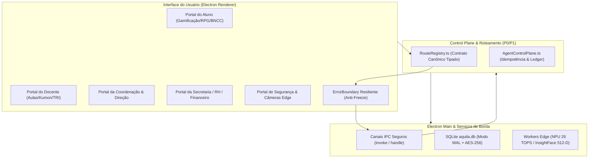

# 🏛️ Áquila Pro — Visão Geral da Arquitetura do Sistema

> **Status:** Ativo & Homologado v2.1  
> **Modelo:** Edge-First Soberano (Electron + React 18 + Node.js + SQLite WAL)  
> **Governança:** LGPD Art. 14 / ECA Digital (Lei 15.211/2025) / Constituição v2.1

---

## 🧭 1. Camadas do Sistema

---

## 🔒 2. Princípios de Segurança e Soberania de Dados

1. **Zero Vazamento de Dados de Menores:** Nenhum dado biométrico, identificador de estudante ou mídia deixa o ambiente edge local em modo de desenvolvimento ou produção.
2. **Ambiente de Testes Sintético:** Testes unitários e E2E operam exclusivamente com *fixtures* sintéticas (`demo_student_001`, `aluno_demo`).
3. **Resiliência Térmica e de Execução:** Proteção ativa anti-congelamento via `ErrorBoundary` global e auto-throttling térmico.
