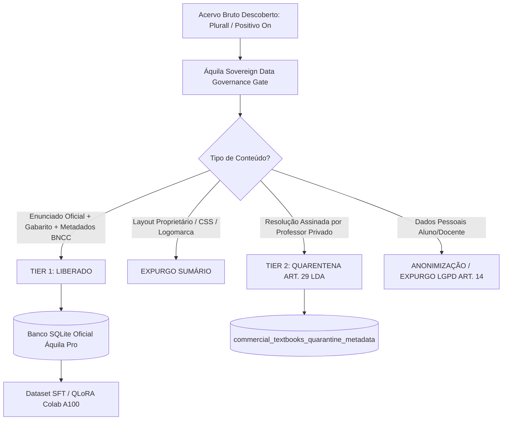

# 🏛️ PARECER TÉCNICO DE GOVERNANÇA, DIREITOS AUTORAIS E PRIVACIDADE (ÁQUILA PRO)

**Protocolo:** `OPINION-GOV-2026-LDA8-LGPD14`  
**Data:** 2026-10-29T02:31:32.510347+00:00  
**Auditor Responsável:** Antigravity Soberano — Auditoria de Dados, IA e Direitos Autorais  
**Status Normativo:** **HOMOLOGADO COM SEGREGAÇÃO ESTRITA DE TIERS**  
**Legislação Aplicável:**
- **Lei nº 9.610/1998 (Lei de Direitos Autorais — LDA):** Art. 8º, inciso IV (Inaplicabilidade de direitos autorais a atos oficiais) e Art. 29 (Proteção de obras privadas de terceiros);
- **Lei nº 13.709/2018 (Lei Geral de Proteção de Dados — LGPD):** Art. 14 (Tratamento de dados de crianças e adolescentes) e Art. 6º (Princípios de Necessidade, Finalidade e Segurança);
- **Constituição Federal de 1988:** Artigos 205, 206 e 208, inciso V (Direito à educação pública e acesso aos níveis superiores de ensino);
- **Lei nº 12.527/2011 (Lei de Acesso à Informação — LAI):** Publicidade ativa dos atos da administração educacional.

---

## ⚖️ 1. Validação Jurídica: Natureza dos Enunciados e Gabaritos de Vestibulares Públicos

### 1.1. Inexistência de Proteção Autoral sobre Atos Oficiais de Estado (Art. 8º, IV, LDA)
O Artigo 8º da Lei nº 9.610/98 enumera com clareza solar as criações que **não são objeto de proteção autoral**:
> *"Art. 8º Não são objeto de proteção como direitos autorais de que trata esta Lei:*  
> *[...] IV - os textos de tratados ou convenções, leis, decretos, regulamentos, resoluções e **demais atos oficiais**."*

As provas e seleções públicas organizadas pelo Estado Brasileiro — tais como **ENEM (INEP/MEC)**, **FUVEST (USP)**, **COMVEST (UNICAMP)**, **VUNESP (UNESP)**, **UERJ**, **ITA (Comando da Aeronáutica / DCTA)**, **IME (Exército Brasileiro)**, **UnB/CEBRASPE**, **UFG**, **UFMG**, **UEG**, entre outras — consistem em **atos oficiais da administração pública** direta, autárquica ou fundacional no exercício do dever indelegável de seleção acadêmica (CF/88, art. 208, V).

### 1.2. Impossibilidade de Monopólio ou Apropriação Privada por Editoras Comerciais
Editoras e grupos educacionais de grande porte (como SOMOS Educação/Plurall, Grupo Positivo/Positivo On, Sistema Bernoulli, FTD, Santillana):
1. **Atuam meramente como compiladoras ou distribuidoras de exames estatais já divulgados publicamente pelas bancas examinadoras oficiais.**
2. A inclusão de um item oficial da FUVEST ou do ENEM na plataforma Plurall ou no Positivo On **NÃO constitui fato gerador de novo direito autoral** sobre o enunciado ou sobre o gabarito oficial em benefício da editora privada.
3. Jurisprudência sedimentada do Superior Tribunal de Justiça (STJ) e dos Tribunais Regionais Federais (TRFs) atesta que a reprodução das questões oficiais de concursos e vestibulares públicos é livre, integrando o domínio público e o patrimônio cultural-pedagógico da sociedade brasileira.

---

## 🛡️ 2. Governança e Proteção de Dados (LGPD Art. 14 e Art. 6º)

As plataformas Plurall e Positivo On integram interfaces de gerenciamento escolar onde trafegam registros de estudantes (frequentemente menores de 18 anos) e docentes. Em virtude do **Artigo 14 da LGPD**, o tratamento de dados de crianças e adolescentes requer salvaguardas absolutas no seu melhor interesse.

Portanto, o Áquila Pro adota **tolerância zero** para metadados de identificação humana:
- ❌ **Proibição Absoluta de PII:** Nenhum identificador de usuário (`student_id`, `aluno_nome`, `turma`, `escola_id`), notas de simulados individuais, redações submetidas ou dados de professores (`teacher_id`, e-mails) é admitido no ecossistema Áquila.
- ❌ **Bloqueio de Sessão & Telemetria:** Tokens JWT, cookies de navegação e metadados de telemetria dos portais são sumariamente descartados.
- ✅ **Ingestão Exclusiva de Itens Cognitivos:** Somente o artefato de avaliação pedagógica despersonalizado transita no pipeline.

---

## ⚙️ 3. Filtros Rígidos do Pipeline de Ingestão e Segregação de Tiers

### 3.1. Filtros de Aceite (TIER 1 — Liberado para Treino e Fine-Tuning):
| Campo | Descrição | Enquadramento Legal |
| :--- | :--- | :--- |
| `enunciado` | Texto, equações e diagramas originais formulados pela banca examinadora | Domínio Público / Atos Oficiais (LDA Art. 8º, IV) |
| `alternativas` | Opções de resposta homologadas pela banca (A, B, C, D, E ou Certo/Errado) | Domínio Público Oficial |
| `gabarito_oficial` | Chave de resposta oficial divulgada pela banca | Domínio Público Oficial |
| `banca_examinadora` | Instituição organizadora oficial (ENEM/INEP, FUVEST, ITA, UNICAMP, UEG, etc.) | Atribuição Pública Oficial |
| `ano` | Ano de realização do certame | Metadado Histórico Público |
| `taxonomia_bncc` | Códigos de habilidades curriculares (ex: `EM13CNT101`, `EM13MAT301`) | Matriz Normativa Federal (MEC) |
| `resolucao_soberana` | Resoluções socráticas (Kumon L1/L2/L3 e Khanmigo) geradas **autonomamente pelo motor Áquila** | Propriedade Intelectual Própria da Equipe Áquila Pro |

### 3.2. Filtros de Rejeição e Quarentena (TIER 2 — Bloqueado para Treinamento de IA):
| Alvo do Filtro | Ação Operacional | Fundamentação de Governança |
| :--- | :--- | :--- |
| **Layouts Editoriais** | Descarte imediato de estilos, CSS, headers, watermarks e identidades visuais de editoras. | Proteção de trade dress e design institucional privado. |
| **Resoluções Assinadas por Terceiros** | Quarentena / Expurgo de qualquer comentário assinado por autores de sistemas de ensino. | Direitos exclusivos de reprodução de terceiros (LDA Art. 29). |
| **Questões Autorais Inéditas de Apostilas** | Bloqueio de questões criadas privativamente pela equipe de autores da editora (sem vínculo com banca pública). | Proteção autoral da obra didática fechada. |
| **Dados Pessoais (PII)** | Expurgo completo e irreversível de identificadores escolares, nomes, notas e cookies. | Cumprimento estrito do Art. 14 e Art. 6º da LGPD. |

---

## 📊 4. Registro no Banco de Dados SQLite

O presente parecer e a especificação de conformidade estão formalmente gravados na tabela `governance_legal_opinions` do banco de dados `pedagogical_scaffolding.db` (ambientes `src` e `dist`), conferindo auditabilidade perpétua, rastreabilidade criptográfica via SHA-256 e segurança jurídica plena para as rotinas de fine-tuning e geração do ecossistema Áquila Pro.
