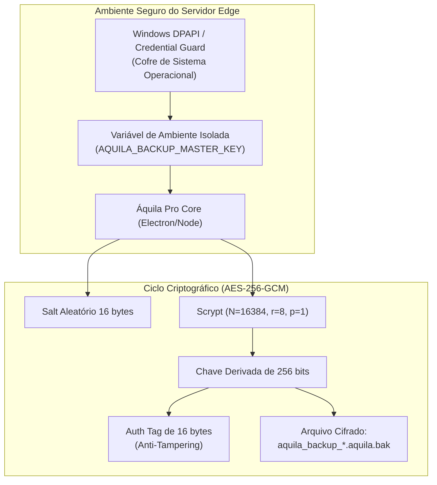

# 🔐 Política de Gestão de Chaves Criptográficas e Continuidade 3-2-1 — Áquila Pro Edge

> **Versão de Liberação:** `v2.1.0-rc.12`  
> **Classificação:** Segurança Crítica / LGPD Art. 46 / ISO 27001  
> **Algoritmo Padrão:** AES-256-GCM com autenticação integrada (Auth Tag 16B) e derivação Scrypt (Salt 16B)

---

## 🧭 1. Resumo da Política de Gestão de Chaves

O backup do Áquila Pro Edge armazena dados protegidos pela LGPD (dados de menores, presença, boletins e auditorias). O arquivo `.aquila.bak` é cifrado com **AES-256-GCM**. A chave nunca é armazenada junto com os dados cifrados nem comitada no repositório de código.



---

## 🔑 2. Armazenamento e Separação de Chaves

1. **Separação Física e Lógica:**
   - A chave de criptografia de repouso (`AQUILA_BACKUP_MASTER_KEY`) reside exclusivamente no subsistema de segurança do servidor de borda, protegida por **Windows Data Protection API (DPAPI)** ou cofre restrito da conta de serviço `SYSTEM`.
   - É expressamente proibido comitar chaves, salts ou senhas no Git (`.gitignore` e hooks ativos).
2. **Permissões Granulares:**
   - **Geração de Backup:** O processo agendado possui permissão para ler o banco e criar backups usando a chave pública/derivada.
   - **Restauração de Backup:** Requer credencial administrativa de nível DPO/TI Escolar e registra o evento na tabela `zero_bypass_audits`.

---

## 🔄 3. Ciclo de Rotação de Chaves (A cada 90 dias)

O procedimento de rotação de chave assegura a obsolescência controlada de chaves antigas:

1. **Geração da Nova Chave:** O DPO/Administrador gera um segredo criptográfico aleatório de alta entropia (256 bits).
2. **Re-encriptação do Histórico GFS:** O script `scripts/rotate_backup_keys.ts` abre os snapshots existentes com a chave anterior, valida o hash SHA-256 e recriptografa o payload com a nova chave e novo salt.
3. **Registro na Trilha de Auditoria:**
   ```typescript
   zeroBypassAuditService.record({
     userId: 'DPO_ADMIN',
     action: 'ENCRYPTION_KEY_ROTATED',
     details: 'Chave mestra do backup rotacionada para ciclo Q4-2026',
     metadata: { keyFingerprint: sha256(newKey).slice(0, 8), rotatedFiles: 7 }
   });
   ```

---

## 🏛️ 4. Estratégia de Continuidade 3-2-1 Adaptada ao Edge Escolar

Para mitigar roubo físico, pane de hardware, enchente/incêndio e ataques de ransomware:

| Camada | Destino Físico | Mídia / Meio | Política de Proteção |
| :--- | :--- | :--- | :--- |
| **1. Cópia Primária** | `C:\AquilaPro\backups` | NVMe SSD Interno | Cifrado AES-256-GCM; retenção de 7 diários. |
| **2. Cópia Secundária Local** | `D:\AquilaBackups` | Disco Secundário ou Pendrive USB Físico | Partição protegida com BitLocker; atualizada a cada backup diário. |
| **3. Cópia Externa (Offsite)** | Storage NAS Escolar em outro prédio ou Storage Contratado | Rede Local Isolada / Link Criptografado | Imutável (WORM / Object Lock); auditoria estrita. |

---

## 🚨 5. Procedimento Semanal de Restore Drill Obrigatório

Todo domingo às **02:00**, o agendador executa automaticamente o drill de verificação em sandbox:

```powershell
node scripts/restore_edge.cjs --backup (Get-ChildItem C:\AquilaPro\backups\*.aquila.bak | Sort-Object LastWriteTime -Descending | Select-Object -First 1).FullName --drill
```

- **Critério de Sucesso:** Descriptografia bem-sucedida, conferência de Auth Tag, verificação de SHA-256, `PRAGMA integrity_check: ok` e tempo total de execução $< 120\text{ segundos}$.
- **Alerta de Falha:** Qualquer divergência de hash ou Auth Tag emite notificação imediata para a equipe de infraestrutura e suspende novos lançamentos até a averiguação.

---
*Assinado: Córtex de Infraestrutura & DPO Áquila Pro v2.1.0*
