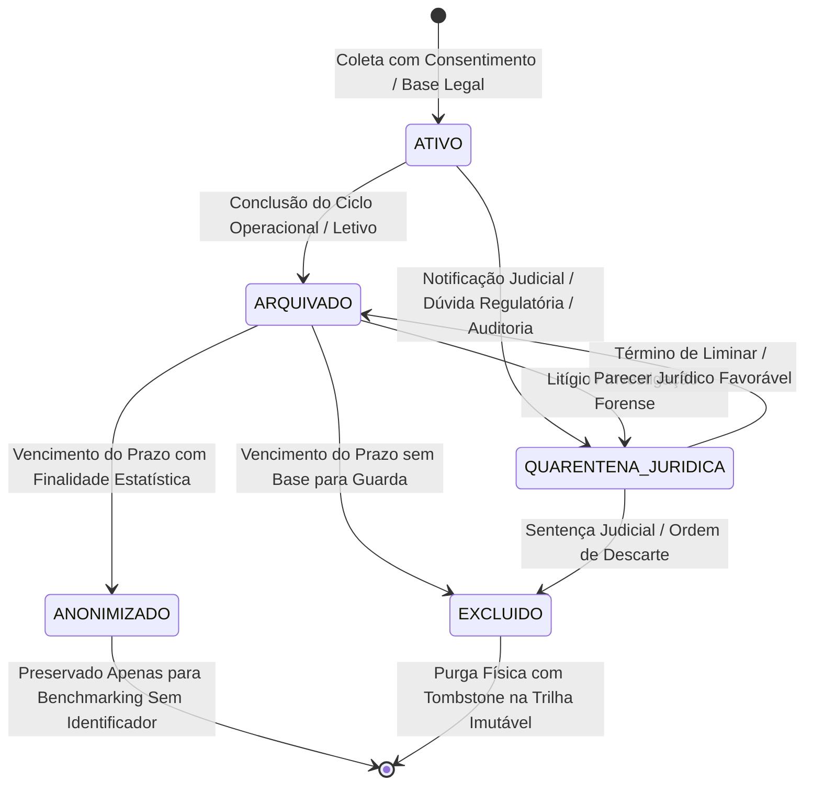

# Política de Retenção e Descarte de Dados — Áquila Pro

**Versão:** 1.0  
**Data de Publicação:** 30 de Outubro de 2026  
**Aplicável a:** `v2.1.0-rc.30` e releases posteriores  
**Objetivo:** Definir por quanto tempo cada categoria de dado permanece armazenada, quem pode prorrogar retenção, como ocorre a exclusão/anonimização e como a instituição escolar comprova conformidade com a LGPD (Lei nº 13.709/2018), Lei de Direitos Autorais (Lei nº 9.610/98), Estatuto da Criança e do Adolescente (ECA - Lei nº 8.069/90 e Lei nº 15.211/2025) e obrigações pedagógicas. Esta política complementa os controles de criptografia em repouso/trânsito, isolamento Edge e governança descritos no `SECURITY.md` e na `POLITICA_USO_DADOS_PROVAS.md`.

---

## 1. Princípios Fundamentais

1. **Retenção Mínima Necessária:** Nenhum dado pessoal ou operacional permanece armazenado além do tempo estritamente necessário para o cumprimento de sua finalidade pedagógica/administrativa, obrigação legal (MEC/fiscal) ou interesse legítimo documentado.
2. **Local-First por Padrão (Edge Soberano):** Todos os dados residem primariamente no servidor Edge local da escola (`aquila.db` em modo WAL). Qualquer replicação externa ou processamento remoto em nuvem/GPU exige autorização prévia, criptografia de ponta a ponta (TLS 1.3) e contrato específico de não-retenção (*Zero Data Retention*).
3. **Descarte Verificável e Auditável:** É expressamente vedada a exclusão silenciosa. Todo ato de descarte, expurgo ou anonimização gera compulsoriamente um evento imutável na tabela `zero_bypass_audits`, contendo operador, data/hora UTC, motivo, categoria de dados e hash SHA-256 do registro afetado.
4. **Separação Estrita entre Dado Pessoal e Conteúdo:** A exclusão de um estudante ou encerramento de vínculo não autoriza o descarte de provas autorais, itens de avaliação licenciados, matrizes pedagógicas ou registros fiscais/contábeis da escola.
5. **Efetividade dos Direitos do Titular:** As solicitações de confirmação, acesso, correção, portabilidade, anonimização e exclusão formuladas por alunos, pais ou responsáveis legais devem ser atendidas nos prazos regulamentares da LGPD, ressalvadas as hipóteses legais de guarda obrigatória.
6. **Fail-Safe & Quarentena Jurídica:** Em caso de controvérsia sobre a obrigatoriedade de retenção, litígio judicial, inquérito administrativo ou solicitação de auditoria pelo DPO, o dado NÃO é excluído: é imediatamente transferido para o estado de **`QUARENTENA_JURIDICA`**, com acesso restrito e exportações bloqueadas.

---

## 2. Tabela Mestra de Retenção e Descarte (20 Categorias)

| # | Categoria de Dado | Exemplos Concretos | Retenção Padrão | Tratamento Pós-Prazo | Responsável Técnico / Funcional |
| :-: | :--- | :--- | :---: | :--- | :--- |
| **01** | **Cadastro do Aluno** | Nome, CPF, data de nascimento, turma, matrícula, filiação | Duração da matrícula + 5 anos | Anonimização irreversível ou exclusão | Secretaria Escolar / DPO |
| **02** | **Dados do Responsável** | Nome, CPF, telefone, e-mail, vínculo legal com o menor | Duração do vínculo + 5 anos | Anonimização ou exclusão | Secretaria Escolar / DPO |
| **03** | **Frequência e Acessos** | Registros de catraca, presença em sala, atrasos e saídas | Ciclo letivo corrente + 5 anos | Agregação anônima estatística ou expurgo | Coordenação / Segurança |
| **04** | **Eventos de Segurança** | Alertas de perímetro, ocorrências, acessos negados, falhas | 5 anos contínuos | Anonimização ou expurgo do log | Equipe de Segurança / DPO |
| **05** | **Imagens de Câmera / CFTV** | Gravações de vídeo de corredores, pátios e portarias | 30 dias corridos | Sobregravação automática contínua | Segurança Patrimonial |
| **06** | **Embeddings Biométricos** | Vetores numéricos 512-D de reconhecimento facial (`ArcFace`) | Duração do vínculo ativo | Exclusão imediata (máx. 24h) pós-desligamento | Segurança / DPO |
| **07** | **Fotos de Alunos** | Fotos de perfil do sistema, carteirinha escolar digital | Duração da matrícula + 5 anos | Exclusão física ou anonimização | Secretaria Escolar / DPO |
| **08** | **Provas e Avaliações** | Cadernos de questões, enunciados, gabaritos, rubricas TRI | Ciclo letivo corrente + 5 anos | Arquivamento do acervo sem dados nominais | Coordenação Pedagógica |
| **09** | **Respostas Individuais** | Marcações de questões, respostas digitais, tempos de resposta | Ciclo letivo corrente + 5 anos | Anonimização desvinculando do estudante | Professor Titular / Coordenação |
| **10** | **Imagem do Cartão OMR** | Fotos ou digitalizações digitalizadas de folhas de resposta | 90 dias após consolidação final | Exclusão segura do arquivo no disco | QA / Coordenação Pedagógica |
| **11** | **Notas e Resultados** | Nota bruta, acertos por competência BNCC, escore TRI | Ciclo letivo corrente + 5 anos | Anonimização estatística para benchmarking | Secretaria / Coordenação |
| **12** | **Comunicação com Pais** | Histórico de WhatsApp, comunicados, avisos, notificações | 5 anos contínuos | Anonimização ou exclusão | Assessoria de Comunicação / DPO |
| **13** | **Leads de Captação** | Cadastro em campanhas, interesse de matrícula, interações | 24 meses sem interação ativa | Exclusão ou anonimização cadastral | Equipe Comercial / DPO |
| **14** | **Leads Convertidos** | Histórico pré-matrícula de estudante que efetivou ingresso | Duração da matrícula + 5 anos | Incorporação ao dossiê acadêmico | Equipe Comercial / Secretaria |
| **15** | **Dados Financeiros** | Mensalidades, cobranças, comprovantes PIX/Boleto, acordos | 5 anos após liquidação ou extinção | Arquivamento fiscal conforme Lei nº 5.172/66 | Departamento Financeiro |
| **16** | **Logs de IA & RAG** | Prompts de elaboração, modelo utilizado, aprovação docente | 12 meses contínuos | Anonimização e expurgo de trilha | DPO / Engenharia de Software |
| **17** | **Logs Técnicos de Sistema** | Erros de runtime, telemetria de performance, IPC bridges | 12 meses contínuos | Agregação estatística e exclusão física | Engenharia de Infraestrutura |
| **18** | **Backups de Banco Edge** | Snapshots binários e dumps criptografados do SQLite | 30 dias rotativos + 12 mensais | Sobrescrita criptográfica segura | TI Local / DPO |
| **19** | **Conteúdo de Terceiros** | Itens do ENEM/INEP, OBA, OBMEP, PISA, editoras privadas | Conforme permissão formal da fonte | Remoção do acervo, índices RAG e caches | Curadoria Pedagógica / Jurídico |
| **20** | **Conteúdo Autoral Áquila** | Banco proprietário, templates de prova, matrizes de maestria | Enquanto vigorar a licença de software | Remoção dos nós locais conforme contrato | Engenharia Áquila / Escola |

---

## 3. Regras Especiais de Proteção e Prazos Críticos

### 3.1 Proteção Reforçada a Menores de Idade (ECA & LGPD Art. 14)
- Os dados pessoais de crianças e adolescentes têm ciclo de vida minimizado e acesso restrito por RBAC rigoroso.
- Biometria, fotos de circulação e relatórios comportamentais são estritamente vedados para fins de profiling comercial, publicidade ou transmissão a terceiros.
- É tecnicamente bloqueada qualquer exportação de relatórios que exponha nominalmente dados sensíveis de menores a redes mantenedoras sem aprovação expressa do DPO Escolar.

### 3.2 Imagens de Cartões de Resposta OMR (Prazo Máximo de 90 Dias)
- A imagem digitalizada ou fotografada do cartão de respostas é tratada como **dado transitório de validação**, prestando-se unicamente à correção óptica e ao esclarecimento de eventuais recursos durante o período de revisão de notas.
- Uma vez concluída a correção e expirada a janela regulamentar de contestação (máximo de 90 dias da prova), a imagem física no disco é excluída definitivamente (`scanImagePath` = null / `[PURGED_EXPIRED]`).
- O sistema retém permanentemente apenas as marcações vetoriais auditadas, o escore calculado, a taxa de confiança e o hash SHA-256 da imagem original.

### 3.3 Biometria Facial e Vetores de Inteligência Artificial (Prazo Máximo de 24 Horas)
- O vetor biométrico de 512 dimensões (embedding de reconhecimento facial) deve ser **definitivamente eliminado em até 24 horas** a contar de:
  1. Formalização do desligamento/transferência do estudante da instituição;
  2. Revogação formal do consentimento pelo responsável legal via portal ou requerimento físico;
  3. Decisão cautelar do DPO Escolar.
- A exclusão biométrica abrange a tabela principal (`face_embeddings` e `student_face_embeddings_512`), o cache em memória RAM do worker de visão e as filas de processamento. Nos backups frios, o registro é criptograficamente invalidado por inclusão na tabela `retention_tombstones`.

### 3.4 Leads Comerciais Não Convertidos (Prazo Máximo de 24 Meses)
- Qualquer contato captado em eventos de portas abertas, formulários web ou campanhas de matrículas que permaneça inativo por 24 meses consecutivos (sem abertura de mensagens, agendamento de visitas ou interações) é automaticamente marcado para descarte ou anonimização.
- O titular do lead pode exercer o direito de exclusão antecipada a qualquer momento, sendo atendido em até 5 dias úteis.

### 3.5 Conteúdos de Terceiros e Quarentena de Propriedade Intelectual
- Conteúdos de vestibulares e editoras sob licenças restritivas (ex: CC-BY-NC-SA ou sem autorização comercial expressa) são mantidos em `QUARENTENA_JURIDICA` e excluídos de índices de RAG de IA generativa.
- Caso o titular dos direitos autorais revogue o uso de uma questão ou vença o convênio de compartilhamento, o item é desindexado imediatamente de todos os cadernos de provas futuros.

---

## 4. Estados do Ciclo de Vida dos Dados



| Estado | Significado Operacional | Nível de Acesso no Sistema |
| :--- | :--- | :--- |
| **`ATIVO`** | Dado necessário para a operação letiva ou administrativa corrente. | Perfis autorizados via RBAC regular. |
| **`ARQUIVADO`** | Dado inativo, mantido para cumprimento de prazo legal ou histórico do aluno. | Acesso restrito com registro obrigatório de justificativa. |
| **`QUARENTENA_JURIDICA`** | Exclusão suspensa em virtude de processo judicial, auditoria fiscal ou liminar. | Acesso exclusivo ao DPO e Departamento Jurídico; exportações bloqueadas. |
| **`ANONIMIZADO`** | Todos os identificadores diretos e indiretos foram suprimidos irreversivelmente. | Analítica estatística e benchmarking educacional. |
| **`EXCLUIDO`** | Conteúdo destruído física e logicamente; resta apenas o evento na trilha forense. | Registro inelegível para restauração ou consulta de conteúdo. |

---

## 5. Metodologia de Exclusão Segura em Três Camadas

A destruição de registros sensíveis e materiais descartáveis opera através do modelo escalonado de higienização de dados:

1. **Camada 1 — Exclusão Lógica Imediata:**
   - O registro tem seu status alterado para `EXCLUIDO`, sendo desvinculado dos índices de busca e das telas dos usuários.
2. **Camada 2 — Purga Criptográfica (Crypto-Shredding):**
   - As chaves de decifragem ou o conteúdo criptografado em repouso são sobrescritos com bytes nulos, inviabilizando qualquer recuperação mesmo a partir de blocos brutos de armazenamento.
3. **Camada 3 — Purga Física & Registro de Tombstone:**
   - O arquivo no sistema de arquivos local (ex: foto de cartão OMR) é excluído usando operações seguras do sistema operacional.
   - O identificador da entidade e o hash SHA-256 do conteúdo expurgado são gravados permanentemente na tabela `retention_tombstones`, assegurando que futuras restaurações de backup não reintegrem indevidamente o dado expurgado.

---

## 6. Anonimização Irreversível e Regra de k-Anonimato

Nos casos em que a retenção histórica para fins analíticos e pedagógicos for juridicamente admitida, o processo de anonimização deve atender compulsoriamente aos seguintes critérios técnicos:
- **Substituição Pseudonimizada:** Nomes, CPFs, e-mails e telefones são substituídos por pseudônimos criptográficos unidirecionais (ex: `ANON_7A9B3E2F`).
- **Remoção de Metadados Indiretos:** Informações de CEP, data exata de nascimento (mantendo apenas o ano) e observações médicas/sociais livres são integralmente eliminadas.
- **Regra de k-Anonimato (Turmas Pequenas):** Se uma turma ou agrupamento acadêmico possuir **menos de 10 alunos**, relatórios analíticos são compulsoriamente suprimidos ou agregados a nível de série inteira, impedindo a reidentificação por exclusão dedutiva.

---

## 7. Atendimento aos Direitos do Titular de Dados (LGPD Art. 18)

| Direito do Titular | Prazo Interno Máximo | Procedimento Técnico Executado pelo Áquila Pro |
| :--- | :---: | :--- |
| **Confirmação de Tratamento** | 5 dias úteis | Emissão de parecer detalhando categorias ativas e finalidades legais. |
| **Acesso aos Dados** | 10 dias úteis | Exportação segura em formato legível e estruturado (JSON/CSV). |
| **Correção de Dados Incompletos** | 5 dias úteis | Atualização cadastral no banco Edge com registro no log de auditoria. |
| **Anonimização ou Bloqueio** | 10 dias úteis | Desvinculação de identificadores diretos ou transição para quarentena. |
| **Exclusão de Dados Desnecessários** | 10 dias úteis | Purga segura em 3 camadas, ressalvadas hipóteses de guarda obrigatória. |
| **Portabilidade de Dados** | 15 dias úteis | Emissão de pacote digital assinado criptograficamente com hash SHA-256. |
| **Revogação de Consentimento** | 5 dias úteis | Paralisação imediata do tratamento dependente e expurgo de biometria. |

---

## 8. Política de Backups, Integridade e Prevenção de Reintrodução

- **Ciclo de Rotação de Segurança:**
  - Backups diários incrementais retidos por **30 dias corridos**.
  - 1 cópia consolidada mensal retida por **12 meses**.
  - Cifragem compulsória dos artefatos de backup em AES-256-GCM.
- **Princípio da Não-Reintrodução Indevida:**
  - Restaurar um backup antigo NÃO PODE reintroduzir dados de titulares que exerceram o direito de exclusão após a data do snapshot.
  - O motor de restauração (`SQLiteDisasterRecoveryService`) cruza compulsoriamente os dados restaurados com a tabela de tombstones (`retention_tombstones`), aplicando expurgo imediato sobre quaisquer registros marcados como excluídos.
- **Restore Drills Trimestrais:** A equipe de TI deve executar simulações trimestrais de recuperação de desastres, auditando a eficácia dos tombstones e a preservação do livro-razão imutável.

---

## 9. Requisitos Técnicos de Log e Trilha de Auditoria

Todo evento de ciclo de vida deve gerar um registro no log imutável com a seguinte estrutura padronizada:

```json
{
  "eventType": "DATA_RETENTION_EXPIRED | DATA_ANONYMIZED | DATA_DELETED | RETENTION_EXTENDED | QUARANTINE_APPLIED",
  "schoolId": "ESC-SP-001",
  "dataSubjectType": "student | guardian | lead | content | ai_log",
  "dataSubjectRef": "PSEUDO_9F8E7D6C",
  "dataCategories": ["omr_image", "exam_response"],
  "retentionPolicy": "OMR_IMAGE_90D",
  "expiresAt": "2026-10-30T17:00:00Z",
  "action": "secure_delete",
  "reason": "retention_period_expired",
  "performedBy": "system_retention_daemon",
  "approvedBy": "dpo@escola.com.br",
  "contentHash": "D4E5F6A7B8C9D0E1F2A3B4C5D6E7F8A9B0C1D2E3F4A5B6C7D8E9F0A1B2C3D4E5",
  "timestamp": "2026-10-30T17:00:00Z"
}
```

---

## 10. Implementação Técnica — `DataRetentionService`

A plataforma Áquila Pro materializa esta política por meio do serviço centralizado [`DataRetentionService.ts`](file:///c:/aquila/apps/electron/src/main/services/DataRetentionService.ts), composto por:
1. **Tabela `retention_policies`:** Define os prazos em dias, ação pós-prazo e responsável para cada uma das 20 categorias.
2. **Tabela `retention_jobs`:** Registra o histórico e o status de cada varredura diária (`items_scanned`, `items_anonymized`, `items_deleted`).
3. **Tabela `retention_tombstones`:** Memória criptográfica forense contra reintrodução de dados em restaurações de backups.
4. **Daemon Diário de Varredura:** Job automatizado que identifica itens com `expires_at < CURRENT_TIMESTAMP` e despacha para exclusão segura ou anonimização.
5. **Bloqueio Cautelar de Exportação:** Lança exceção de segurança (`QuarantineExportBlockedError`) caso haja tentativa de envio de dado em `QUARENTENA_JURIDICA`.
6. **Cockpit Executivo do DPO:** Interface de consulta com os próximos 30/60/90 dias de vencimentos e histórico de expurgos.

---

## 11. Critérios Formais de Aceite

A política é considerada formalmente implementada e apta para operação escolar após a validação dos seguintes critérios:
- [x] Todas as 20 categorias de dados devidamente cadastradas com prazos padrão não infinitos;
- [x] Remoção compulsória de vetores biométricos em até 24 horas comprovada em teste automatizado;
- [x] Descarte de imagens OMR em até 90 dias com retenção das marcações ópticas e notas;
- [x] Expurgo ou anonimização de leads comerciais inativos há mais de 24 meses;
- [x] Bloqueio técnico irrestrito de exportação para registros em quarentena jurídica;
- [x] Gravação encadeada de eventos na tabela `zero_bypass_audits` com hash SHA-256;
- [x] Emissão de relatório de conformidade do DPO com estatísticas e pendências;
- [x] Teste E2E comprovando restauração controlada de backup com respeito aos tombstones de registros excluídos.

---
*Assinado: Comitê de Governança de Dados, DPO & Diretoria Jurídica Áquila Pro*  
*Documento vinculado à Release Candidate v2.1.0-rc.32 (Commit `e15817ca`)*
