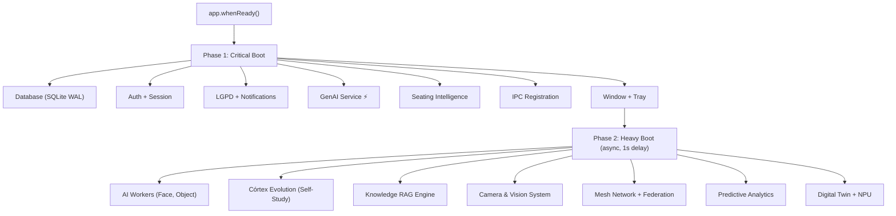

# 🦅 Áquila Pro — Context Recovery Report
> **Data:** 2026-08-08 | **Versão:** 2.1.0-rc1 | **Stack:** Electron + React + SQLite + Python AI Workers

---

## 📊 Visão Geral do Ecossistema

| Métrica | Valor |
|---|---|
| Páginas UI (.tsx) | **~130+** |
| Componentes (.tsx) | **294** |
| Serviços Backend (.ts) | **476** |
| Skills do Agente | **16 soberanas + 6 Fable** |
| Tamanho do IPC handlers | **176 KB** (monolítico) |
| Database Engine | SQLite (better-sqlite3, WAL mode) |
| AI Engine | Google Generative AI + Ollama local |
| Versão Electron | 28.2.0 |

---

## ✅ O Que Está Construído e Funcionando

### 🏫 HUB ENSINO (Pedagógico) — 100% Funcional

| Página | Arquivo | Status | Descrição |
|---|---|---|---|
| Diário de Classe | [Diary.tsx](file:///C:/aquila/apps/electron/src/ui/pages/Diary.tsx) | ✅ OK | Chamada rápida (grid compacto), chamada por voz, humor socioemocional, observações |
| Relatório Diário IA | [TeacherDailyReport.tsx](file:///C:/aquila/apps/electron/src/ui/pages/TeacherDailyReport.tsx) | ✅ OK | Accordion de alunos, conteúdo ministrado, IA generativa, voz (só mobile) |
| Tarefas & Agendamentos | [TaskScheduler.tsx](file:///C:/aquila/apps/electron/src/ui/pages/TaskScheduler.tsx) | ✅ OK | CRUD de tarefas, geração IA, links YouTube, grid compacto |
| Mapa de Assentos IA | [SeatingIntelligence.tsx](file:///C:/aquila/apps/electron/src/ui/pages/SeatingIntelligence.tsx) | ✅ OK | Grid drag-and-drop, distribuição automática, câmera live, ocorrências |
| Painel do Professor | [TeacherDashboard.tsx](file:///C:/aquila/apps/electron/src/ui/pages/TeacherDashboard.tsx) | ✅ OK | HUD ambiental, pulso da sala, cronômetro, scanner de provas |
| Painel da Sala | [ClassroomDashboard.tsx](file:///C:/aquila/apps/electron/src/ui/pages/ClassroomDashboard.tsx) | ✅ OK | Display para TV/projetor, relógio, horários, avisos |
| Painel Coordenação | [CoordinationDashboard.tsx](file:///C:/aquila/apps/electron/src/ui/pages/CoordinationDashboard.tsx) | ✅ OK | Evasão, alertas comportamentais, intervenções, finanças, biometria |
| Inteligência Pedagógica | [PedagogicalIntelligenceHub.tsx](file:///C:/aquila/apps/electron/src/ui/pages/PedagogicalIntelligenceHub.tsx) | ✅ OK | Hub de IA pedagógica |
| Radar de Evasão | [PredictiveDashboard.tsx](file:///C:/aquila/apps/electron/src/ui/pages/PredictiveDashboard.tsx) | ✅ OK | Radar preditivo, varredura de turmas em risco |
| Biblioteca Pedagógica | [SovereignLibrarianUI.tsx](file:///C:/aquila/apps/electron/src/ui/pages/SovereignLibrarianUI.tsx) | ✅ OK | Acervo digital soberano |

### 🔒 HUB SEGURANÇA — 100% Funcional

| Página | Status | Descrição |
|---|---|---|
| Câmeras ao Vivo | ✅ OK | RTSP/USB, CLIP semântico, bounding boxes |
| Monitor de Segurança | ✅ OK | Busca semântica, planta baixa, modelo 3D, logs |
| Night Sentry | ✅ OK | Patrulha noturna automatizada |
| Ocorrências / Alertas | ✅ OK | Registro e resposta a incidentes |
| Wi-Fi DensePose | ✅ OK | Estimativa de presença sem câmera |

### 🏛️ HUB GESTÃO (Admin) — 100% Funcional

| Página | Status | Descrição |
|---|---|---|
| Cockpit Executivo | ✅ OK | KPIs, métricas, decisões estratégicas |
| BI Financeiro | ✅ OK | Mensalidades, PIX, inadimplência |
| Secretaria Digital | ✅ OK | Matrículas, documentação, transferências |
| Controle de Acessos | ✅ OK | Gestão de usuários e permissões por papel |
| Governança & LGPD | ✅ OK | Compliance, auditoria, consentimento |
| Cérebro Coletivo | ✅ OK | Self-Study, conselho de inteligência |

---

## 🔧 Correções Realizadas Nesta Sessão

### Já Completadas ✅

| # | Problema | Arquivo | Solução |
|---|---|---|---|
| 1 | IA não funcionava (genAIService não registrado a tempo) | [orchestrator.ts](file:///C:/aquila/apps/electron/src/main/orchestrator.ts) | Movido para Phase 1 do boot |
| 2 | UI com espaços enormes e scroll desnecessário | [index.css](file:///C:/aquila/apps/electron/src/index.css) | Redução global de gaps, paddings, font scales |
| 3 | Aba "Quadro IA" visível no PC | [Sidebar.tsx](file:///C:/aquila/apps/electron/src/ui/components/Sidebar.tsx) | `window.aquila` check → hidden on desktop |
| 4 | TaskScheduler ocupava muito espaço vertical | [TaskScheduler.tsx](file:///C:/aquila/apps/electron/src/ui/pages/TaskScheduler.tsx) | Layout grid horizontal 2 colunas |
| 5 | Relatório de alunos com dropdown grande | [TeacherDailyReport.tsx](file:///C:/aquila/apps/electron/src/ui/pages/TeacherDailyReport.tsx) | Accordion expandível compacto |
| 6 | Botão "Ditar" visível no PC | TeacherDailyReport + Diary | `!(window as any).aquila` → só mobile |
| 7 | Botão "Autopreencher IA" visível no PC | TeacherDailyReport | Condicional desktop/mobile |
| 8 | Diário de Classe cards grandes demais | [Diary.tsx](file:///C:/aquila/apps/electron/src/ui/pages/Diary.tsx) | Strip horizontal compacto + grid 8 colunas |
| 9 | Seletor de turma invisível no Mapeamento | [SeatingIntelligence.css](file:///C:/aquila/apps/electron/src/ui/pages/SeatingIntelligence.css) | `option { background: #0f172a; color: #fff }` |
| 10 | Alunos não apareciam no mapa de assentos | [SeatingIntelligence.tsx](file:///C:/aquila/apps/electron/src/ui/pages/SeatingIntelligence.tsx) | Filtro `null \|\| undefined` corrigido |
| 11 | Distribuir Automático não funcionava | SeatingIntelligence.tsx | Algoritmo melhorado com busca de vagas |

---

## 🏗️ Arquitetura Backend (Boot Sequence)

---

## 🧠 Skills do Agente Ativas

| Tier | Skills |
|---|---|
| **Core** | `operations_manager`, `code_governance`, `security_review`, `mcp_architect`, `fable-think/code/debug/architect/verify` |
| **Domain** | `lgpd_guard`, `ui_sync`, `qa_expert`, `performance_audit`, `document_audit`, `vision_worker`, `npu_optimizer` |
| **Meta** | `experience_intelligence`, `sovereign_intelligence`, `skill_factory`, `skill_inventory`, `agentic_engineering` |

---

## 📁 Navegação (3 Hubs Soberanos)

### Hub Segurança (`security`)
Câmeras, Ocorrências, Night Sentry, Monitor do Sistema, Auditoria, Social Nexus

### Hub Gestão (`admin`)
Cockpit Executivo, BI Financeiro, Financeiro, Grade & Turmas, Controle de Acessos, Secretaria, Cérebro Coletivo, LGPD, Ecossistema, Configurações, Ajuda

### Hub Ensino (`pedagogical`)
Gestão de Alunos, Chamada, Tarefas, Quadro IA (só mobile), Relatório Diário IA, Inteligência Ativa, Relatórios, Diário de Classe, Córtex AI Lab, Coordenação, Radar de Evasão, Mapa de Assentos, Biblioteca, Painel da Sala, Ciclo de Vida

---

## 🎯 Pendências Conhecidas

| # | Item | Prioridade | Status |
|---|---|---|---|
| 1 | Seletor de turma pode estar invisível em **outras páginas** além do Mapa de Assentos | 🟡 Média | A verificar |
| 2 | Content Tab do TeacherDailyReport precisa condensação | 🟢 Baixa | Parcialmente feito (botão IA escondido no PC) |
| 3 | CHANGELOG.md não existe | 🟡 Média | Criar para rastreabilidade |
| 4 | Testes E2E (`test:e2e`) podem precisar de atualização após refatorações de UI | 🟡 Média | A verificar |

---

> **Conclusão:** O Áquila Pro v2.1.0-rc1 é um ecossistema massivo e funcional com ~130+ páginas, 476 serviços backend e 294 componentes. Todas as funcionalidades-chave dos 3 hubs estão operacionais. As correções desta sessão focaram em **densidade de UI** (zero-scroll), **separação desktop/mobile** e **estabilidade do serviço de IA**.
