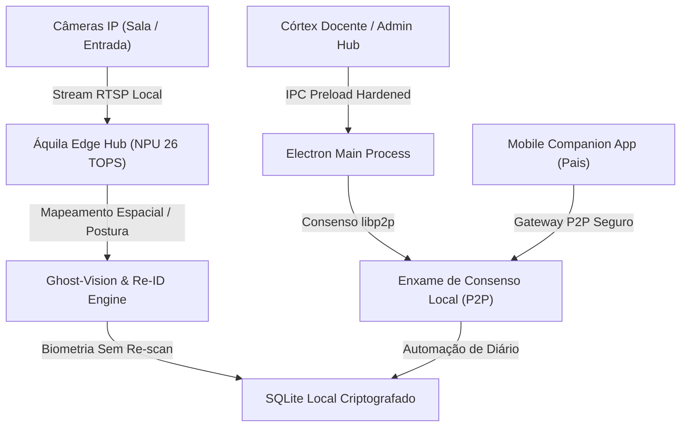

# 🦅 Áquila Pro — Materiais de Divulgação & Descrição Técnica (v2.1.0)

Este documento reúne a **Ficha Técnica de Engenharia** e os **Materiais de Divulgação Comercial** do ecossistema **Áquila Pro (Sovereign OS)**, prontos para apresentação a diretores, investidores e equipes técnicas de TI escolar.

---

# 🛠️ 1. FICHA TÉCNICA E DESCRIÇÃO DE ENGENHARIA

O **Áquila Pro** é o primeiro Sistema Operacional de Borda (Edge OS) projetado especificamente para instituições de ensino. Sob o paradigma *Agent-First* e *Local-Only*, ele unifica a segurança física do colégio, a automação acadêmica e o engajamento familiar em uma malha local imutável e descentralizada.

## 📐 Arquitetura de Software e Borda (Edge OS)

### 1. Núcleo Soberano (Sovereign Core)
- **Runtime Principal**: Electron Framework, sandboxeado e endurecido com `contextIsolation` ativo e `preload` blindado.
- **Camada de Visão (Vite / React 18)**: Interface ultra-premium baseada em Glassmorphism, otimizada com aceleração por GPU (CSS vanilla otimizado por hardware).
- **Persistência de Borda**: SQLite embarcado localmente. Dispensa servidores de nuvem pública, eliminando custos de infraestrutura de nuvem recorrentes (AWS/GCP) e protegendo a integridade dos dados escolares.

### 2. Aceleração de Hardware (Local NPU Support)
- **Poder Computacional**: Integração direta com aceleradores NPU locais de **26 TOPS** (Tensor Operations Per Second).
- **Processamento de Redes Neurais**: Inferência local de modelos YOLOv8 (detecção de objetos/anomalias) e FaceNet (reconhecimento facial local).
- **Monitoramento Térmico**: Algoritmo nativo de *Auto-Throttling* que reduz o ciclo de amostragem se a temperatura interna da CPU/NPU exceder 75ºC.

### 3. Ghost-Vision & Person Re-Identification (Re-ID)
- **Tecnologia**: Rastreamento baseado em postura, silhueta e padrões de vestimenta (128d Feature Vector).
- **Privacidade Extrema**: Uma vez efetuada a entrada biométrica na catraca, o aluno é acompanhado pelos corredores e pátios sem necessidade de nova biometria facial, reduzindo a fadiga de processamento e mitigando riscos de privacidade.

### 4. Enxame de Consenso e Redundância P2P
- **Conectividade**: Malha de dados P2P (Peer-to-Peer) utilizando a especificação do protocolo `libp2p`.
- **Sincronia**: Se houver perda de conectividade com a rede principal, os hubs das salas de aula continuam operando em modo offline isolado e sincronizam de forma autônoma (Self-Healing) assim que a rede é restabelecida.

### 5. Blindagem Jurídica e Higiene de Dados (LGPD Mastery)
- **Criptografia**: Credenciais dos usuários hasheadas com algoritmos de memória rígida (*Scrypt* memory-hard).
- **Higiene Temporal**: Política de purgação dinâmica de telemetria bruta após 60 dias de inatividade de alunos.

---

# 🚀 2. MATERIAL DE DIVULGAÇÃO & PITCH COMERCIAL

## 🎯 O Pitch Soberano (Mensagem de Vendas)

> *"A nuvem é cara, vulnerável e viola a privacidade dos seus alunos. Conheça o Áquila Pro: a inteligência artificial de elite que opera 100% dentro dos muros da sua escola."*

A maioria dos sistemas de gestão escolar trava a sua instituição em contratos de nuvem abusivos, nos quais seus dados biométricos sensíveis e de comportamento de menores são enviados a servidores estrangeiros vulneráveis a vazamentos. O **Áquila Pro** muda o jogo. Ele roda localmente em um hardware elegante, consome menos energia, e oferece as ferramentas pedagógicas e de segurança mais avançadas do mundo, em conformidade integral e nativa com a LGPD.

---

## 💻 Vitrine das Telas (Showcase do Ecossistema)

### 🎓 1. Córtex Docente (Painel do Professor)
O centro de comando neuro-pedagógico do professor:
- **Diário de Voz Inteligente**: O professor dita comandos e notas. O motor de IA local compreende, transcreve e atualiza o diário de classe sem necessidade de digitação.
- **Mapeamento de Engajamento Coletivo**: Gráficos orgânicos em tempo real que mapeiam o índice de fadiga e atenção dos alunos na sala, permitindo ao professor saber o momento exato de aplicar uma dinâmica de quebra de ritmo.
- **Corretor Automático de Provas**: Escaneamento de folhas de respostas com correção instantânea e atribuição de nota automática integrada ao banco local.

### 🛡️ 2. Admin Hub (Portal do Diretor / Gestor)
- **Gestão de Acessos & RBAC**: Controle detalhado de privilégios e credenciais para colaboradores (RH, coordenação, professores e portaria).
- **Relatório de Impacto LGPD (RIPD)**: Exportação em um clique de relatórios de conformidade e auditoria de purga de dados criptografados para comprovação jurídica imediata.

### 📱 3. Espaço Família (Portal de Pais)
- **Timeline de Trânsito Ativo**: Os pais sabem o horário exato da passagem do filho na catraca, a sua presença confirmada na sala de aula e podem notificar a portaria quando estiverem a 500m do portão.

### 🚗 4. Arrival Board (Mural de Chegada da Portaria)
- **Visualização de Aproximação**: Mapeamento inteligente de geofence que prevê a chegada dos pais por carro, ordenando a fila de alunos no pátio para uma saída sem filas e em apenas 1.2 segundos por veículo.

---

## 💎 Simulação de ROI (Retorno de Investimento)

Para uma escola com **1.200 Alunos** e **45 Colaboradores**:

| Métrica | Situação Anterior | Com Áquila Pro | Ganho / Economia |
|---|---|---|---|
| **Chamada de Presença** | 10 min por aula perdida | 100% Automática | **+3.500 horas de aula/ano** recuperadas |
| **Purgação de Burocracia** | Professores digitando notas | Diário de Voz & Scanner | **85% de redução** no estresse burocrático |
| **Controle de Portaria** | Fila de carros e atrasos | Geofence Arrival Board | Saída em **1.2 segundos** por veículo |
| **Custos de Infraestrutura** | R$ 12.000/ano em Servidores Web | R$ 0.00 (Processamento Local) | **Economia direta de R$ 12.000/ano** |
| **Mitigação de Risco LGPD** | Risco de multas de até 2% do faturamento | 100% Offline e blindado | **Segurança jurídica absoluta** |

---

> [!IMPORTANT]
> **Selo Áquila Certified: Sovereign School**
> Ao implementar o ecossistema, a escola recebe a certificação oficial para divulgar a pais e comunidade que é uma instituição com privacidade soberana, agregando valor à marca e protegendo a identidade digital de suas crianças.
