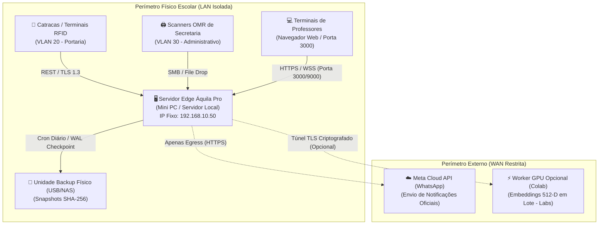

# 🏛️ Guia Oficial de Implantação do Servidor Edge — Piloto Áquila Pro v2.1

> **Público-Alvo:** Administradores de Redes, Analistas de Infraestrutura de TI e Direção Escolar  
> **Versão Homologada:** `v2.1.0-rc.8`  
> **Escopo:** Instalação e Operação de Servidor de Borda Local Soberano (Sem dependência de nuvem para operações críticas)

---

## 🏗️ 1. Arquitetura de Implantação Local

O Áquila Pro foi desenhado segundo o princípio de **Soberania Local de Borda**: todos os registros acadêmicos, logs de presença, imagens de provas e auditorias residem exclusivamente no servidor físico instalado nas dependências da instituição escolar.



---

## 💻 2. Requisitos Mínimos e Recomendados de Hardware

Para um ambiente escolar de **500 a 1.500 estudantes**:

| Componente | Requisito Mínimo | Configuração Recomendada (Alta Performance) |
| :--- | :--- | :--- |
| **Processador (CPU)** | Intel Core i5 10ª Geração ou AMD Ryzen 5 (4 núcleos / 8 threads) | Intel Core i7 12ª+ Geração / AMD Ryzen 7 (8 núcleos / 16 threads) |
| **Memória RAM** | 16 GB DDR4 (2666 MHz) | 32 GB DDR4/DDR5 (3200 MHz+) |
| **Armazenamento** | 256 GB SSD NVMe M.2 | 512 GB NVMe M.2 (Leitura $\ge 3.000\text{ MB/s}$) + 1 TB HDD/NAS (Cold Storage) |
| **Rede** | 1x Porta Gigabit Ethernet (1.000 Mbps) | 2x Portas Gigabit Ethernet (Redundância / VLAN Trunking) |
| **Alimentação Elétrica** | Nobreak Senoidal 1.200 VA (Autonomia mínima: 30 minutos) | Nobreak Senoidal Online Dupla Conversão 2.000 VA (Autonomia $\ge 60\text{ min}$) |
| **Sistema Operacional** | Windows 11 Pro 64-bit / Ubuntu Server 22.04 LTS | Windows 11 Pro 64-bit (com BitLocker ativado) ou Debian 12 |

---

## 🌐 3. Configuração de Rede e Firewall Local

### A. Endereçamento IP Estático
O servidor deve receber um endereço IP estático no roteador principal da instituição:
- **IP Sugerido:** `192.168.10.50` (ou subnet dedicada da gestão)
- **Máscara:** `255.255.255.0`
- **Gateway:** `192.168.10.1`
- **DNS Primário:** `1.1.1.1` | **Secundário:** `8.8.8.8`

### B. Regras de Firewall (Windows Defender Firewall / UFW)
O servidor **não deve ter nenhuma porta exposta diretamente para a Internet** (WAN). Todo o acesso deve ser restrito à rede local interna (LAN).

#### Portas de Entrada Permitidas na LAN:
1. **Porta TCP 3000:** Interface Web Next.js para acesso de coordenadores e professores.
2. **Porta TCP 9000:** Barramento de Mensageria em Tempo Real (WebSocket com TLS 1.3).
3. **Porta TCP 22 / 3389:** Acesso administrativo SSH/RDP (restrito aos IPs dos administradores de TI).

#### Script de Liberação no PowerShell (Administrador):
```powershell
# 1. Bloqueia acessos externos indesejados
Set-NetFirewallProfile -Profile Domain,Public,Private -DefaultInboundAction Block

# 2. Libera Portal Web e WebSocket apenas na sub-rede local
New-NetFirewallRule -DisplayName "AquilaPro Web Portal (3000)" -Direction Inbound -LocalPort 3000 -Protocol TCP -Action Allow -RemoteAddress "192.168.10.0/24"
New-NetFirewallRule -DisplayName "AquilaPro WebSocket Core (9000)" -Direction Inbound -LocalPort 9000 -Protocol TCP -Action Allow -RemoteAddress "192.168.10.0/24"
```

---

## 📱 4. Configuração da Mensageria (WhatsApp Meta Cloud API)

Conforme a **Política de Governança e Escopo v2.1.0**, o piloto escolar utiliza **exclusivamente a API Oficial da Meta** para comunicação com pais e responsáveis:

1. **Conta Comercial do WhatsApp (WABA):** Criar e verificar a conta comercial no [Meta Business Manager](https://business.facebook.com/).
2. **Número Oficial da Escola:** Cadastrar o número fixo ou móvel institucional como remetente oficial.
3. **Variáveis de Ambiente no Servidor (`.env.production`):**
   ```env
   # Provedor Oficial de Mensageria
   NOTIFICATION_PRIMARY_PROVIDER=whatsapp_meta
   WHATSAPP_API_URL=https://graph.facebook.com/v19.0
   WHATSAPP_PHONE_NUMBER_ID=109283746501928
   WHATSAPP_ACCESS_TOKEN=EAAG...SEU_TOKEN_PERMANENTE_META...
   WHATSAPP_BUSINESS_ACCOUNT_ID=728192039485710

   # Fallbacks não oficiais bloqueados por padrão no piloto
   ENABLE_EVOLUTION_API_FALLBACK=false
   ```
4. **Modelos de Mensagem (Templates HSM):** Todos os avisos de entrada, saída e notas devem ser submetidos previamente para aprovação na Meta via painel comercial.

---

## 💾 5. Política de Backup Automático e Disaster Recovery (DR)

O banco de dados SQLite local opera em modo **WAL (Write-Ahead Logging)** para suporte a centenas de leituras simultâneas.

### Rotina Diária de Backup:
1. **Checkpoint do WAL:** Executado de hora em hora via `PRAGMA wal_checkpoint(TRUNCATE)`.
2. **Snapshot Atômico:** Às **23:00** diariamente, o serviço [`SQLiteDisasterRecoveryService`](file:///c:/aquila/apps/electron/src/main/services/SQLiteDisasterRecoveryService.ts) cria uma imagem consistente utilizando `VACUUM INTO`.
3. **Assinatura SHA-256:** Para cada snapshot, um arquivo `.sha256` é gravado no disco.
4. **Espelhamento Físico (3-2-1):** O diretório de backup (`C:\AquilaPro\backups`) deve ser espelhado em um pendrive/SSD USB dedicado conectado ao servidor ou storage NAS da escola.

### Procedimento de Restauração em Caso de Pane (Disaster Recovery):
Caso haja falha de disco ou corrupção acidental:
```powershell
# Executar a ferramenta de restauração validada
node scripts/sqlite_backup_dr.cjs --restore "D:\AquilaBackups\aquila_edge_2026-10-25.db"
```
O script verifica o hash SHA-256, roda `PRAGMA integrity_check` e substitui o arquivo danificado sem risco de dados corrompidos.

---

## ⚡ 6. Protocolo de Resiliência Offline (Queda de Internet / Luz)

1. **Falta de Conexão com a Internet:**
   - As catracas e computadores da secretaria continuam operando normalmente via rede local.
   - Os eventos de presença e correções de prova são gravados no SQLite local.
   - As notificações para pais via WhatsApp são enfileiradas na tabela `notification_outbox`.
   - Assim que o link de Internet é restaurado, a fila é drenada gradualmente respeitando o rate limit da Meta.
2. **Queda de Energia Elétrica:**
   - O Nobreak senoidal assume o fornecimento imediatamente.
   - Caso a bateria atinja 15% de carga, o serviço de supervisão emite alerta no console e executa o *Graceful Shutdown* do banco SQLite (`wal_checkpoint` + flush de buffers) para evitar corrupção de páginas.

---

## ✅ 7. Checklist de Homologação Pré-Go-Live (Assinatura Obrigatória)

Antes de autorizar o primeiro dia de operação com estudantes:

- [ ] **Hardware:** Nobreak testado puxando da tomada sob carga; bateria segurou por no mínimo 30 min.
- [ ] **Rede:** IP Fixo configurado; servidor inacessível a partir de rede Wi-Fi de visitantes (*Guest*).
- [ ] **Firewall:** Portas 3000 e 9000 liberadas apenas na faixa de IP dos computadores da escola.
- [ ] **LGPD:** Termo de consentimento dos pais cadastrado e importado para menores de idade.
- [ ] **Backup:** Executado teste de restauração em pasta temporária com `PRAGMA integrity_check: ok`.
- [ ] **Stress Test:** Executado `scripts/stress_test_pilot_load` com sucesso (500 alunos/20 turmas).
- [ ] **WhatsApp:** Teste de envio de template aprovado pela Meta recebido com sucesso no celular da direção.

---
*Aprovado para Implantação Piloto — Diretoria de Tecnologia & Governança Áquila Pro v2.1.0*
