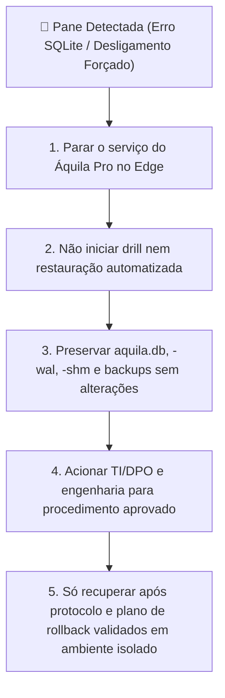

# 💾 Guia de 1 Página: Backup & Disaster Recovery (DR) — Áquila Pro Edge

> **Destinado a:** Administrador de TI / Suporte Local da Escola  
> **Versão de Liberação:** `v2.1.0-rc.10` | **Status de restauração:** BLOQUEADA; RTO não demonstrado

---

## ⚡ 1. Comandos Essenciais (Terminal / PowerShell)

| Operação Desejada | Comando PowerShell | Objetivo Operacional |
| :--- | :--- | :--- |
| **Backup Diário Imediato** | `pnpm backup:edge` | Executa checkpoint do WAL, gera snapshot atômico, assina SHA-256 e cifra com AES-256-GCM. |
| **Restore Drill** | **SUSPENSO — não executar** | A rota de restore permanece desabilitada até protocolo seguro e recuperação após falha serem demonstrados em ambiente isolado. |
| **Restauração real** | **BLOQUEADA — não executar** | Não substitua `aquila.db` nem remova arquivos `-wal`/`-shm`; preserve o banco atual e os backups e escale para procedimento aprovado. |
| **Bateria automatizada de DR** | `pnpm test:dr:full` — somente ambiente isolado | Suíte de teste não é autorização nem evidência suficiente para restaurar uma instalação escolar. |

---

## 🛡️ 2. Como o Áquila Responde às 3 Perguntas Críticas de Auditoria

1. **Qual foi o último estado válido do banco?**
   - O arquivo `manifest.json` incorporado a cada backup armazena o timestamp exato, a versão do software e o censo exato de tuplas: total de alunos (`students`), turmas (`classes`), presenças registradas (`attendance_logs`) e auditorias (`zero_bypass_audits`).
2. **Quanto tempo leva para restaurar?**
   - Não demonstrado. Não há RTO validado para recuperação segura; não prometa prazo de restauração.
3. **Como se prova que o backup é íntegro e restaurável?**
   - **Tripla Barreira de Verificação:**
     - *Autenticidade Criptográfica:* Auth Tag do **AES-256-GCM** rejeita imediatamente qualquer arquivo adulterado ou chave incorreta.
     - *Integridade Binária:* Hash **SHA-256** do snapshot SQLite calculado e comparado bit a bit.
     - *Integridade Estrutural:* `PRAGMA integrity_check` é necessário, mas não demonstra sozinho que promoção/rollback são seguros sob WAL, bloqueio ou interrupção.

---

## ⏰ 3. Agendamento Automático no Windows (Task Scheduler)

Para automatizar o backup diário às **23:00** sem intervenção humana:

```powershell
# Executar como Administrador no PowerShell do Servidor:
$Action = New-ScheduledTaskAction -Execute "node" -Argument "C:\aquila\scripts\backup_edge.cjs --dest C:\AquilaPro\backups --dest-secondary D:\AquilaBackups"
$Trigger = New-ScheduledTaskTrigger -Daily -At 23:00
$Principal = New-ScheduledTaskPrincipal -UserId "SYSTEM" -LogonType ServiceAccount -RunLevel Highest
Register-ScheduledTask -TaskName "AquilaPro_DailyBackup" -Action $Action -Trigger $Trigger -Principal $Principal -Description "Rotina Oficial de Backup Criptografado do Áquila Pro"
```

---

## 🔄 4. Política de Retenção GFS (Grandfather-Father-Son)

O sistema gerencia automaticamente o ciclo de vida dos backups no disco:
- **7 Backups Diários:** Mantidos na pasta primária `C:\AquilaPro\backups`.
- **4 Backups Semanais:** Exportados automaticamente no domingo.
- **12 Backups Mensais:** Arquivados no último dia do mês para fins regulatórios e contábeis.
- **Cópia Secundária (USB/NAS):** Gravada simultaneamente na unidade externa `D:\AquilaBackups` configurada.

---

## 🚨 5. Pane elétrica ou suspeita de corrupção — recuperação bloqueada



---
*Assinado: Córtex de Infraestrutura & Governança Soberana Áquila Pro v2.1.0*
