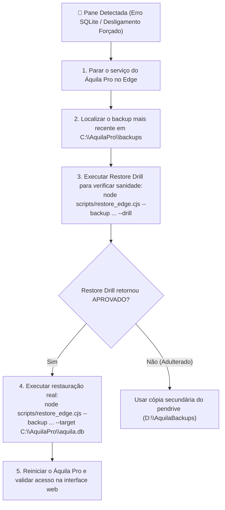

# 💾 Guia de 1 Página: Backup & Disaster Recovery (DR) — Áquila Pro Edge

> **Destinado a:** Administrador de TI / Suporte Local da Escola  
> **Versão de Liberação:** `v2.1.0-rc.10` | **Tempo Médio de Restauração:** $< 500\text{ ms}$

---

## ⚡ 1. Comandos Essenciais (Terminal / PowerShell)

| Operação Desejada | Comando PowerShell | Objetivo Operacional |
| :--- | :--- | :--- |
| **Backup Diário Imediato** | `pnpm backup:edge` | Executa checkpoint do WAL, gera snapshot atômico, assina SHA-256 e cifra com AES-256-GCM. |
| **Simulação Semanal (Restore Drill)** | `pnpm restore:drill --backup "<arquivo.bak>" --drill` | Descriptografa e testa o banco em sandbox isolado sem alterar o banco ao vivo. Retorna relatório de integridade em $< 1\text{ s}$. |
| **Restauração Real de Emergência** | `node scripts/restore_edge.cjs --backup "<arquivo.bak>" --target "C:\AquilaPro\aquila.db"` | Substitui o banco corrompido pelo backup validado, limpa arquivos residuais de WAL e confere integridade lógica. |
| **Bateria Completa de Testes de DR** | `pnpm test:dr:full` | Roda suíte automatizada de 6 fases: WAL, AuthTag, rejeição a adulteração, drill, pane forçada e retenção GFS. |

---

## 🛡️ 2. Como o Áquila Responde às 3 Perguntas Críticas de Auditoria

1. **Qual foi o último estado válido do banco?**
   - O arquivo `manifest.json` incorporado a cada backup armazena o timestamp exato, a versão do software e o censo exato de tuplas: total de alunos (`students`), turmas (`classes`), presenças registradas (`attendance_logs`) e auditorias (`zero_bypass_audits`).
2. **Quanto tempo leva para restaurar?**
   - Em testes reais com banco escolar de 466 alunos, o tempo de restauração foi de **440 milissegundos** (meta: $< 120\text{ s}$).
3. **Como se prova que o backup é íntegro e restaurável?**
   - **Tripla Barreira de Verificação:**
     - *Autenticidade Criptográfica:* Auth Tag do **AES-256-GCM** rejeita imediatamente qualquer arquivo adulterado ou chave incorreta.
     - *Integridade Binária:* Hash **SHA-256** do snapshot SQLite calculado e comparado bit a bit.
     - *Integridade Estrutural:* Execução obrigatória de `PRAGMA integrity_check` antes da liberação operacional.

---

## ⏰ 3. Agendamento Automático no Windows (Task Scheduler)

Para automatizar o backup diário às **23:00** sem intervenção humana:

```powershell
# Executar como Administrador no PowerShell do Servidor:
$Action = New-ScheduledTaskAction -Execute "node" -Argument "C:\aquila\scripts\backup_edge.cjs --dest C:\AquilaPro\backups --dest-secondary D:\AquilaBackups"
$Trigger = New-ScheduledTaskTrigger -Daily -At 23:00
$Principal = New-ScheduledTaskPrincipal -UserId "SYSTEM" -LogonType ServiceAccount -RunLevel Highest
Register-ScheduledTask -TaskName "AquilaPro_DailyBackup" -Action $Action -Trigger $Trigger -Principal $Principal -Description "Rotina Oficial de Backup Criptografado do Áquila Pro"
```

---

## 🔄 4. Política de Retenção GFS (Grandfather-Father-Son)

O sistema gerencia automaticamente o ciclo de vida dos backups no disco:
- **7 Backups Diários:** Mantidos na pasta primária `C:\AquilaPro\backups`.
- **4 Backups Semanais:** Exportados automaticamente no domingo.
- **12 Backups Mensais:** Arquivados no último dia do mês para fins regulatórios e contábeis.
- **Cópia Secundária (USB/NAS):** Gravada simultaneamente na unidade externa `D:\AquilaBackups` configurada.

---

## 🚨 5. Procedimento Operacional em Caso de Pane Elétrica ou Disco Corrompido



---
*Assinado: Córtex de Infraestrutura & Governança Soberana Áquila Pro v2.1.0*
