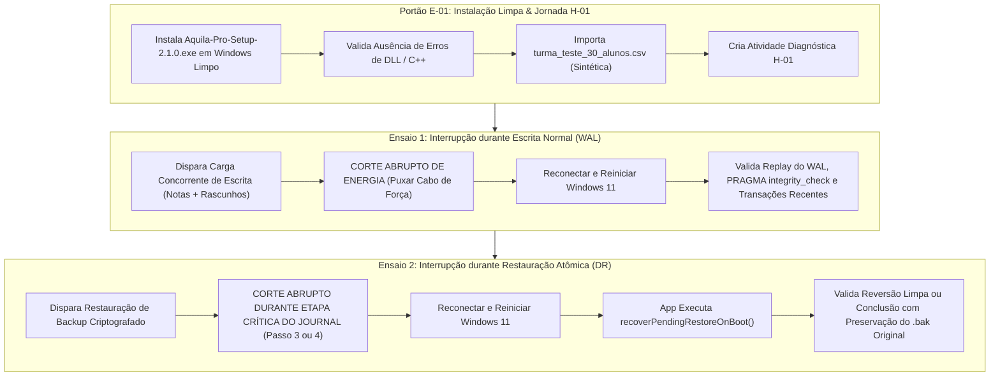

# 🔌 Áquila Pro — Protocolo de Teste de Bancada e Drill Físico de Corte de Energia
### Validação em Máquina Limpa (Windows 11 sem Dev-Tools) e Resiliência Transacional SQLite (Ensaios 1 e 2)

> **Versão de Referência:** `v2.1.0-rc.15` (SHA de Integração `b4a77d98c141cb51c8682b48bb5c6a3b6408ab91`)  
> **Finalidade:** Pré-requisito técnico obrigatório para liberação do Gate P4 (Piloto H-01 em Campo)  
> **Responsáveis Técnicos:** Tech Lead de Engenharia (`andrejrunb`) e Administrador de Infraestrutura/TI Escolar  
> **Governança:** [`AGENTS.md` (Constitution v2.1)](file:///c:/aquila/AGENTS.md) — Zero Perda de Dados Acadêmicos, LGPD Art. 14 e Integridade SQLite  

---

## 🎯 1. Objetivo, Escopo e Princípios de Segurança

Este protocolo estabelece o roteiro experimental padronizado e auditável para a **Homologação em Bancada Física**:
1. **Validação em Máquina Limpa (Portão E-01):** Instalação do pacote oficial compilado do Áquila Pro em um computador com Windows 11 recém-formatado, **sem** Node.js, Python, Git ou Visual Studio, comprovando que o instalador é 100% autocontido e resolve nativamente todas as bibliotecas C++ (`better-sqlite3`, `MSVCP140.dll`).
2. **Execução da Jornada H-01:** Execução do fluxo pedagógico completo (importação de turma sintética de 30 alunos, criação de atividade diagnóstica, preenchimento discente e geração de evidência).
3. **Dois Ensaios Físicos de Recuperação Distintos (Portão E-02):**
   - **Ensaio 1 (Interrupção durante Escrita Normal):** Observa a recuperação de transações concorrentes e o comportamento do WAL SQLite (`aquila.db-wal`).
   - **Ensaio 2 (Interrupção durante Etapas da Restauração):** Observa o jornal atômico de recuperação (`recovery_journal.json`), a preservação do backup original (`.bak`), a idempotência da transição entre etapas e a retomada limpa via `recoverPendingRestoreOnBoot()`.
   > ⚠️ **Atenção:** Um ensaio não substitui o outro. Ambos devem ser executados e aprovados de forma independente.

---

## 🛡️ 2. Salvaguardas Obrigatórias de Segurança e Pré-Requisitos

Antes de iniciar qualquer ensaio físico, o técnico de bancada deve verificar e atestar:

| Salvaguarda | Regra Obrigatória |
| :--- | :--- |
| **Equipamento Dedicado** | O ensaio DEVE ser realizado em computador de bancada de testes especificamente autorizado, **nunca** em máquina de uso pessoal ou administrativo da escola. |
| **Dados Exclusivamente Sintéticos** | É expressamente PROIBIDO o uso de dados reais de alunos, professores ou funcionários da escola. Toda a massa de dados deve ser gerada sinteticamente (`turma_teste_30_alunos.csv`). |
| **Backup Externo Off-Disk** | Uma cópia conhecida, íntegra e verificável do banco e da base de teste deve ser mantida em mídia externa desconectada (pendrive isolado), fora do disco testado. |
| **Integridade Física e Elétrica** | O ensaio é conduzido **sem abrir o gabinete e sem manipular componentes elétricos internos**. O corte é executado na tomada ou na chave do filtro de linha externo. |
| **Distinção de Nobreak vs. Queda de Alimentação** | Se houver nobreak, retirar a energia da tomada da parede testa a bateria do nobreak, NÃO uma perda abrupta de alimentação do computador. Para testar o computador, deve-se desconectar o cabo de força **diretamente entre o PC e o nobreak/fonte**. |
| **Registro de Hardware e Cache** | Registrar marca/modelo da máquina, CPU, modelo de SSD (NVMe ou SATA), versão exata do SO e política de cache do Windows (*Write-cache buffer flushing*). |
| **Critérios de Interrupção Imediata (Abort)** | Abortar o ensaio imediatamente caso ocorra: superaquecimento do hardware, falha elétrica externa não controlada, ruídos anormais no disco, ou corrupção irremediável do SO Windows. |

---

## 💻 3. Ficha Técnica da Máquina de Bancada (Registro Obrigatório)

```text
[REGISTRO DE BANCADA FÍSICA]
Data/Hora: _____________________ Local: _________________________________________
Fabricante / Modelo da Máquina: _________________________________________________
Processador (CPU): ____________________ Memória RAM: ________ GB
Armazenamento (SSD / NVMe / SATA): ____________________ Modelo: _________________
Política de Cache de Escrita do Windows: [ ] Habilitada  [ ] Com Buffer Flushing
Sistema Operacional: Windows 11 Pro 64-bit | Build / Versão: ____________________
Software Instalado: Windows Limpo (Sem Node, Sem Python, Sem Git, Sem VS Code)
Instalador Avaliado: Aquila-Pro-Setup-2.1.0.exe (SHA-256 verificado: ____________)
Alimentação: [ ] Direta na Tomada  [ ] Nobreak (Desconexão entre PC e Nobreak)
```

---

## 📋 4. Roteiro de Execução: Dois Ensaios de Recuperação



---

### 4.1. Portão E-01: Instalação e Execução da Jornada H-01 em Máquina Limpa

1. Conecte o pendrive com o executável `Aquila-Pro-Setup-2.1.0.exe` na máquina limpa.
2. Execute o instalador como usuário padrão (sem privilégios elevados de desenvolvedor).
3. Verifique se o assistente conclui sem exibir solicitações de dependências externas (`MSVCP140.dll`, `vcruntime140.dll`).
4. Inicie o aplicativo pelo atalho na Área de Trabalho.
5. Inspecione `%APPDATA%\aquila-pro\logs\boot.log`:
   - Confirme: `[BOOT] SQLite Engine initialized successfully in WAL mode`.
   - Confirme: `[SECURITY] AQUILA_AUTH_SECRET soberano de borda gerado e persistido.` (quando ausente `.env`).
6. **Jornada H-01:**
   - Efetue login com as credenciais iniciais de demonstração segura.
   - Importe a turma sintética `turma_teste_30_alunos.csv`.
   - Crie 1 atividade diagnóstica de 10 questões BNCC.
   - Abra o portal discente local (porta 3000) e preencha respostas para 5 alunos sintéticos, ativando salvamento de rascunhos.

---

### 4.2. Ensaio 1: Interrupção Física durante Escrita Normal (Comportamento WAL)

> **O que observa:** Recuperação atômica de transações, integridade do arquivo WAL (`aquila.db-wal`), ausência de tuplas corrompidas e consistência das transações comitadas imediatamente antes da queda.

1. **Ponto Exato da Interrupção:** Dispare a rotina de submissão em lote de notas e gabaritos dos 30 alunos via script ou interface.
2. Durante o pico de escrita no disco (indicador visual ativo e gravação de tuplas):
   > ⚡ **AÇÃO FÍSICA:** Desconecte abruptamente o cabo de força AC da fonte do computador (entre o PC e a tomada/nobreak).
3. Aguarde 30 segundos com o computador totalmente desenergizado.
4. Reconecte o cabo de força e ligue o computador.
5. Inicie o Áquila Pro e verifique:
   - **Replay do WAL:** O log `%APPDATA%\aquila-pro\logs\boot.log` deve indicar que o SQLite realizou o replay limpo do WAL.
   - **`PRAGMA integrity_check`:** Retorna estritamente `ok`.
   - **`PRAGMA foreign_key_check`:** Retorna `0` inconsistências.
   - **Transações Recentes:** As transações que receberam commit antes do corte permanecem gravadas; as transações que estavam no meio da execução no momento exato do corte são revertidas integralmente (sem registros parciais órfãos).

---

### 4.3. Ensaio 2: Interrupção Física durante Etapa da Restauração (Journal DR)

> **O que observa:** Resiliência do protocolo transacional de 7 etapas do `SQLiteDisasterRecoveryService`, leitura de `recovery_journal.json`, preservação do banco original (`aquila.db.bak`) e retomada segura sem perda de dados na inicialização (`recoverPendingRestoreOnBoot()`).

1. **Preparação:** Configure um backup criptografado válido (`aquila-backup-valid.enc`) em diretório isolado.
2. **Ponto Exato da Interrupção:** Inicie o comando de restauração de backup criptografado.
3. No momento em que o journal estiver ativo (durante a Fase 3 `BACKING_UP_CURRENT` ou Fase 4 `REPLACING_ACTIVE_DATABASE`):
   > ⚡ **AÇÃO FÍSICA:** Desconecte abruptamente o cabo de força AC do computador.
4. Aguarde 30 segundos com a máquina desenergizada.
5. Reconecte a alimentação e reinicie o Windows 11.
6. Inicie o Áquila Pro e verifique:
   - O serviço detecta `recovery_journal.json` em estado pendente.
   - Executa `recoverPendingRestoreOnBoot()`.
   - **Se a interrupção ocorreu antes da substituição completa:** O banco original `aquila.db.bak` é restaurado com integridade total e o journal é concluído como revertido com segurança.
   - **Se a interrupção ocorreu após a gravação da nova base:** A nova base é checada com `integrity_check`; se íntegra, é ativada; se corrompida, o fallback para `aquila.db.bak` é acionado automaticamente.
   - O aplicativo nunca inicializa em estado nulo ou banco de 0 bytes.

---

## 📊 5. Critérios Objetivos de Sucesso (Checklist de Aceite da Bancada)

| ID | Item de Verificação | Critério de Aceite Definitivo | Resultado |
| :---: | :--- | :--- | :---: |
| **C-01** | Instalação Autocontida (E-01) | Instala e inicializa no Windows 11 limpo sem erros de DLLs C++ ou dependência externa. | `[  ] CONFORME` |
| **C-02** | Operação 100% Offline | Importação, planejamento e resolução de atividades operam sem Internet pública. | `[  ] CONFORME` |
| **C-03** | Segredo Soberano Automático | `AQUILA_AUTH_SECRET` gerado de forma autônoma e segura no primeiro boot em `%APPDATA%`. | `[  ] CONFORME` |
| **C-04** | Ensaio 1 — Replay de WAL | SQLite recupera o WAL sem tuplas corrompidas; `PRAGMA integrity_check` retorna `ok`. | `[  ] CONFORME` |
| **C-05** | Ensaio 1 — Transações Atômicas | Transações completadas persistem; transações interrompidas não deixam lixo órfão. | `[  ] CONFORME` |
| **C-06** | Ensaio 2 — Journal de DR | `recoverPendingRestoreOnBoot()` resolve journal pendente sem perda do `.bak` original. | `[  ] CONFORME` |
| **C-07** | Ensaio 2 — Sem Banco Zero-Byte | O arquivo ativo `aquila.db` nunca é corrompido ou zerado após corte durante DR. | `[  ] CONFORME` |
| **C-08** | Auditoria Zero-Bypass | Registros de auditoria pós-boot registram o evento de recuperação sem evasão de log. | `[  ] CONFORME` |

---

## ✍️ 6. Termo de Homologação de Bancada (HITL — Assinatura Tripartite)

O ensaio físico só é homologado mediante assinatura unânime e registro formal das evidências:

```text
[TERMO DE HOMOLOGAÇÃO DE TESTE DE BANCADA H-01]

Data do Ensaio: _____ / _____ / 2026
Duração Total dos Ensaios: ________ minutos
Hash SHA-256 do Binário Testado: __________________________________________________

Veredito Técnico dos Ensaios:
  Ensaio 1 (Corte em Escrita Normal / WAL):           [ ] APROVADO   [ ] REPROVADO
  Ensaio 2 (Corte em Restauração / Journal DR):       [ ] APROVADO   [ ] REPROVADO
  Portão E-01 (Instalação Limpa sem Dev-Tools):      [ ] APROVADO   [ ] REPROVADO

Assinaturas Obrigatórias:

1. Administrador de Redes / TI Escolar (Executor da Bancada):
   Nome: ______________________________________ Assinatura: _______________________

2. Tech Lead de Engenharia de Software (andrejrunb):
   Nome: ______________________________________ Assinatura: _______________________

3. Encarregado de Dados / DPO (Validação de Dados Sintéticos):
   Nome: ______________________________________ Assinatura: _______________________

Decisão de Liberação:
[ ] LIBERADO PARA HOMOLOGAÇÃO OPERACIONAL EM CAMPO (GATE P4)
[ ] BLOQUEADO — REQUER REMEDIAÇÃO DE ENGENHARIA ANTES DE NOVO DRILL
```
