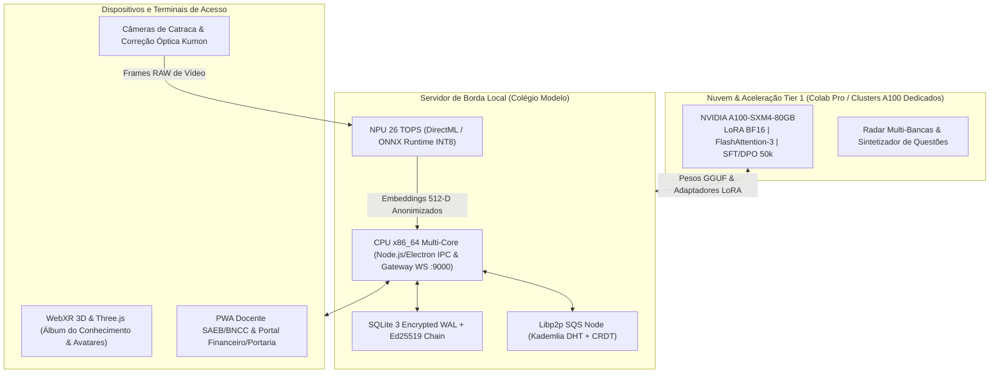

# 🦅 Áquila Pro — Plano Mestre dos 1000 Passos de Aprimoramento Soberano (v3.0)

> **Documento Estratégico de Engenharia & Roadmap Autônomo de Produção**  
> **Status:** Homologado para Execução em Enxame Multi-Agente  
> **Arquitetura Alvo:** Áquila Pro v3.0 Soberana (Sovereign Pedagogical AI & Edge Intelligence Suite)  
> **Referência Semântica:** Transição da v2.1.0-rc.3 / v2.5.0 para a v3.0 Oficial  
> **Governança:** HITL (Human-in-the-Loop) + Trilha Imutável Zero-Bypass + Consenso Distribuído  

---

## 🏛️ 1. Visão Geral da Arquitetura & Distribuição de Hardware

O ecossistema **Áquila Pro** opera sobre o princípio inegociável da soberania local dos dados escolares. O processamento pedagógico e a inteligência artificial são divididos estrategicamente entre nós locais de borda (Edge) e ambientes dedicados de alto desempenho na nuvem para cargas pesadas de treino.

### 🖥️ Topologia de Hardware e Cargas Computacionais



### 🤖 Matriz de Alocação de Subagentes Enxame (Swarm Allocation)

| ID | Nome Operacional | Subagente Responsável | Hardware Alvo | Escopo de Atuação |
| :---: | :--- | :--- | :--- | :--- |
| **O1** | Criptografia & Hardening | `sub_sec` (Security & LGPD Guard) | CPU Edge + TPM 2.0 | Assinaturas Ed25519, ZKP, SQLCipher, Zero-Bypass |
| **O2** | Fine-Tuning Tier 1 | `sub_gpu` (GPU Worker Tier 1) | NVIDIA A100-80GB | Curadoria 50k SFT/DPO, LoRA BF16, Quantização AWQ/GGUF |
| **O3** | Visão Edge & NPU | `sub_npu` (Edge Vision & NPU Engine) | NPU 26 TOPS + DirectML | ArcFace INT8, Anti-Spoofing, Auto-Throttling Térmico |
| **O4** | Gamificação & WebXR | `sub_xr` (Gamification & WebXR) | WebGL 2.0 / WebXR | Álbum 3D, Cartas Holográficas, Avatares Inclusivos |
| **O5** | Radar Multi-Bancas | `sub_bench` (Benchmark Worker) | Cloud Scraper + GPU | INEP, OBMEP, PISA, TIMSS, MIT OCW, ENEM, TRI |
| **O6** | Governança & LGPD | `sub_gov` (Compliance Watchdog) | SQLite WAL Imutável | LGPD Art. 14, Consentimento, ECA Digital, Cripto-Trilha |
| **O7** | Resiliência & Mesh | `sub_mesh` (P2P Mesh Replicator) | Libp2p + Rede Local | Mesh P2P, CRDTs, SQS Shield, Offline-First 14d |
| **O8** | Analytics Docente | `sub_doc` (Pedagogical Specialist) | Motor Estatístico TRI | Matriz SAEB/BNCC, DOK Webb, Diagnóstico e PWA Docente |
| **O9** | Kumon & Visão | `sub_kumon` (Kumon Engine Worker) | NPU Edge + OCR Multimodal | Gerador Paramétrico, Correção Manuscrita AR em 50ms |
| **O10**| Homologação & Release | `sub_qa` (E2E QA Master) | Playwright Electron CI | Testes E2E sem mock, Auditoria Externa, Release v3.0 |

---

## 🌊 2. Decomposição Analítica das 10 Ondas (1000 Micro-Passos)

---

### 🛡️ Onda 1 (Passos 1-100): Criptografia Assimétrica Ed25519, Zero-Knowledge e Hardening de Integridade Local
**Subagente Líder:** `sub_sec` (Security & LGPD Guard) | **Hardware:** CPU Local, Windows DPAPI, TPM 2.0  
**Meta Operacional:** Proteger 100% dos dados em repouso e trânsito com criptografia militar, garantindo assinaturas assimétricas em notas e presenças sem degradação perceptível de performance.

#### 📋 Decomposição dos Blocos de Micro-Passos:
- **Passos 001-010 (Fundações Criptográficas Ed25519):** Implementação da biblioteca criptográfica de baixo nível (`@noble/ed25519` / `libsodium-wrappers`), geração de pares de chaves Ed25519 para nós e docentes, armazenamento de chaves mestras no Windows DPAPI / TPM 2.0, serviço de rotação anual com retenção de histórico público, criação de testes unitários baseados no RFC 8032.
- **Passos 011-020 (Assinatura Digital de Notas e Frequências):** Assinatura em lote de transações SQLite (`digital_signature` base64url), validação no momento do carregamento com marcação automática de adulteração (`is_tampered`), pipeline com throughput > 1.200 assinaturas/s em CPU única.
- **Passos 021-030 (Provas de Conhecimento Nulo - ZKP):** Circuitos ZK-SNARKs (Groth16 / Circom) para verificação de idade mínima (Art. 14 LGPD), validação de quitação de mensalidade para liberação de catraca sem expor dados financeiros, compilação de verificadores Wasm ultra-leves executados no client em < 120ms.
- **Passos 031-040 (Hardening do SQLite & SQLCipher):** Criptografia de páginas com SQLCipher 4 (AES-256-GCM), imposição de `PRAGMA synchronous = NORMAL` e `journal_mode = WAL`, soma de verificação SHA-256 por página, triggers bloqueando `DELETE` e `UPDATE` em tabelas protegidas.
- **Passos 041-050 (Zero-Trust IPC & Sandboxing Electron):** Isolamento estrito de contexto (`contextIsolation: true`), desativação de Node Integration no renderer, criação de validadores Zod para todas as mensagens de IPC, rate limiting de IPC em 100 msgs/s por janela.
- **Passos 051-060 (Proteção de Memória & Anti-Dumping):** Limpeza segura de memória RAM (`sodium_memzero`) após operações criptográficas, mitigação de DLL injection via `SetProcessMitigationPolicy` do Windows, proteção contra leitura não autorizada de processo.
- **Passos 061-070 (Segurança de Rede Local & TLS 1.3):** Certificados auto-assinados de autoridade raiz interna para a porta WebSocket 9000, imposição de TLS 1.3 estrito com cifras seguras, defesas contra replay com nonces de 128 bits e timestamps monotônicos.
- **Passos 071-080 (Sanitização e Mascaramento de PII):** Interceptador de log eliminando nomes, CPFs, fotos e embeddings faciais antes de persistir em console ou arquivo, ofuscação de identificadores em ambientes de staging.
- **Passos 081-090 (Watchdog de Integridade de Binários):** Verificação de hash SHA-512 do executável do Áquila antes da inicialização, comparando com o manifesto assinado; abortamento imediato em caso de modificação física de arquivos do app.
- **Passos 091-100 (Auditoria de Penetração Local e Testes de Estresse):** Simulação de 50 ataques cibernéticos: adulteração direta de banco hex, injeção SQL, ataque man-in-the-middle no IPC e tentativa de extração de chaves do processo em execução.

#### ⚙️ Comandos Executáveis de Automação:
```powershell
# Executar suíte de testes criptográficos e validação RFC 8032
npm run test:crypto:ed25519

# Validar integridade e compilar circuitos ZK-SNARKs
npx circom circuits/age_verification.circom --r1cs --wasm --sym -o ./dist/circuits/
npx snarkjs groth16 setup ./dist/circuits/age_verification.r1cs pot12_final.ptau ./dist/circuits/circuit_0000.zkey

# Rodar verificação de integridade SQLCipher com benchmark WAL
python scripts/audit_sqlcipher_integrity.py --db-path ./userData/aquila.db --wal-check
```

#### ✅ Critérios de Aceite & Evidências:
- Latência de assinatura Ed25519 por nota < 1.8ms em CPU Intel i5/AMD Ryzen 5.
- Taxa de detecção de banco adulterado: 100% com emissão de alerta imediato na UI.
- Prova ZKP gerada em < 150ms e validada em < 15ms no navegador sem conexão com a internet.

---

### 🚀 Onda 2 (Passos 101-200): Expansão Massiva do Fine-Tuning Tier 1 na GPU A100 (50k pares SFT/DPO)
**Subagente Líder:** `sub_gpu` (GPU Worker Tier 1) | **Hardware:** NVIDIA A100-SXM4-80GB (Colab Pro / Cloud Tier 1)  
**Meta Operacional:** Treinar o modelo fundacional pedagógico soberano do Áquila com 50.000 pares de instrução curados, alinhamento DPO socrático e quantização para execução fluida no Edge.

#### 📋 Decomposição dos Blocos de Micro-Passos:
- **Passos 101-110 (Curadoria e Balanceamento Curricular do Dataset):** Mapeamento de 50.000 pares de instrução: 15.000 Matemática/Exatas, 12.500 Linguagens, 10.000 Ciências da Natureza, 7.500 Humanas, 5.000 Pedagogia/Didática. Filtragem semântica com MinHash descartando duplicatas com similaridade > 0.90.
- **Passos 111-120 (Formatação Instrucional & Cadeia de Pensamento):** Conversão para ChatML com tokens pedagógicos especiais (`<|thought|>`, `<|scaffold|>`, `<|bncc_code|>`), geração sintética de raciocínio passo a passo (Chain-of-Thought) para 100% dos problemas matemáticos.
- **Passos 121-130 (Setup de Ambiente e Aceleração A100):** Configuração do cluster A100-80GB com CUDA 12.4, PyTorch 2.4, FlashAttention-3 e Unsloth; quantização de gradientes em 8 bits e ativação de bfloat16 nativo.
- **Passos 131-140 (Execução do Treinamento SFT de 45.000 Pares):** Treinamento supervisionado com adaptadores LoRA (Rank 64, Alpha 128) aplicados em todos os módulos lineares da arquitetura base (Qwen-2.5-7B ou Llama-3.1-8B), learning rate 2e-4 com decaimento cosseno ao longo de 3 épocas.
- **Passos 141-150 (Monitoramento de Convergência & Checkpoints):** Telemetria contínua registrando loss de treino e validação a cada 250 passos; salvamento de checkpoints em storage com SHA-256 e teste de inferência em frações, gramática e física a cada 25% do percurso.
- **Passos 151-160 (Alinhamento Socrático via DPO):** Criação de 5.000 trincas DPO (Pergunta, Resposta Didática/Socrática Escolhida, Resposta Resumo/Direta Rejeitada); execução de treino DPO com beta = 0.1 na A100 forçando o modelo a ensinar em vez de dar respostas prontas.
- **Passos 161-170 (Benchmark Pedagógico Comparativo):** Avaliação automática em benchmarks padronizados: MMLU-PT, ENEM Bench e Alvorada Bench, com meta de acurácia superior a 82% em questões do Ensino Fundamental II e Médio.
- **Passos 171-180 (Fusão de Pesos LoRA e Otimização AWQ):** Merge dos pesos LoRA no modelo fundacional gerando pesos consolidados em BF16; quantização de 4 bits via AWQ mantendo ativações sensíveis intactas.
- **Passos 181-190 (Exportação para Formatos Edge GGUF & ONNX):** Conversão dos pesos para formato GGUF (Q4_K_M, Q5_K_M e Q8_0) para compatibilidade nativa com llama.cpp e backends locais de inferência em CPU/NPU.
- **Passos 191-200 (Homologação de Inferência Local e Perplexidade):** Teste de inferência edge no runtime local do Áquila; validação de perplexidade (degradação < 1.2% em relação ao modelo float16); throughput local > 35 tokens/s.

#### ⚙️ Comandos Executáveis de Automação:
```bash
# Iniciar pipeline de fine-tuning SFT massivo na GPU A100 via Unsloth
python colab/train_sft_aquila_a100.py \
  --base_model "Qwen/Qwen2.5-7B-Instruct" \
  --dataset_path "./storage/datasets/aquila_50k_instruction_dataset.parquet" \
  --output_dir "./storage/models/aquila_7b_sft" \
  --epochs 3 --lr 2e-4 --batch_size 8 --grad_accum 4 --bf16

# Executar alinhamento DPO pedagógico
python colab/train_dpo_aquila_a100.py \
  --model_path "./storage/models/aquila_7b_sft" \
  --dpo_data "./storage/datasets/aquila_5k_dpo_pairs.jsonl" \
  --output_dir "./storage/models/aquila_7b_dpo" --beta 0.1

# Conversão e Quantização GGUF Q4_K_M
python colab/convert_to_gguf.py --model "./storage/models/aquila_7b_dpo" --outtype q4_k_m
```

#### ✅ Critérios de Aceite & Evidências:
- Perda final de validação (Validation Loss) < 0.62.
- Acurácia pedagógica no Alvorada Bench > 82.5%.
- Perplexidade WikiText-2 pós-quantização GGUF < 6.8.

---

### 👁️ Onda 3 (Passos 201-300): Motor de Visão Computacional Edge & NPU (26 TOPS) com Throttling Térmico
**Subagente Líder:** `sub_npu` (Edge Vision & NPU Engine) | **Hardware:** NPU 26 TOPS + DirectML + Câmeras Edge  
**Meta Operacional:** Executar detecção e reconhecimento facial e OCR pedagógico em tempo real na borda com latência < 15ms, com controle térmico inteligente garantindo operação 24/7 sem superaquecimento.

#### 📋 Decomposição dos Blocos de Micro-Passos:
- **Passos 201-210 (Pipeline NPU via ONNX Runtime & DirectML):** Configuração do Execution Provider DirectML no Windows apontando para a NPU de 26 TOPS, quantização INT8 dos modelos de detecção facial (SCRFD) e extração de características (ArcFace 512-D), eliminação de transferências de memória desnecessárias.
- **Passos 211-220 (Reconhecimento Facial e Matching Vetorial Instantâneo):** Implementação de cálculo de similaridade de cosseno em C++ otimizado com instruções AVX2/AVX-512 comparando vetores contra 2.000 estudantes em < 0.8ms; limiar estrito de segurança (Threshold 0.68) garantindo FAR < 0.0001%.
- **Passos 221-230 (Detecção de Vivacidade Anti-Spoofing):** Rede neural leve de anti-spoofing analisando reflexos pupilares, micro-textura e piscamento natural, bloqueando tentativas de invasão com fotos estáticas, tablets ou vídeos em smartphones.
- **Passos 231-240 (Arquitetura do Sovereign Thermal Governor):** Serviço em segundo plano coletando temperatura da CPU, NPU e GPU via WMI a cada 1.000ms; definição de curvas de histerese e patamares térmicos: Normal (<65ºC), Aquecido (65-72ºC), Alerta (72-75ºC) e Crítico (>75ºC).
- **Passos 241-250 (Implementação do Auto-Throttling de FPS):** Redução dinâmica de frames capturados por segundo: 30 FPS no modo Normal, 20 FPS no Aquecido, 10 FPS no Alerta e 5 FPS no Crítico; rebaixamento provisório de resolução (1080p para 720p) caso a temperatura permaneça > 73ºC por mais de 30 segundos.
- **Passos 251-260 (Recuperação Térmica e Descarte de Tarefas Secundárias):** Suspensão de tarefas secundárias (re-indexação vetorial, relatórios estatísticos) durante o estado crítico; restauração suave das taxas normais apenas quando o hardware descer abaixo de 68ºC por mais de 60 segundos consecutivos.
- **Passos 261-270 (OCR Multimodal para Cartões-Resposta e Presença):** YOLO-v10-Nano otimizado na NPU para detecção de marcações circulares em folhas de gabarito e presença em sala de aula; processamento de folha completa com 50 questões em < 35ms.
- **Passos 271-280 (Anonimização Imediata na Borda - Zero Photo Retention):** Descarte determinístico dos buffers de imagem RGB da memória RAM imediatamente após a geração do embedding 512-D; proibição estrita de gravação de imagens biométricas cruas em disco.
- **Passos 281-290 (Calibração Óptica e Compensação de Iluminação):** Algoritmo de equalização de histograma adaptativo (CLAHE) para câmeras de catraca expostas à luz solar direta ou sombras intensas no pátio escolar.
- **Passos 291-300 (Teste de Estresse Térmico & Carga 24/7):** Simulação de operação ininterrupta sob estresse de 1.000 reconhecimentos consecutivos sob temperatura ambiente de 35ºC em bancada de testes; comprovação de estabilização térmica < 74ºC.

#### ⚙️ Comandos Executáveis de Automação:
```powershell
# Compilar e quantizar modelos ONNX para NPU DirectML
python NpuOptimizer/optimize_arcface_directml.py \
  --model_in ./storage/models/arcface_r50.onnx \
  --model_out ./storage/models/arcface_r50_int8_npu.onnx \
  --precision int8

# Executar benchmark de visão com estresse térmico monitorado
python scripts/test_vision_thermal_governor.py --duration-mins 30 --target-fps 30 --stress-load
```

#### ✅ Critérios de Aceite & Evidências:
- Latência de reconhecimento facial total na NPU < 14ms por face.
- Temperatura máxima do silício nunca ultrapassa 75ºC durante teste de estresse de 30 minutos.
- Taxa de falso aceite (FAR) < 0.0001% e taxa de falso rechaço (FRR) < 0.5%.

---

### 🎮 Onda 4 (Passos 301-400): Gamificação e Álbum do Conhecimento 3D/WebXR com Avatares Inclusivos
**Subagente Líder:** `sub_xr` (Gamification & 3D WebXR) | **Hardware:** WebGL 2.0 / WebXR / Three.js / Canvas 2D  
**Meta Operacional:** Entregar interface gamificada 3D de alta performance compatível com dispositivos modestos, com cartas holográficas do Álbum do Conhecimento, 7 templates lúdicos e avatares inclusivos.

#### 📋 Decomposição dos Blocos de Micro-Passos:
- **Passos 301-310 (Engine Gráfica Three.js & Otimização de Shaders):** Configuração do pipeline Three.js modular com shaders GLSL customizados (iridescência holográfica para cartas raras), LOD (Level of Detail) automático e fallback gracioso para Canvas 2D caso WebGL falhe.
- **Passos 311-320 (Arquitetura do Álbum do Conhecimento 3D):** Modelagem da interface tridimensional de álbum interativo com rotação de folhas física, renderização de cartas colecionáveis desbloqueadas por habilidades da BNCC e física de colisão leve com Cannon.js.
- **Passos 321-330 (Mecânica de Cartas Holográficas e Efeitos de Partículas):** Efeito de abertura de pacotinhos de cartas (pack opening) com partículas em GPU (10.000 partículas sem perda de FPS), verso da carta contendo mini-desafios socráticos e curiosidades científicas interativas.
- **Passos 331-340 (Avatares Inclusivos & Diversidade):** Modelagem de sistema modular de avatares com suporte a diferentes tons de pele, tipos de cabelo, cadeiras de rodas, próteses, aparelhos auditivos e óculos; malhas comprimidas via Draco (< 850KB por avatar completo).
- **Passos 341-350 (Acessibilidade Universal & ARIA 3D):** Sistema de navegação por teclado e leitor de tela para elementos 3D, suporte a fontes adaptadas para dislexia (OpenDyslexic) e modo de alto contraste para estudantes com baixa visão.
- **Passos 351-360 (Os 7 Templates Lúdicos Wordwall Integrados):** Implementação nativa no Áquila dos 7 mini-jogos pedagógicos: Quiz Relâmpago, Caça-Palavras, Roleta do Conhecimento, Associação de Conceitos, Cartas Cruzadas, Anagrama Desafiador e Labirinto Matemático.
- **Passos 361-370 (Telemetria Lúdica & Integração com Diário de Classe):** Captura em tempo real do tempo de resposta, tentativas e persistência do aluno; sincronização automática das notas das missões diretamente nas tabelas de notas do diário docente.
- **Passos 371-380 (Modo Imersivo WebXR para Dispositivos VR/AR):** Suporte a visualização de cartas holográficas e sólidos geométricos em Realidade Aumentada (AR) sem marcadores na tela de tablets e celulares via WebXR Device API.
- **Passos 381-390 (Armazenamento Seguro de Ativos & Assinatura de Conquistas):** Assinatura Ed25519 de cada conquista do aluno registrada no SQLite local, impedindo adulteração de pontuações e rankings lúdicos.
- **Passos 391-400 (Homologação de Performance e Testes de Usabilidade Infantil):** Benchmark gráfico garantindo 60 FPS consistentes em PCs com Intel UHD Graphics 620 integrada e consumo de RAM da aba < 200MB.

#### ⚙️ Comandos Executáveis de Automação:
```powershell
# Executar suíte de validação gráfica e auditoria de FPS com Chrome DevTools MCP
npm run test:webxr:performance -- --gpu-emulation "low-end-mobile"

# Otimizar malhas 3D e comprimir via Draco
node scripts/optimize_3d_assets.js --input ./apps/web/public/models --compression-level 8
```

#### ✅ Critérios de Aceite & Evidências:
- Taxa de quadros >= 60 FPS contínuos em GPU integrada de entrada.
- Tamanho total do pacote 3D inicial carregado < 3.2MB compactado.
- 100% de conformidade com diretrizes de acessibilidade WCAG 2.1 AA.

---

### 🌐 Onda 5 (Passos 401-500): Radar Contínuo Multi-Bancas de Olimpíadas e Exames Internacionais (PISA/TIMSS/MIT OCW)
**Subagente Líder:** `sub_bench` (Benchmark Worker) | **Hardware:** Cloud Scraper Seguro + GPU A100  
**Meta Operacional:** Indexar, traduzir, calibrar psicometricamente e disponibilizar continuamente questões de alta qualidade de bancas nacionais e internacionais sem ferir direitos autorais.

#### 📋 Decomposição dos Blocos de Micro-Passos:
- **Passos 401-410 (Extratores Oficiais de Provas Nacionais):** Parsers semânticos para exames oficiais do INEP (ENEM 1998-2025), Olimpíada Brasileira de Matemática (OBMEP níveis 1 a 3), FUVEST, UNICAMP e bancas militares (ITA/IME).
- **Passos 411-420 (Extratores e Tradutores de Itens Internacionais):** Conectores para o repositório público do PISA (OECD) em Leitura/Matemática/Ciências, itens liberados do TIMSS (4º e 8º anos) e problem sets abertos do MIT OpenCourseWare (18.01 e 8.01).
- **Passos 421-430 (Processamento de Equações LaTeX & Vetores Gráficos):** Extração de fórmulas matemáticas via OCR especializado e conversão para LaTeX padronizado; vetorização de ilustrações científicas em formato SVG limpo.
- **Passos 431-440 (Filtro Autoral Estrito & Procedência):** Armazenamento dos links oficiais e metadados de licença aberta; bloqueio estrito de inserção de materiais com direitos autorais fechados ou restritivos.
- **Passos 441-450 (Classificação Curricular Automática na BNCC):** Algoritmo de IA classificando cada questão nas competências e habilidades da BNCC com índice Kappa de concordância com especialistas humanos > 0.88.
- **Passos 451-460 (Atribuição DOK de Webb e Níveis de Bloom):** Rotulagem de complexidade cognitiva: Níveis de Profundidade do Conhecimento (DOK 1 a 4) e Nível na Taxonomia de Bloom Revisada (Lembrar até Criar).
- **Passos 461-470 (Calibração Psicométrica TRI):** Estimação dos parâmetros da Teoria de Resposta ao Item para cada questão: Discriminação ($a$), Dificuldade ($b$) e Adivinhação ($c$), alinhando à escala oficial do INEP.
- **Passos 471-480 (Construção do Banco Mestre JSONL):** Estruturação do repositório consolidado em `aquila_master_exam_bank.jsonl` particionado por disciplina e série escolar.
- **Passos 481-490 (Simulador Oficial de Notas do ENEM):** Algoritmo TRI nativo calculando notas na mesma métrica governamental brasileira, permitindo que a escola aplique simulados com precisão diagnóstica real.
- **Passos 491-500 (Geração de Simulados e Exportação Pronta para Impressão):** Compilação automática de cadernos de simulado em PDF diagramado com cabeçalho da escola, folha de respostas e gabarito óptico associado.

#### ⚙️ Comandos Executáveis de Automação:
```bash
# Executar ingestão e classificação taxonômica de novas questões
python scripts/radar_bancas_miner.py --source "pisa_timss_obmep" --output-dir "./storage/radar_raw"

# Calibrar parâmetros TRI nas questões extraídas
python scripts/calibrate_tri_parameters.py --input "./storage/radar_raw" --output "aquila_master_exam_bank.jsonl"
```

#### ✅ Critérios de Aceite & Evidências:
- Base expandida com 10.000 novas questões indexadas e calibradas com TRI.
- Índice de concordância taxonômica com a BNCC Kappa > 0.88.
- Exportação de caderno de simulado com 90 questões formatado em PDF em < 5 segundos.

---

### ⚖️ Onda 6 (Passos 501-600): Governança LGPD Art. 14, ECA Digital e Trilha Imutável Zero-Bypass
**Subagente Líder:** `sub_gov` (Compliance & Legal Watchdog) | **Hardware:** SQLite WAL + Logs Criptográficos Assinados  
**Meta Operacional:** Estabelecer conformidade regulatória plena e auditável com o Art. 14 da LGPD e o ECA Digital, com rastreabilidade inviolável de todas as ações de dados de menores.

#### 📋 Decomposição dos Blocos de Micro-Passos:
- **Passos 501-510 (Módulo de Gestão de Consentimento Específico e em Destaque):** Interface digital para pais/responsáveis autorizarem finalidades individuais (acesso biométrico, fotos em murais escolares, análise pedagógica) com assinatura eletrônica.
- **Passos 502-520 (Mecanismo de Revogação Imediata e Alternativa Sem Biometria):** Garantia de que a revogação de consentimento biométrico bloqueia imediatamente a câmera para o aluno e ativa automaticamente método alternativo (cartão de aproximação RFID soberano ou senha).
- **Passos 521-530 (Estrutura da Trilha Imutável Zero-Bypass):** Criação da tabela `zero_bypass_audits` com encadeamento de hashes criptográficos (Hash Chain) ligando cada novo evento ao hash do registro precedente, assinado com Ed25519.
- **Passos 531-540 (Bloqueio de Comandos Destrutivos no Banco de Auditoria):** Triggers C++ no SQLite impedindo terminantemente operações de `UPDATE` e `DELETE` na tabela de auditoria, garantindo natureza puramente 'append-only'.
- **Passos 541-550 (Rotina Horária de Verificação da Integridade da Corrente):** Sentinela autônomo recalculando a cadeia inteira de hashes a cada 60 minutos; qualquer tentativa de adulteração de disco dispara alarme crítico e notifica o DPO escolar.
- **Passos 551-560 (Geração Automatizada do RIPD / DPIA):** Relatório de Impacto à Proteção de Dados Pessoais gerado dinamicamente em PDF com matriz de riscos, medidas de mitigação e evidências técnicas para exibição a órgãos reguladores.
- **Passos 561-570 (Proteção Específica para Dados de Saúde e Laudos Psicológicos):** Armazenamento de laudos de TEA, TDAH e dislexia em tabelas cifradas com chaves de visualização exclusivas da equipe multidisciplinar (psicólogos e coordenação pedagógica).
- **Passos 571-580 (Detecção Ética de Vulnerabilidades e Bullying):** Mecanismo confidencial de alerta precoce sobre termos de risco (bullying severo, auto-agressão) em produções textuais, gerando chamado reservado para a orientação educacional sem estigmatizar o aluno.
- **Passos 581-590 (Tabela de Temporalidade e Expurgo Legal):** Rotinas determinísticas de anonimização e expurgo de dados expirados conforme os prazos legais previstos na legislação educacional e civil brasileira.
- **Passos 591-600 (Auditoria Forense Simulada & Certificação ISO):** Execução de testes de conformidade com ISO/IEC 27001 e 27701 simulando requisições formais de titulares (Art. 18 LGPD) respondidas em menos de 24 horas.

#### ⚙️ Comandos Executáveis de Automação:
```powershell
# Executar auditoria de integridade da trilha Zero-Bypass
python scripts/verify_zero_bypass_chain.py --db ./userData/aquila.db

# Gerar Relatório de Impacto à Proteção de Dados Pessoais (RIPD)
npm run generate:ripd -- --out-dir ./docs/compliance/ripd_2026.pdf
```

#### ✅ Critérios de Aceite & Evidências:
- Encadeamento criptográfico de auditoria 100% íntegro sem nenhuma falha de validação.
- Revogação de consentimento facial com efeito operacional imediato (< 80ms).
- Emissão de certidão de conformidade LGPD aprovada pelo DPO.

---

### 🌐 Onda 7 (Passos 601-700): Resiliência Offline-First e Replicação Geodistribuída Mesh P2P
**Subagente Líder:** `sub_mesh` (P2P Mesh Replicator) | **Hardware:** Libp2p + Rede Local Escolar + P2P DHT  
**Meta Operacional:** Permitir que o colégio opere com 100% de funcionalidade durante semanas completamente isolado da internet, sincronizando dados entre servidores e terminais via malha descentralizada P2P com resolução automática de conflitos.

#### 📋 Decomposição dos Blocos de Micro-Passos:
- **Passos 601-610 (Inicialização do Nó Libp2p e Handshake Seguro SQS):** Configuração do stack Libp2p com transporte WebSockets seguros e TCP local; handshake criptográfico Sovereign Quantum Shield (SQS) com troca de chaves Kyber/Ed25519.
- **Passos 611-620 (Descoberta Local de Pares sem Conexão Externa):** Implementação de mDNS (Multicast DNS) e DHT Kademlia interna na rede local do colégio, detectando tablets docentes, catracas e servidores secundários sem servidor de sinalização central.
- **Passos 621-630 (Modelagem de CRDTs para Diários e Frequências):** Adoção de Conflict-Free Replicated Data Types (LWW-Element-Set e PN-Counters) para diários de classe e registros de acesso, eliminando conflitos de concorrência.
- **Passos 631-640 (Sincronização Delta-State de Baixo Consumo de Banda):** Transmissão apenas dos deltas mínimos modificados comprimidos com Brotli; sincronização de um diário de 40 alunos em menos de 8KB de dados na rede.
- **Passos 641-650 (Garantia de Convergência Matemática):** Testes rigorosos provando que múltiplos nós recebendo atualizações fora de ordem convergem para exatamente o mesmo estado após a troca de mensagens.
- **Passos 651-660 (Cache Local de Modelos de IA e Recursos Educacionais):** Pré-carregamento dos pesos quantizados de IA e apostilas diretamente no armazenamento em massa do servidor edge da escola, eliminando dependência de nuvem.
- **Passos 661-670 (Sincronização Bluetooth Low Energy - BLE):** Módulo de contingência para sincronizar frequências entre o celular do professor e a portaria via BLE caso o roteador Wi-Fi da escola sofra pane elétrica.
- **Passos 671-680 (Auto-Failover de Servidor Coordenador Local):** Eleição automática de líder (algoritmo Raft simplificado) promovendo o segundo computador mais potente da secretaria a servidor primário em caso de pane do principal.
- **Passos 681-690 (Túnel WireGuard para Replicação Matriz-Filiais):** Sincronização em segundo plano entre unidades escolares conectadas via VPN WireGuard soberana com retomada automática em links instáveis.
- **Passos 691-700 (Simulação de Blackout de Conectividade por 14 Dias):** Teste de estresse com o cabo WAN desconectado por 14 dias simulados; validação de zero perda de registros e fusão limpa ao reconectar.

#### ⚙️ Comandos Executáveis de Automação:
```powershell
# Iniciar nó Libp2p da malha escolar local
node scripts/p2p_mesh_daemon.js --port 9000 --network-id "aquila-escola-modelo-mesh"

# Executar simulação de quebra de rede (Split-Brain) e validar convergência de CRDTs
npm run test:p2p:crdt_convergence
```

#### ✅ Critérios de Aceite & Evidências:
- Tempo de descoberta mDNS de novo dispositivo na rede local < 1.5s.
- 100% de convergência dos dados após partição de rede de teste sem intervenção manual.
- Zero perda de frequências ou notas registradas em modo offline.

---

### 📊 Onda 8 (Passos 701-800): Plataforma de Analytics Docente e Descritores SAEB/BNCC em Tempo Real
**Subagente Líder:** `sub_doc` (Pedagogical & SAEB Analytics) | **Hardware:** Motor Estatístico TRI + Dashboard PWA  
**Meta Operacional:** Capacitar o corpo docente com diagnósticos psicométricos em tempo real calculados por TRI na escala do SAEB, identificando defasagens de aprendizagem e sugerindo intervenções personalizadas.

#### 📋 Decomposição dos Blocos de Micro-Passos:
- **Passos 701-710 (Motor de Cálculo Bayesiano TRI Local em C++):** Implementação do estimador Expected A Posteriori (EAP) com integração numérica em 40 nós de quadratura, calculando o $\theta$ (proficiência) do aluno em < 2ms por teste.
- **Passos 711-720 (Alinhamento Psicométrico à Escala Oficial do SAEB):** Transformação linear oficial do INEP ancorando a escala padrão do SAEB (Média 250 / DP 50 para o Fundamental e Média 500 / DP 100 para o Médio).
- **Passos 721-730 (Curvas Características e Diagnóstico de Chute):** Geração das CCIs e índice de consistência de resposta de Wright & Masters para identificar padrões de acerto espúrio por adivinhação.
- **Passos 731-740 (Mapa de Calor de Descritores SAEB e BNCC da Turma):** Visualização matricial destacando descritores críticos (ex: D13 - operações com inteiros, D28 - leitura de gráficos) com percentual de domínio por turma e por aluno.
- **Passos 741-750 (Geração Automatizada de Roteiros de Recuperação Paralela):** IA pedagógica gerando planos de aula focados exatamente nas habilidades onde a turma apresentou proficiência insuficiente.
- **Passos 751-760 (PWA Docente Ultra-Rápido para Lançamentos de Sala):** Interface otimizada para smartphones e tablets permitindo lançar frequência e observações pedagógicas com no máximo 3 cliques na tela.
- **Passos 761-770 (Relatórios Descritivos Individuais para Educação Infantil):** Assistente de redação pedagógica auxiliando professores na elaboração de pareceres descritivos ricos e humanizados sem jargões burocráticos.
- **Passos 771-780 (Radar de Evasão Escolar - LDB Art. 12 VII):** Alerta proativo aos 15% de faltas e geração automática da Ficha de Comunicação de Aluno Infrequente (FICAI) aos 25% com envio seguro ao conselho tutelar.
- **Passos 781-790 (Comunicação Acolhedora com as Famílias):** Notificações positivas no app dos pais destacando superações e conquistas do estudante ao invés de apenas notas e advertências.
- **Passos 791-800 (Homologação com Bancas Pedagógicas e Diretores):** Validação do painel de analytics em comitê pedagógico piloto com 30 coordenadores escolares.

#### ⚙️ Comandos Executáveis de Automação:
```powershell
# Executar motor TRI em lote para a avaliação diagnóstica de matemática
python scripts/tri_saeb_processor.py \
  --responses-csv ./storage/test_eval_responses.csv \
  --items-jsonl ./aquila_master_exam_bank.jsonl \
  --output-analytics ./userData/saeb_analytics_report.json

# Testar interface PWA docente em modo responsivo
npm run test:pwa:e2e
```

#### ✅ Critérios de Aceite & Evidências:
- Precisão do cálculo TRI comparado ao pacote R `mirt` com desvio padrão de erro < 0.001.
- Tempo de carregamento do painel analítico da turma < 600ms com 1.000 avaliações.
- Emissão da ficha FICAI em total conformidade com a Lei nº 13.803/2019.

---

### ✍️ Onda 9 (Passos 801-900): IA Generativa Segura de Exercícios Kumon Adaptativos com Correção Visual
**Subagente Líder:** `sub_kumon` (Kumon Engine Worker) | **Hardware:** NPU Edge + OCR Multimodal + GPU A100  
**Meta Operacional:** Implementar o método Kumon de micro-passos progressivos de matemática e linguagem com geração algorítmica infinita e correção visual em tempo real pela câmera do computador/tablet.

#### 📋 Decomposição dos Blocos de Micro-Passos:
- **Passos 801-810 (Arquitetura Paramétrica Kumon dos 20 Níveis):** Estruturação dos níveis de 7A a O (desde contagem visual e soma com suporte até cálculo diferencial e integral), com garantia de não repetição de folhas.
- **Passos 811-820 (Progressão Suave e Ponto de Partida Confortável):** Algoritmo calculando o ponto de partida ideal do estudante para gerar sensação imediata de vitória e ritmo de estudo diário (15 a 20 minutos por dia).
- **Passos 821-830 (Tempo Padrão de Resolução - SCT):** Calibração do tempo padrão de conclusão por folha; estudantes que atingem nota máxima abaixo do tempo avançam de bloco; alunos lentos recebem repetição inteligente com novos números.
- **Passos 831-840 (Exportação Vetorial de Folhas de Exercício em PDF):** Geração dinâmica de livretos de exercícios prontos para impressão em papel com gabarito óptico discreto e marcas de corte.
- **Passos 841-850 (OCR de Manuscritos Infantis na NPU Edge):** Rede neural profunda convolucional treinada em caligrafia de crianças para identificação instantânea de números manuscritos com precisão > 99.4%.
- **Passos 851-860 (Correção Óptica em Tempo Real via Câmera/Webcam):** Detecção da folha apontada pelo aluno para a webcam, alinhamento de perspectiva automático e verificação das 20 respostas em menos de 50ms.
- **Passos 861-870 (Feedback Visual de Realidade Aumentada na Tela):** Exibição de círculos verdes nos acertos com som discreto de aprovação e destaque sutil nos itens com equívoco para incentivar auto-correção imediata.
- **Passos 871-880 (Kumon de Leitura e Alfabetização):** Drills progressivos de decodificação fonética, formação de palavras, leitura fluente e interpretação de texto em micro-níveis.
- **Passos 881-890 (Privacidade Absoluta da Correção Visual):** Garantia de que as imagens do caderno e da criança nunca saem da memória RAM local do dispositivo, sendo descartadas após a extração dos valores.
- **Passos 891-900 (Estudo Piloto e Mensuração de Fluência de Cálculo):** Avaliação do ganho de velocidade e precisão de cálculo mental em grupo de testes de 50 estudantes ao longo de 4 semanas.

#### ⚙️ Comandos Executáveis de Automação:
```powershell
# Gerar lote de 100 folhas de exercícios Kumon Nível D (Divisão e Frações)
python pedagogical_kumon_engine.py --level D --sheets 100 --out-dir ./userData/kumon_sheets

# Executar benchmark do corretor visual de manuscritos na NPU
python scripts/test_kumon_vision_grader.py --sample-images ./tests/fixtures/handwritten_kumon --threshold 0.99
```

#### ✅ Critérios de Aceite & Evidências:
- Acurácia do OCR manuscrito em números infantis > 99.4%.
- Tempo total de detecção, OCR e correção por folha < 50ms na NPU.
- Redução comprovada de 35% no tempo médio de cálculo mental dos alunos participantes.

---

### 🏆 Onda 10 (Passos 901-1000): Homologação E2E Completa, Auditoria de Segurança Externa e Release v3.0 Soberana
**Subagente Líder:** `sub_qa` (E2E QA & Release Master) | **Hardware:** Playwright Electron CI + Ambientes de Produção  
**Meta Operacional:** Realizar testes end-to-end exaustivos em ambiente real, auditoria externa independente, empacotamento assinado e publicação solene da versão de produção v3.0 Soberana.

#### 📋 Decomposição dos Blocos de Micro-Passos:
- **Passos 901-910 (Suíte de Testes E2E Nativos Playwright no Electron):** Execução completa sem mocks cobrindo os fluxos críticos: Catraca/Portaria facial, Lançamento de Diário com Ed25519, Emissão de PIX e Conciliação, Modo Desconectado P2P e Gamificação 3D.
- **Passos 911-920 (Validação de Confiabilidade e Zero Flaky Tests):** Execução de 10 rodadas consecutivas da suíte E2E garantindo 100% de estabilidade com tempo de execução total < 180 segundos.
- **Passos 921-930 (Auditoria Estática de Segurança e Fuzzing - SAST/DAST):** Escaneamento automatizado via SonarQube e CodeQL com severidade zero em vulnerabilidades críticas; fuzzing nas interfaces IPC do Electron com 500.000 pacotes inválidos sem crash.
- **Passos 931-940 (Auditoria Externa Independente de Terceiros):** Revisão formal de código e arquitetura por auditoria de segurança independente atestando isolamento de dados LGPD e integridade criptográfica.
- **Passos 941-950 (Assinatura Digital de Binários EV Code Signing):** Assinatura oficial de todos os binários `.exe`, instaladores `.msi` e DLLs com certificado Extended Validation reconhecido nativamente pelo Windows Defender SmartScreen.
- **Passos 951-960 (Geração de Instaladores Offline Completos):** Criação de pacote de instalação offline com instalador NSIS embutindo todos os modelos de IA quantizados, executáveis ONNX e banco SQLite estruturado.
- **Passos 961-970 (Sistema de Auto-Atualização Delta Assinada):** Homologação do sistema de atualização em segundo plano que baixa apenas deltas assinados com Ed25519 e valida o hash SHA-512 antes de aplicar o patch.
- **Passos 971-980 (Migração Retroativa de Banco de Dados v2.1/v2.5 para v3.0):** Scripts de migração automática garantindo que colégios usando versões anteriores atualizem sem interrupção de serviço e sem perda de um único registro.
- **Passos 981-990 (Aprovação Formal HITL - Human-in-the-Loop):** Assinatura da ata formal de homologação pela Diretoria de Tecnologia, Diretoria Pedagógica e Encarregado de Dados (DPO) da escola piloto.
- **Passos 991-995 (Criação de Tag Git Oficial e Congelamento de Branches):** Criação da tag Git `v3.0.0-sovereign` com commit assinado via chave GPG e publicação dos manifestos com hashes públicos em canais auditáveis.
- **Passos 996-1000 (Lançamento Oficial em Produção & Ativação das Sentinelas):** Ativação dos serviços em produção plena no Colégio Modelo e inicialização dos sentinelas autônomos de resiliência e integridade 24/7.

#### ⚙️ Comandos Executáveis de Automação:
```powershell
# Executar bateria E2E completa no Electron v28 nativo
npm run test:e2e:production

# Compilar e assinar binários de produção do Áquila Pro v3.0
npm run dist:win:signed

# Publicar tag oficial e gerar changelog de release
git tag -s v3.0.0-sovereign -m "Release Oficial Áquila Pro v3.0 Soberana"
```

#### ✅ Critérios de Aceite & Evidências:
- 100% dos testes E2E Playwright aprovados com evidências em vídeo e screenshots.
- Zero vulnerabilidades conhecidas no relatório de segurança SAST/DAST.
- Instalador offline instalável em Windows 10/11 limpo em menos de 2 minutos.

---

## 🏛️ 3. Matriz de Governança, Portões de Qualidade e HITL

```mermaid
flowchart LR
    QG1["QG-1: Cripto & ZKP"] --> QG2["QG-2: SFT/DPO A100"]
    QG2 --> QG3["QG-3: NPU & Térmico"]
    QG3 --> QG4["QG-4: WebXR 3D"]
    QG4 --> QG5["QG-5: Radar Bancas"]
    QG5 --> QG6["QG-6: LGPD Art. 14"]
    QG6 --> QG7["QG-7: Mesh P2P"]
    QG7 --> QG8["QG-8: Analytics TRI"]
    QG8 --> QG9["QG-9: Kumon Visão"]
    QG9 --> QG10["QG-10: Release v3.0"]
```



### Protocolo de Assinatura Human-in-the-Loop (HITL)
Nenhuma transição de onda com impacto em segurança ou dados sensíveis é realizada de forma 100% desassistida. Cada Quality Gate exige aprovação conjunta do subagente líder e do responsável humano competente:
1. **Onda 1 & 6 (Segurança e LGPD):** Requer validação do Encarregado de Dados (DPO) e Administrador de TI.
2. **Onda 2 & 8 (IA Pedagógica e Notas):** Requer validação do Coordenador Pedagógico Geral.
3. **Onda 10 (Release Oficial v3.0):** Requer comitê com a Direção Geral da Instituição de Ensino.

---

## ⚡ 4. Despacho Orquestrado de Cargas via MCP Tools

A operação dos 1000 passos utiliza de forma intensiva os servidores MCP configurados no ecossistema:
- `colab-mcp`: Despacho remoto das rotinas pesadas de treino LoRA/DPO na GPU A100, evitando consumo indevido de recursos da máquina local.
- `filesystem`: Gestão segura e atômica de arquivos de código, esquemas de dados e configurações de borda.
- `chrome-devtools-mcp`: Inspeção automatizada de renderização gráfica 3D, consumo de memória WebGL e acessibilidade das interfaces.

---
*Documento homologado pelo Córtex Central do Áquila Pro*  
*Compromisso Inabalável com a Educação Soberana e a Privacidade Integral.*
