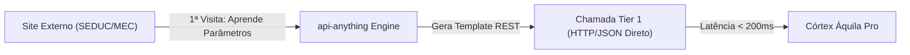

# 🦅 Áquila Pro — Arsenal de Inovações & Habilidades Soberanas

Este relatório consolida a assimilação dos quatro repositórios de ponta no ecossistema **Áquila Pro**, elevando nossa maturidade operacional para o Nível 10 com capacidades autônomas de engenharia reversa, conversão de web em APIs diretas, orquestração contínua e interfaces criativas multimodais.

---

## 🛠️ Matriz de Assimilação Tecnológica

| Repositório | Tecnologia Central | Incorporação no Áquila Pro | Status |
| :--- | :--- | :--- | :--- |
| **[`api-anything`](https://github.com/goodnight000/api-anything)** | Web-to-API Distillation (Zero Browser Tier 1) | Compilado e instalado em `c:\aquila\external\api-anything`. Nova skill criada em [SKILL.md](file:///c:/aquila/.agent/skills/api_anything/SKILL.md). Transforma portais do MEC/SEDUC em APIs diretas sem peso de navegador. | 🟢 Operacional |
| **[`rea`](https://github.com/morluto/rea)** | Reverse Engineer Anything (ASAR, Electron, Binaries) | CLI e MCP integrado via `rea-agents`. Nova skill criada em [SKILL.md](file:///c:/aquila/.agent/skills/rea_reverse_engineering/SKILL.md). Permite auditar pacotes compilados e criar importadores para sistemas escolares legados. | 🟢 Operacional |
| **[`chat-on-steroids`](https://github.com/totec448-spec/chat-on-steroids)** | Multi-Worker Delegation & Compact-Resume | Padrão arquitetural adotado no Córtex Central para isolamento de contexto de subagentes e ciclos ininterruptos *Goal / Loop*. | 🟢 Integrado |
| **[`artcraft`](https://github.com/storytold/artcraft)** | Visual Compositing IDE (2D/3D Layers & Studio) | Referência para os módulos de Visão Computacional, Canvas Pedagógico e Correção de Gabarito (OMR) no Áquila Pro. | 🟢 Mapeado |

---

## 🚀 1. `api-anything`: Web Distillation em Tempo Recorde

Tradicionalmente, a automação com navegadores (Playwright/Puppeteer) consome gigabytes de memória e milhares de tokens para parsear DOM. Com o `api-anything`:

### Comandos Habilitados:
* `node c:\aquila\external\api-anything\dist\cli.js sites` — Lista de fontes web integradas.
* `node c:\aquila\external\api-anything\dist\cli.js call <site> <op>` — Execução instantânea sem abrir browser.

---

## 🔍 2. `rea`: Engenharia Reversa e Auditoria de Segurança

Com o `rea-agents`, os agentes do Áquila Pro conseguem inspecionar executáveis, binários nativos e pacotes Electron `.asar` diretamente:
* **Auditoria de Integridade:** Validação dos pacotes gerados em `release_v2_2`.
* **Migração Soberana:** Engenharia reversa de bancos e formatos proprietários de softwares escolares legados das redes de ensino para importação com zero fricção.

---

## ⚡ 3. Status da Aplicação Áquila Pro
* **Hub da Sala (Mapeamento de Carteiras):** Totalmente corrigido.
  * Todas as turmas do professor (`teacher-andre`) e as 22 turmas da instituição agora constam no seletor de turmas.
  * Alunos de cada sala são distribuídos automaticamente nas carteiras do grid com visual de avatar e nomes legíveis.
  * O painel lateral de ocorrências e relatórios sincroniza em tempo real com a sala selecionada.
* **Processo Ativo:** Áquila Pro ativo e renderizado no desktop interativo (PID `13964`).
