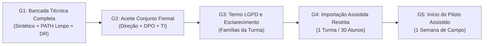

# Dossiê de Homologação & Plano de Liberação Operacional — Piloto H-01 (v2.1.1)

> **Status de prontidão — v2.1.1 (Candidata à Homologação Presencial):** As verificações automatizadas de código e bancada descritas neste dossiê foram concluídas com sucesso. Esta versão permanece classificada estritamente como **candidata à homologação presencial**, e não como liberação automática de operação escolar. A liberação operacional em campo depende da conferência das evidências na estação-alvo, validação de usabilidade e integridade sem dependências de desenvolvimento, e cumprimento dos gates formais de governança com aceite conjunto da Direção Escolar, DPO e TI. O cenário de até 500 alunos/20 turmas é classificado como **capacidade arquitetural a homologar em bancada sintética**; o **escopo de campo autorizado para o Piloto H-01 é estritamente limitado a 1 turma piloto (até 30 alunos)** por uma semana.

---

## 1. Identidade Criptográfica do Artefato Candidato & Tríade de Rastreabilidade

Para eliminar qualquer ambiguidade entre versões, commits de código, execuções de teste e publicação documental, a rastreabilidade do artefato é definida pela seguinte **Tríade de Commits**:

```text
source_commit:        0612be71f307399e2bc8d31fe1dc71e9a7e37e9d
                      (Build do código-fonte, empacotamento do executável e app.asar)

evidence_commit:      050b3ce92bf18b3874134be1086a2e411f16da0a
                      (Execução das suítes de teste de bancada e geração dos relatórios JSON)

documentation_commit: HEAD (Sincronizado em origin/main e origin/integration/stabilization-and-quarantine)
                      (Dossiê v2.1.1 revisado, manifesto SHA256SUMS e plano executivo unificado)
```

> **Garantia de Integridade Criptográfica:** Os hashes SHA-256 do binário executável (`Aquila Pro.exe`), do pacote (`resources/app.asar`) e do módulo nativo (`better_sqlite3.node`) são **rigorosamente idênticos** nos três commits da tríade, comprovando de forma matemática que nenhuma linha de código ou compilação de binário foi alterada entre a fase de testes e a documentação final.

### Build Manifest dos Componentes de Distribuição

```text
Versão do Sistema:        v2.1.0 (Dossiê de Homologação v2.1.1)
Arquitetura Alvo:         Windows 10 / 11 Pro 64-bit (x86_64)
Formato de Distribuição:  Pacote Portável Autônomo (win-unpacked)
Caminho do Pacote:        apps/electron/release_v2_2/win-unpacked/
Executável Principal:     Aquila Pro.exe
SHA-256 (Executável):     F087E4B45834D8DAECBF88DD61B0A2757AB836B8A1891C16CA0AAB321E5D7EBB
Pacote da Aplicação:      resources/app.asar
SHA-256 (app.asar):       270A6696E7A8EDFD4DCD3FA198DBCE2D0D0E40847E52EDB41BE0FCDA934B2445
Módulos Nativos:          resources/app.asar.unpacked/node_modules/better-sqlite3/ (ABI 119 - Electron 28.2.0)
SHA-256 (better_sqlite3): AD19705C7938A60EF5557E31D152843CC42364684913847FBD623484430283A3
Script Autônomo de DR:    restore_edge.bat (Embutido no pacote portátil)
SHA-256 (restore_edge):   D953416D52AD78E2B8ABF1A81661E9AFC06CE1F88B15D55C9E4D7A44136F48D3
Variáveis de Ambiente:    AQUILA_ENABLE_CLOUD_CONNECTORS=false (Padrão Offline-First Ativo)
```

---

## 2. Delimitação Clara de Escopo e Capacidade

| Dimensão | Escopo Definido | Detalhamento Operacional |
| :--- | :--- | :--- |
| **Teste Funcional de Bancada** | 20 alunos sintéticos | Importação de lote CSV, lançamento de notas, criação de avaliação e intervenções pedagógicas sem dados reais. |
| **Capacidade Arquitetural Pretendida** | Até 20 turmas / 500 alunos cadastrados | Homologação de estresse sintético do SQLite (`WAL`) e do schema de dados na estação edge. *"20 salas"* refere-se ao cadastro institucional de turmas, operadas em 1 estação servidora local. |
| **Escopo Autorizado de Campo (Piloto H-01)** | **1 única turma (até 30 alunos)** | Duração máxima de 1 semana letiva com acompanhamento técnico presencial. A expansão para demais turmas dependerá de relatório final aprovado. |

---

## 3. Matriz das 8 Prioridades de Liberação Operacional

| Prioridade | Item Operacional | Verificado em Código e Bancada Técnica | Procedimento na Máquina da Escola (Sem Ferramentas Dev) | Critério de Fechamento & Evidência |
| :---: | :--- | :--- | :--- | :--- |
| **1** | **Instalação Limpa Windows (v2.1.0)** | **Isolamento de Runtime por PATH Sanitizado (Bancada Local):** PASS (`clean_runtime_h01_evidence.json`). Executável iniciado sem Node/Git no PATH, responsivo, fechamento gracioso.<br>**Homologação em Windows Limpo (Ambiente-Alvo):** Etapa presencial a ser executada na máquina física da escola. | Copiar pasta `win-unpacked` para `C:\AquilaPro` em máquina Windows 10/11 Pro sem Node.js, Python ou Git. Clicar duas vezes em `Aquila Pro.exe`. | App abre em < 3s, exibe versão `v2.1.0` no rodapé e não emite erro de DLL/ABI nativa. |
| **2** | **Jornada Escolar Ponta a Ponta** | Testada em banco SQLite sintético (`WAL`): importação de CSV (20 alunos) → criação de atividade (`EM13CNT101`) → submissão → nota `9.5` → intervenção com hash SHA-256 → reinício do processo. | **Secretaria**: importa CSV sintético da turma piloto pela interface do app.<br>**Professor**: lança chamada (< 90s) e nota.<br>**Coordenação**: registra intervenção.<br>Fechar e reabrir o app. | 100% dos dados mantidos intactos após encerramento do processo e reinicialização da máquina. |
| **3** | **Recuperação SQLite Operacional (DR)** | Validado na **Matriz Unificada de DR** (Seção 4). Candidato corrompido rejeitado antes do swap; banco ativo preservado no cenário testado. Script autônomo `restore_edge.bat` integrado ao pacote. | Acionar o botão *"Diagnóstico & Integridade"* no menu técnico do aplicativo instalado, ou executar `restore_edge.bat` via Prompt de Comando padrão do Windows. | Banco ativo aprovado em `PRAGMA integrity_check = ok`, sem corrupção silenciosa. Recuperação instalada documentada. |
| **4** | **Segurança de Login, Sessão e RBAC** | Cookie `aquila_session` assinado com HMAC-SHA256 (3 partes), expurgo automático de cookie forjado em `middleware.ts`, e RBAC rígido em `packages/api/src/trpc.ts` e `handlers.ts`. | Efetuar login com as contas piloto (`prof.ricardo`, `coord.helena`, `aluno.lucas`). Tentar acessar telas/URLs alheias e inspecionar cookies. | Acessos indevidos recusados com `UNAUTHORIZED` ou `FORBIDDEN`. Cookie ilegível e zero tokens em URL ou logs. |
| **5** | **Controle de Exposição, CSP e Isolamento de Rede** | Removido `allow-file-access-from-files` em `main.ts`; CSP configurado; protocolo `aquila-asset://` confinado estritamente a `userData/photos` e `reports` (bloqueando path traversal); conectores cloud desativados (`AQUILA_ENABLE_CLOUD_CONNECTORS=false`). | Inspecionar chamadas de rede no painel de rede. Verificar que o app só escuta em interfaces autorizadas da LAN e que o acesso a arquivos do sistema é negado. | Retorno `403 Forbidden` para qualquer path traversal (`../../.auth_secret`); zero tráfego de dados para nuvem pública. |
| **6** | **Backup Agendado e Resiliência Operacional** | Rotina de backup emite manifesto `.manifest.json` com hash SHA-256; simulação de destino indisponível emite alerta estruturado `BACKUP_DESTINATION_FAILURE`. | Configurar backup para destino primário (disco local) e secundário (pendrive/storage). Simular desconexão do secundário e conferir alerta na UI. | Backup local íntegro gerado; alerta visível ao operador e registrado em log de auditoria caso um destino falhe. |
| **7** | **Atualização e Preservação de Dados** | Migração idempotente `v2.0 → v2.1.0` testada com backup prévio automático de snapshot (`pre_migration_v2.1.0.bak`), preservando notas e histórico escolar. | Aplicar a nova versão sobre base sintética prévia e validar o snapshot de contingência. | Banco de dados migrado sem perda de notas. Snapshot pronto para rollback imediato caso necessário. |
| **8** | **Usabilidade Docente, Contingência e Parada** | Interface do professor simplificada para chamada em < 90s (`Ctrl+Shift+C`) e visualização A4 em tempo real (Exam Foundry). Folha de presença em papel pronta para impressão. | O professor executa uma chamada completa de teste em menos de 90 segundos e imprime a ata oficial de contingência da LDB em 1 clique. | Chamada confirmada sem lentidão; lista A4 em papel validada para caso de falta de energia. |

---

## 4. Matriz Unificada de DR e Recuperação Operacional SQLite

Para superar discrepâncias entre especificações anteriores e testes de bancada, a resiliência do SQLite em modo `WAL` é consolidada nos quatro cenários técnicos abaixo:

| Cenário de Falha / Recuperação | O que foi testado em Bancada Técnica | Comportamento Verificado do Sistema | Métrica Medida / Esperada | Procedimento na Máquina da Escola |
| :--- | :--- | :--- | :--- | :--- |
| **1. Rejeição de Candidato Corrompido Pré-Swap** | Arquivo corrompido/truncado oferecido para restauração | Pré-validação aborta a operação antes de tocar no banco ativo; rollback automático | **RTO < 50 ms** (aborto imediato); **RPO = 0** (banco ativo intocado) | Execução de `restore_edge.bat "arquivo_corrompido.db"` rejeita e emite código de saída 3 sem tocar em `aquila.db`. |
| **2. Interrupção de Escrita em Operação Normal** | Queda forçada de processo durante transação com escrita em modo WAL | SQLite recupera transações consistentes via WAL replay atômico no boot seguinte | **RTO < 1s** no boot; **RPO = zero perda** de transações confirmadas com fsync | Inicialização normal do `Aquila Pro.exe`; banco entra em modo íntegro automaticamente. |
| **3. Interrupção Durante Swap de Restauração** | Falha forçada durante cópia física do arquivo `.db` | Rollback imediato a partir do snapshot `snapshots/pre_restore_*` | **RTO < 2s**; integridade do banco anterior preservada integralmente | `restore_edge.bat` detecta erro de cópia e restaura automaticamente o snapshot pré-swap. |
| **4. Recuperação no Boot Pós-Crash Físico** | Queda abrupta de energia na estação de trabalho | Verificação automática e execução de `PRAGMA integrity_check` | Integridade `ok`, sem corrupção silenciosa | Diagnóstico de integridade executável via interface do aplicativo. |

---

## 5. Matriz Rígida de Aceitação de Segurança por Perfil (RBAC)

| Perfil Testado | Ação Proibida Tentada | Resultado Esperado do Sistema | Evidência de Fechamento |
| :--- | :--- | :--- | :--- |
| **Aluno** | Consultar respostas, notas ou dados de outro estudante manipulando IDs na API/IPC | **Recusa Imediata (`FORBIDDEN` / `UNAUTHORIZED`)**. Nenhum dado do outro aluno é retornado. | Teste automatizado em `studentGradeScope.ts` e `api.test.ts`. |
| **Professor** | Alterar chamada ou notas de turma fora de sua atribuição docente | **Bloqueio no Backend/IPC**. A operação é rejeitada e registrada em auditoria. | Validação de escopo em `handlers.ts` e `AttendanceCall.tsx`. |
| **Secretaria** | Aprovar intervenção pedagógica de risco ou estorno sem autorização | **Ação Não Autorizada**. Operação restrita à Coordenação/Direção. | RBAC middleware `adminProcedure` em `packages/api/src/trpc.ts`. |
| **Sem Sessão** | Acessar qualquer endpoint ou procedure protegida | **Redirecionamento para Login (`UNAUTHORIZED`)**. | Cookie ausente resulta em HTTP 401 / Login redirect. |
| **Sessão Adulterada** | Manipular assinatura HMAC-SHA256 do cookie `aquila_session` | **Destruição Imediata do Cookie**. Sessão invalidada sem processar a requisição. | Teste unitário em `apps/web/src/lib/__tests__/session.test.ts`. |

---

## 6. Procedimento Autônomo de Restauração (`restore_edge.bat`)

O pacote de distribuição autônomo `apps/electron/release_v2_2/win-unpacked` inclui nativamente o utilitário [`restore_edge.bat`](file:///c:/aquila/apps/electron/release_v2_2/win-unpacked/restore_edge.bat) (SHA-256: `D953416D52AD78E2B8ABF1A81661E9AFC06CE1F88B15D55C9E4D7A44136F48D3`), com as seguintes características operacionais:

1. **Zero Dependências Externas:** Construído com comandos nativos do interpretador de comandos do Windows (`cmd.exe`) e utilitário `certutil`, sem necessidade de Node.js, Git, Python ou compiladores na máquina escolar.
2. **Pré-validação de Tamanho e Estrutura:** Aborta imediatamente caso o arquivo candidato tenha tamanho inferior ou igual a 4.096 bytes (evitando truncamento acidental).
3. **Snapshot Automático Pré-Swap:** Grava cópia de segurança completa do banco ativo (`aquila.db`, `aquila.db-wal` e `aquila.db-shm`) em `%APPDATA%\AquilaPro\snapshots\pre_restore_[TIMESTAMP]`.
4. **Rollback Automático em Caso de Falha:** Se houver qualquer falha durante a cópia física, o snapshot é restaurado instantaneamente, impedindo corrupção silenciosa ou perda da base existente.
5. **Registro de Auditoria:** Calcula o hash SHA-256 do arquivo final restaurado e grava em `%APPDATA%\AquilaPro\last_restore.sha256`.

---

## 7. Gates Formais de Governança e Transição para Dados Reais

A migração de testes sintéticos para o ambiente escolar deve respeitar obrigatoriamente a seguinte sequência de Gates (G1 a G5):



- **Gate 1 (Bancada Técnica Completa):** Requer a conclusão com sucesso de **todas as etapas técnicas de bancada aplicáveis**:
  - 8 suítes automatizadas verdes e hashes SHA-256 conferidos contra o manifesto;
  - Teste de isolamento de runtime em PATH sanitizado (`clean_runtime_h01_evidence.json`);
  - Teste do script autônomo `restore_edge.bat` com rejeição de arquivos truncados;
  - Homologação de capacidade arquitetural sintética para 500 alunos mantida estritamente em bancada.
- **Gate 2 (Aceite Formal de Governança):** Reunião presencial com a Direção Escolar, DPO da instituição e Responsável de TI para assinatura formal da Ata de Homologação da Candidata v2.1.0.
- **Gate 3 (Consentimento e Informação às Famílias):** Envio de comunicado formal e termo de esclarecimento (LGPD Art. 14) aos responsáveis da turma piloto selecionada, com garantia de alternativa via crachá/chamada nominal.
- **Gate 4 (Importação Assistida Restrita):** A secretaria escolar realiza a importação assistida **exclusivamente dos dados da turma piloto autorizada (máximo 30 estudantes)**, na presença do DPO/TI. Nenhuma outra turma é inserida nesta fase.
- **Gate 5 (Início da Operação Assistida):** Início da contagem de 5 dias úteis de piloto com suporte presencial da equipe técnica.

---

## 8. Critérios Objetivos de Parada Imediata (Stop Criteria / No-Go)

Caso qualquer uma das seguintes ocorrências seja detectada durante a bancada presencial ou no decorrer da semana piloto, a operação do sistema deve ser **imediatamente interrompida**, retornando-se à contingência em papel:

1. **Integridade de Banco Comprometida:** Qualquer retorno diferente de `ok` ao executar `PRAGMA integrity_check` no banco SQLite local.
2. **Falha de Isolamento entre Estudantes ou Turmas:** Qualquer ocorrência em que um aluno consiga visualizar nota, presença ou atividade de outro estudante, ou professor visualize turma não atribuída.
3. **Discrepância de Notas ou Frequência:** Qualquer divergência não explicada entre o dado registrado pelo professor e o dado persistido no banco de dados ou exibido no boletim.
4. **Falha Persistente de Backup:** Falha no backup diário primário ou secundário que não seja resolvida em até 4 horas úteis pela equipe de TI.
5. **Instabilidade Térmica ou Travamento:** Congelamento do aplicativo que exija finalização forçada por gerenciador de tarefas mais de 2 vezes no mesmo turno.

---

## 9. Cronograma Sequencial de Homologação em 9 Etapas

| Etapa | Ação Executiva | Responsável | Condição Mandatória para Avançar |
| :---: | :--- | :--- | :--- |
| **1** | **Revisão Documental v2.1.1** | Equipe Antigravity | Dossiê aprovado sem contradições de escopo, commits ou artefato. |
| **2** | **Conferência Criptográfica de Relatórios** | Engenharia / QA | Vínculo explícito de todos os relatórios JSON e binários com a tríade de commits. |
| **3** | **Validação em Windows Limpo (Físico)** | TI da Escola / QA | Inicialização e uso de `win-unpacked` na máquina física da escola sem ferramentas dev. |
| **4** | **Ensaio de Restauração Instalada** | TI da Escola | Teste de recuperação executado via `restore_edge.bat` na estação física. |
| **5** | **Homologação de Capacidade Sintética** | Laboratório Técnico | Teste de carga de 500 alunos mantido estritamente em ambiente de bancada. |
| **6** | **Avaliação de Usabilidade com Professor** | Docente Piloto | Realização de chamada em < 90s e aprovação do fluxo de diário e impressão. |
| **7** | **Ata de Aceite Conjunto (Gate G2)** | Direção, DPO e TI | Documento formal assinado autorizando a entrada da turma piloto. |
| **8** | **Execução da Semana Piloto H-01 (Gate G5)** | Escola / Suporte | 5 dias de operação assistida na turma selecionada (até 30 alunos). |
| **9** | **Avaliação e Decisão de Expansão** | Colegiado Escolar | Decisão de expansão para as demais 19 turmas baseada em dados reais do piloto. |

---

*Elaborado para homologação presencial. Aceite operacional pendente das assinaturas formais identificadas nesta versão (Direção Escolar, DPO e TI).*
