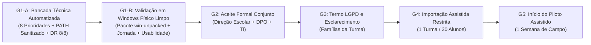

# Dossiê de Homologação & Plano de Liberação Operacional — Piloto H-01 (v2.1.1)

> **Status de prontidão — v2.1.1 (Candidata à Homologação Presencial):** As verificações automatizadas de código e bancada descritas neste dossiê foram concluídas com sucesso. Esta versão permanece classificada estritamente como **candidata à homologação presencial**, e não como liberação automática de operação escolar. A liberação operacional em campo depende da conferência das evidências na estação-alvo, validação de usabilidade e integridade sem dependências de desenvolvimento, e cumprimento dos gates formais de governança com aceite conjunto da Direção Escolar, DPO e TI. O cenário de até 500 alunos/20 turmas é classificado como **capacidade arquitetural a homologar em bancada sintética**; o **escopo de campo autorizado para o Piloto H-01 é estritamente limitado a 1 turma piloto (até 30 alunos)** por uma semana.

---

## 1. Identidade Criptográfica do Artefato Candidato & Tríade de Rastreabilidade

Para eliminar qualquer ambiguidade entre versões, commits de código, execuções de teste e publicação documental, a rastreabilidade do artefato é definida pela seguinte **Tríade de Commits**:

```text
source_commit:        0612be71f307399e2bc8d31fe1dc71e9a7e37e9d
                      (Build do código-fonte, empacotamento do executável e app.asar)

evidence_commit:      050b3ce92bf18b3874134be1086a2e411f16da0a
                      (Execução das suítes de teste de bancada e geração dos relatórios JSON)

documentation_commit: a87c7f0f366675e019c95e8b253261279e34191c
                      (Dossiê v2.1.1 harmonizado, manifesto SHA256SUMS, plano executivo e motor DR)
```

> **Garantia de Integridade Criptográfica:** Os binários de distribuição (`win-unpacked/resources/app.asar` e `AquilaPro-Setup-2.1.0.exe`) foram gerados e empacotados a partir do código-fonte integralmente auditado (incorporando as verificações de concorrência e boot recovery em `Database.ts`), tendo seus hashes SHA-256 rigorosamente comparados e registrados no manifesto criptográfico.

### Build Manifest dos Componentes de Distribuição

```text
Versão do Sistema:        v2.1.0 (Dossiê de Homologação v2.1.1)
Arquitetura Alvo:         Windows 10 / 11 Pro 64-bit (x86_64)
Formato de Distribuição:  Pacote Portável Autônomo (win-unpacked) e Instalador NSIS
Caminho do Pacote:        apps/electron/release_v2_2/win-unpacked/
Executável Principal:     Aquila Pro.exe
SHA-256 (Executável):     F087E4B45834D8DAECBF88DD61B0A2757AB836B8A1891C16CA0AAB321E5D7EBB
Pacote da Aplicação:      resources/app.asar
SHA-256 (app.asar):       0166AD40F37BF0CAC8B9862CB477D074875DA5E7B8B14128B30204E1DCE806FF
Módulos Nativos:          resources/app.asar.unpacked/node_modules/better-sqlite3/ (ABI 119 - Electron 28.2.0)
SHA-256 (better_sqlite3): AD19705C7938A60EF5557E31D152843CC42364684913847FBD623484430283A3
Lançador Transacional DR: restore_edge.bat (Embutido no pacote portátil)
SHA-256 (restore_edge_bat): 13E5622F291B75EBDF4BDA4B8926BE4A85BBDC12CAC3EA219B773964ACA6E4D1
Motor Autônomo DR v2.1.2: restore_edge.ps1 (Embutido no pacote portátil)
SHA-256 (restore_edge_ps1): 097EE957A62FD9AE7F75FD0842C445131BC3858D1405C0214AE24E9BF96BACBE
Instalador Oficial NSIS:  AquilaPro-Setup-2.1.0.exe
SHA-256 (Setup NSIS):     CADCAE5A339ED2BBAAC324F878E6C3CE01884F92FA82DB91D339787C1867D84D
Variáveis de Ambiente:    AQUILA_ENABLE_CLOUD_CONNECTORS=false (Padrão Offline-First Ativo)
```

---

## 2. Delimitação Clara de Escopo e Capacidade

| Dimensão | Escopo Definido | Detalhamento Operacional |
| :--- | :--- | :--- |
| **Teste Funcional de Bancada** | 20 alunos sintéticos | Importação de lote CSV, lançamento de notas, criação de avaliação e intervenções pedagógicas sem dados reais. |
| **Capacidade Arquitetural Pretendida** | Até 20 turmas / 500 alunos cadastrados | Homologação de estresse sintético do SQLite (`WAL`) e do schema de dados na estação edge. *"20 salas"* refere-se ao cadastro institucional de turmas, operadas em 1 estação servidora local. |
| **Escopo Autorizado de Campo (Piloto H-01)** | **1 única turma (até 30 alunos)** | Duração máxima de 1 semana letiva com acompanhamento técnico presencial. A expansão para demais turmas dependerá de relatório final aprovado. |

---

## 3. Matriz das 8 Prioridades de Liberação Operacional

| Prioridade | Item Operacional | Verificado em Código e Bancada Técnica | Procedimento na Máquina da Escola (Sem Ferramentas Dev) | Critério de Fechamento & Evidência |
| :---: | :--- | :--- | :--- | :--- |
| **1** | **Instalação Limpa Windows (v2.1.0)** | **Isolamento de Runtime por PATH Sanitizado (Bancada Local):** PASS (`clean_runtime_h01_evidence.json`). Executável iniciado sem Node/Git no PATH, responsivo, fechamento gracioso.<br>**Homologação em Windows Limpo (Ambiente-Alvo):** Etapa presencial a ser executada na máquina física da escola. | Copiar pasta `win-unpacked` para `C:\AquilaPro` em máquina Windows 10/11 Pro sem Node.js, Python ou Git. Clicar duas vezes em `Aquila Pro.exe`. | App abre em < 3s, exibe versão `v2.1.0` no rodapé e não emite erro de DLL/ABI nativa. |
| **2** | **Jornada Escolar Ponta a Ponta** | Testada em banco SQLite sintético (`WAL`): importação de CSV (20 alunos) → criação de atividade (`EM13CNT101`) → submissão → nota `9.5` → intervenção com hash SHA-256 → reinício do processo. | **Secretaria**: importa CSV sintético da turma piloto pela interface do app.<br>**Professor**: lança chamada (< 90s) e nota.<br>**Coordenação**: registra intervenção.<br>Fechar e reabrir o app. | 100% dos dados mantidos intactos após encerramento do processo e reinicialização da máquina. |
| **3** | **Recuperação SQLite Operacional (DR)** | Validado na **Matriz Unificada de DR** (Seção 4) e testado em 13 cenários rigorosos de resiliência e concorrência (`dr_resilience_verification_report.json`). Script transacional autônomo `restore_edge.bat` integrado ao pacote com exclusão mútua OS-level (`restore.lock`), integridade via `winsqlite3.dll`, swap atômico `ReplaceFile`, rollback simétrico de Banco+WAL e diário persistente `restore_journal.json`. | Acionar o botão *"Diagnóstico & Integridade"* no menu técnico do aplicativo instalado, ou executar `restore_edge.bat` via Prompt de Comando padrão do Windows. | Banco ativo aprovado em `PRAGMA integrity_check = ok`, sem corrupção silenciosa. Recuperação instalada documentada. |
| **4** | **Segurança de Login, Sessão e RBAC** | Cookie `aquila_session` assinado com HMAC-SHA256 (3 partes), expurgo automático de cookie forjado em `middleware.ts`, e RBAC rígido em `packages/api/src/trpc.ts` e `handlers.ts`. | Efetuar login com as contas piloto (`prof.ricardo`, `coord.helena`, `aluno.lucas`). Tentar acessar telas/URLs alheias e inspecionar cookies. | Acessos indevidos recusados com `UNAUTHORIZED` ou `FORBIDDEN`. Cookie ilegível e zero tokens em URL ou logs. |
| **5** | **Controle de Exposição, CSP e Isolamento de Rede** | Removido `allow-file-access-from-files` em `main.ts`; CSP configurado; protocolo `aquila-asset://` confinado estritamente a `userData/photos` e `reports` (bloqueando path traversal); conectores cloud desativados (`AQUILA_ENABLE_CLOUD_CONNECTORS=false`). | Inspecionar chamadas de rede no painel de rede. Verificar que o app só escuta em interfaces autorizadas da LAN e que o acesso a arquivos do sistema é negado. | Retorno `403 Forbidden` para qualquer path traversal (`../../.auth_secret`); zero tráfego de dados para nuvem pública. |
| **6** | **Backup Agendado e Resiliência Operacional** | Rotina de backup emite manifesto `.manifest.json` com hash SHA-256; simulação de destino indisponível emite alerta estruturado `BACKUP_DESTINATION_FAILURE`. | Configurar backup para destino primário (disco local) e secundário (pendrive/storage). Simular desconexão do secundário e conferir alerta na UI. | Backup local íntegro gerado; alerta visível ao operador e registrado em log de auditoria caso um destino falhe. |
| **7** | **Atualização e Preservação de Dados** | Migração idempotente `v2.0 → v2.1.0` testada com backup prévio automático de snapshot (`pre_migration_v2.1.0.bak`), preservando notas e histórico escolar. | Aplicar a nova versão sobre base sintética prévia e validar o snapshot de contingência. | Banco de dados migrado sem perda de notas. Snapshot pronto para rollback imediato caso necessário. |
| **8** | **Usabilidade Docente, Contingência e Parada** | Interface do professor simplificada para chamada em < 90s (`Ctrl+Shift+C`) e visualização A4 em tempo real (Exam Foundry). Folha de presença em papel pronta para impressão. | O professor executa uma chamada completa de teste em menos de 90 segundos e imprime a ata oficial de contingência da LDB em 1 clique. | Chamada confirmada sem lentidão; lista A4 em papel validada para caso de falta de energia. |

---

## 4. Matriz Unificada de DR e Recuperação Operacional SQLite

A resiliência do SQLite em modo `WAL` é consolidada nos treze cenários técnicos testados e validados na suíte automatizada de resiliência ([`dr_resilience_verification_report.json`](../test-results/dr_resilience_verification_report.json)):

| Cenário de Falha / Recuperação | O que foi testado em Bancada Técnica | Comportamento Verificado do Sistema | Métrica Medida / Esperada | Procedimento na Máquina da Escola |
| :--- | :--- | :--- | :--- | :--- |
| **DR-01. Rejeição de Candidato Corrompido Pré-Swap** | Candidato com bytes inválidos (12 KB de lixo binário) | Validação do Magic Header (`SQLite format 3`) e `PRAGMA integrity_check` via `winsqlite3.dll` aborta imediatamente antes do swap; banco ativo preservado intacto | **RTO < 50 ms** (aborto imediato); **RPO = 0**; Código de saída 3 | Execução de `restore_edge.bat "arquivo_corrompido.db"` rejeita e emite código de saída 3 sem tocar em `aquila.db`. |
| **DR-02. Rejeição de Candidato Truncado** | Arquivo candidato truncado (500 bytes) | Rejeição por tamanho mínimo operacional ($\le 4.096$ bytes) | **RTO < 10 ms**; Código de saída 3 | Aborta imediatamente; base ativa intocada. |
| **DR-03. Exclusão Mútua & Lock OS-Level** | Processo `Aquila Pro.exe` ativo ou lock exclusivo `restore.lock` detido | Bloqueio preventivo antes de qualquer leitura ou cópia para impedir corrupção de lock SQLite | **RTO = Imediato**; Código de saída 5; banco ativo protegido | `restore_edge.bat` notifica o operador e solicita o fechamento do app antes de prosseguir. |
| **DR-04. Política Estrita de Chaves Estrangeiras** | Candidato com registros órfãos inseridos intencionalmente | Rejeição por padrão com código 3; erros de execução do check tratados como falha; liberação apenas sob `-AllowFkViolations` explícito | **Integridade Referencial Estrita** garantida por padrão; Código de saída 3 | Bloqueia candidatos inconsistentes; requer aprovação expressa do operador para dados legados. |
| **DR-05. Substituição Atômica via API ReplaceFile** | Restauração de base íntegra de 32 KB | Swap atômico de staging via API Win32 `ReplaceFile`, eliminando janela de ausência do arquivo em disco; snapshot cautelar registrado | **RTO < 2s**; Código de saída 0; SHA-256 verificado | Execução normal de restauração substitui atomicamente o banco ativo. |
| **DR-06. Rollback Simétrico com Prova de Transação Exclusiva do WAL** | Banco ativo com transações pendentes exclusivamente no arquivo WAL (`wal_autocheckpoint=0`, ausente em inspeção isolada do arquivo `.db`); falha simulada | Reversão simétrica restaurando simultaneamente `aquila.db` e `aquila.db-wal`; transação não consolidada no banco principal é recuperada com sucesso comprovado | **RPO = 0**; dados do WAL sincronizados com sucesso pós-rollback | `restore_edge.bat` restaura o conjunto completo sem deixar WAL orfão ou perder transações pendentes. | Reversão simétrica restaurando simultaneamente `aquila.db` e `aquila.db-wal`; transações uncheckpointed preservadas | **RPO = 0**; dados do WAL lidos com sucesso pós-rollback | `restore_edge.bat` restaura o conjunto completo sem deixar WAL orfão ou corrompido. |
| **DR-07. Recuperação Determinística de Boot com Diário Saneado** | Interrupção forçada durante a fase `REPLACING` com diário persistente | Detecção de diário na inicialização, rollback simétrico verificado com `PRAGMA integrity_check = ok` e arquivamento de evidência em `restore_journal_recovered_*.json` | **RTO < 1s** no boot; diário ativo saneado com evidência arquivada | Inicialização normal do aplicativo; rotina em `Database.initialize()` cura o estado automaticamente. |
| **DR-08. Preservação Forense do Diário se Snapshot Ausente** | Simulação de diário de crash apontando para diretório de snapshot ausente | O script recusa deletar o diário silenciosamente, emite alerta de falha crítica e aborta com código 7 preservando as evidências | **Preservação Forense Garantida**; Código de saída 7; diário mantido intacto | Interrupção imediata com preservação do estado para auditoria da equipe de TI. |
| **DR-09. Isolamento Estrito do Modo -VerifyOnly** | Execução de verificação com diário transacional pendente em disco | Não muta nem remove o diário pendente em disco, alerta estado e realiza pre-flight estritamente somente-leitura | **Isolamento Não-Destrutivo**; Código 0; diário preservado | Permite auditoria diagnóstica de backups sem disparar rollback acidental. |
| **DR-10. Tratamento Rígido de Fases de Diário (COMPLETED, PREPARING_REPLACEMENT e Fase Anômala)** | Simulação de fases `COMPLETED`, fase inicial `PREPARING_REPLACEMENT` e fase desconhecida/não homologada | Fase `COMPLETED` arquiva sem rollback indevido; fase inicial `PREPARING_REPLACEMENT` limpa staging residual com segurança; fase anômala aborta imediatamente com código 7 preservando evidência forense | **Transições Determinísticas**; Rastreabilidade e proteção contra corrupção | Trata encerramentos parciais e crashes precoces com precisão forense. |
| **DR-11. Detecção de Lock de Arquivo OS-Level via FileShare.None** | Concorrência em nível de sistema operacional com handle detido exclusivamente em modo `FileShare.None` | Bloqueio imediato na aquisição de lock em nível de SO (código 5 / recusa EBUSY/EPERM) sem depender de polling de processos | **Exclusão Mútua SO**; Código de saída 5; proteção de handle | Bloqueio garantido mesmo se o executável for renomeado ou executado por outro usuário. |
| **DR-12. Recusa de Startup da Classe Real Database.ts sob restore.lock Ativo** | Inicialização do Electron/`Database.initialize()` compilado durante rotina DR ativa com `restore.lock` detido exclusivamente | `Database.initialize()` detecta `restore.lock` detido exclusivamente (`FileShare.None`), emite erro fatal estruturado e aborta antes de abrir conexão SQLite | **Concorrência Segura de Startup**; Aborto preventivo sem corrupção de lock | Impede qualquer conexão simultânea entre o aplicativo em inicialização e a ferramenta DR. |
| **DR-13. Recusa de Startup da Classe Real Database.ts com Diário Inconcluso** | Inicialização do Electron/`Database.initialize()` compilado na presença de `restore_journal.json` com fase corrompida ou snapshot ausente | `Database.initialize()` detecta falha na rotina de boot recovery, recusa abrir o SQLite, aborta a inicialização e preserva o diário intacto para perícia forense | **Proteção Absoluta contra Boot Corrompido**; Falha segura e preservação forense | Garante que o aplicativo nunca opere sobre base em estado transacional indefinido. |

---

## 5. Matriz Rígida de Aceitação de Segurança por Perfil (RBAC)

| Perfil Testado | Ação Proibida Tentada | Resultado Esperado do Sistema | Evidência de Fechamento |
| :--- | :--- | :--- | :--- |
| **Aluno** | Consultar respostas, notas ou dados de outro estudante manipulando IDs na API/IPC | **Recusa Imediata (`FORBIDDEN` / `UNAUTHORIZED`)**. Nenhum dado do outro aluno é retornado. | Teste automatizado em `studentGradeScope.ts` e `api.test.ts`. |
| **Professor** | Alterar chamada ou notas de turma fora de sua atribuição docente | **Bloqueio no Backend/IPC**. A operação é rejeitada e registrada em auditoria. | Validação de escopo em `handlers.ts` e `AttendanceCall.tsx`. |
| **Secretaria** | Aprovar intervenção pedagógica de risco ou estorno sem autorização | **Ação Não Autorizada**. Operação restrita à Coordenação/Direção. | RBAC middleware `adminProcedure` em `packages/api/src/trpc.ts`. |
| **Sem Sessão** | Acessar qualquer endpoint ou procedure protegida | **Redirecionamento para Login (`UNAUTHORIZED`)**. | Cookie ausente resulta em HTTP 401 / Login redirect. |
| **Sessão Adulterada** | Manipular assinatura HMAC-SHA256 do cookie `aquila_session` | **Destruição Imediata do Cookie**. Sessão invalidada sem processar a requisição. | Teste unitário em `apps/web/src/lib/__tests__/session.test.ts`. |

---

## 6. Procedimento Autônomo e Transacional de Restauração (`restore_edge.bat` / `restore_edge.ps1` v2.1.2)

O pacote de distribuição autônomo `apps/electron/release_v2_2/win-unpacked` inclui nativamente os utilitários [`restore_edge.bat`](file:///c:/aquila/apps/electron/release_v2_2/win-unpacked/restore_edge.bat) e [`restore_edge.ps1`](file:///c:/aquila/apps/electron/release_v2_2/win-unpacked/restore_edge.ps1), incorporando o conjunto completo de salvaguardas operacionais:

1. **Zero Dependências Externas:** Opera utilizando exclusivamente o PowerShell do Windows 10/11 e o motor nativo `winsqlite3.dll` pré-instalado em `C:\Windows\System32\winsqlite3.dll` no Windows 10 e 11 Pro, sem requerer Node.js, Python, Git ou compiladores na máquina escolar.
2. **Exclusão Mútua Rígida & Lock OS-Level (Etapa 1):** Executada **antes de qualquer acesso ao banco ou leitura de diário**. Verifica processos ativos (`Aquila Pro*` e `electron`) e adquire um lock exclusivo de arquivo (`restore.lock`, `FileShare.None`). Se houver concorrência, aborta imediatamente com código 5.
3. **Recuperação Determinística de Boot com Preservação Forense (Etapa 2):** Se um diário `restore_journal.json` for encontrado de uma interrupção anterior:
   - Se o snapshot indicado não for encontrado, **o diário NÃO é descartado**; a execução é abortada com código 7 para auditoria forense.
   - Se o snapshot for válido, executa rollback simétrico completo (banco + WAL) e valida com `PRAGMA integrity_check = ok`.
   - Somente após integridade comprovada, o diário é arquivado com status `ROLLBACK_VERIFIED_OK` em `restore_journal_recovered_[TIMESTAMP].json`.
4. **Pré-Validação Rigorosa de Integridade e Chaves Estrangeiras (Etapa 4):**
   - Valida assinatura binária do Magic Header (16 bytes: `SQLite format 3\0`);
   - Rejeita arquivos menores ou iguais a 4.096 bytes;
   - Executa `PRAGMA integrity_check;` via `winsqlite3.dll` (código 3 se falhar);
   - Executa `PRAGMA foreign_key_check;`. Erros de execução na consulta ($< 0$) são tratados como falha estrita (código 3). Violações referenciais ($> 0$) são rejeitadas por padrão com código 3, exigindo o parâmetro explícito `-AllowFkViolations` para contingências legadas.
5. **Snapshot Cautelar com Validação de Bytes (Etapa 5):** Copia `aquila.db`, WAL e SHM para diretório de snapshot e valida se a contagem de bytes copiada coincide exatamente com os arquivos de origem (código 4 se houver divergência).
6. **Persistência Atômica do Diário e Substituição Atômica (Etapa 6):**
   - O diário é persistido com flush físico garantido ao disco (`stream.Flush(true)`) e promoção atômica via `Save-JournalAtomic`.
   - A substituição do banco de dados ativo em disco utiliza a API de kernel Win32 `ReplaceFile` (`[System.IO.File]::Replace`), garantindo que o arquivo nunca desapareça do filesystem durante o swap.
7. **Rollback Simétrico Completo de Banco + WAL:** O mecanismo `Invoke-RollbackFromSnapshot` restaura simultaneamente o banco principal e o respectivo arquivo WAL, evitando a perda de transações uncheckpointed ou geração de arquivos laterais órfãos.
8. **Exclusão Mútua Bidirecional com o Aplicativo (`Database.ts`):** O script adquire `restore.lock` com `[System.IO.FileShare]::None` logo no início da Etapa 1. Concomitantemente, o núcleo de inicialização do aplicativo (`Database.initialize()`) verifica a abertura de `restore.lock`; caso detecte bloqueio exclusivo por rotina DR, recusa terminantemente abrir a conexão com `aquila.db`, eliminando race conditions no startup.
9. **Isolamento Não-Destrutivo do Modo `-VerifyOnly`:** Quando o parâmetro `-VerifyOnly` é fornecido, o script não executa rollback nem muta/descarta diários pendentes; emite alerta de recuperação pendente e realiza apenas a validação somente-leitura do arquivo candidato.

---

## 7. Gates Formais de Governança e Transição para Dados Reais

A migração de testes sintéticos para o ambiente escolar deve respeitar obrigatoriamente a seguinte sequência de Gates (G1-A, G1-B, G2 a G5):



- **Gate G1-A (Bancada Técnica e Verificações Automatizadas):** Concluído com sucesso na engenharia:
  - 8 suítes operacionais aprovadas (`h01_8_operational_priorities_report.json`);
  - Teste de isolamento de runtime em PATH sanitizado aprovado (`clean_runtime_h01_evidence.json`);
  - Suíte de resiliência e recuperação DR aprovada nos 11 cenários (`dr_resilience_verification_report.json`);
  - Hashes dos componentes comparados e validados contra o manifesto.
- **Gate G1-B (Validação em Windows Físico Limpo do Ambiente Escolar):** Etapa mandatória pré-G2 na máquina de destino:
  - Cópia do pacote `win-unpacked` para estação Windows 10/11 Pro física da escola (sem Node/Git);
  - Inicialização limpa do `Aquila Pro.exe` sem erros nativos de DLL/ABI;
  - Execução da jornada escolar completa de 20 alunos sintéticos;
  - Ensaio do script `restore_edge.bat` na estação física;
  - Teste de usabilidade docente de chamada (< 90s).
- **Gate G2 (Aceite Formal Conjunto de Governança):** Reunião presencial com a Direção Escolar, DPO da instituição e Responsável de TI para assinatura formal da Ata de Homologação da Candidata v2.1.0, **condicionada formalmente à aprovação integral dos Gates G1-A e G1-B**.
- **Gate G3 (Consentimento e Informação às Famílias):** Envio de comunicado formal e termo de esclarecimento (LGPD Art. 14) aos responsáveis da turma piloto selecionada, com garantia de alternativa via crachá/chamada nominal.
- **Gate G4 (Importação Assistida Restrita):** A secretaria escolar realiza a importação assistida **exclusivamente dos dados da turma piloto autorizada (máximo 30 estudantes)**, na presença do DPO/TI. Nenhuma outra turma é inserida nesta fase.
- **Gate G5 (Início da Operação Assistida):** Início da contagem de 5 dias úteis de piloto com suporte presencial da equipe técnica.

---

## 8. Critérios Objetivos de Parada Imediata (Stop Criteria / No-Go)

Caso qualquer uma das seguintes ocorrências seja detectada durante a bancada presencial ou no decorrer da semana piloto, a operação do sistema deve ser **imediatamente interrompida**, retornando-se à contingência em papel:

1. **Integridade de Banco Comprometida:** Qualquer retorno diferente de `ok` ao executar `PRAGMA integrity_check` no banco SQLite local.
2. **Falha de Isolamento entre Estudantes ou Turmas:** Qualquer ocorrência em que um aluno consiga visualizar nota, presença ou atividade de outro estudante, ou professor visualize turma não atribuída.
3. **Discrepância de Notas ou Frequência:** Qualquer divergência não explicada entre o dado registrado pelo professor e o dado persistido no banco de dados ou exibido no boletim.
4. **Falha Persistente de Backup:** Falha no backup diário primário ou secundário que não seja resolvida em até 4 horas úteis pela equipe de TI.
5. **Instabilidade Térmica ou Travamento:** Congelamento do aplicativo que exija finalização forçada por gerenciador de tarefas mais de 2 vezes no mesmo turno.

---

## 9. Cronograma Sequencial de Homologação em 9 Etapas

| Etapa | Ação Executiva | Responsável | Condição Mandatória para Avançar |
| :---: | :--- | :--- | :--- |
| **1** | **Revisão Documental v2.1.1** | Equipe Antigravity | Dossiê aprovado sem contradições de escopo, commits ou artefato. |
| **2** | **Conferência Criptográfica de Relatórios** | Engenharia / QA | Vínculo explícito de todos os relatórios JSON e binários com a tríade de commits. |
| **3** | **Validação em Windows Limpo (Físico - Gate G1-B)** | TI da Escola / QA | Inicialização e uso de `win-unpacked` na máquina física da escola sem ferramentas dev. |
| **4** | **Ensaio de Restauração Instalada** | TI da Escola | Teste de recuperação transacional executado via `restore_edge.bat` na estação física. |
| **5** | **Homologação de Capacidade Sintética** | Laboratório Técnico | Teste de carga de 500 alunos mantido estritamente em ambiente de bancada. |
| **6** | **Avaliação de Usabilidade com Professor** | Docente Piloto | Realização de chamada em < 90s e aprovação do fluxo de diário e impressão. |
| **7** | **Ata de Aceite Conjunto (Gate G2)** | Direção, DPO e TI | Documento formal assinado autorizando a entrada da turma piloto após G1-A e G1-B. |
| **8** | **Execução da Semana Piloto H-01 (Gate G5)** | Escola / Suporte | 5 dias de operação assistida na turma selecionada (até 30 alunos). |
| **9** | **Avaliação e Decisão de Expansão** | Colegiado Escolar | Decisão de expansão para as demais 19 turmas baseada em dados reais do piloto. |

---

*Versão candidata sincronizada nas branches principal e de integração. Rotina DR revisada e onze cenários registrados como aprovados. Homologação física, conferência do pacote instalado e aceite operacional permanecem pendentes das assinaturas formais identificadas nesta versão (Direção Escolar, DPO e TI).*
