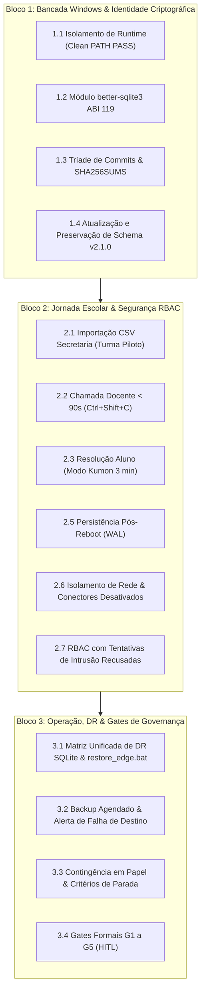

# Plano Executivo de Homologação H-01 — Áquila Pro (v2.1.1)

Este plano estabelece os testes práticos e evidências necessárias para homologação presencial da versão candidata v2.1.0 (Dossiê v2.1.1), em estrita conformidade com a governança soberana do Áquila Pro.

---

## 🎯 Escopo Estrito H-01 & Delimitação de Capacidade

### O que está no escopo de campo (Piloto H-01):
- **Instalação Windows Limpa**: Nó único local em estação física da escola, executando pacote autônomo `win-unpacked` (sem dependência de Node.js, Python ou Git).
- **Escopo Autorizado de Campo**: Estritamente **1 única turma piloto (até 30 alunos)** durante 1 semana letiva com acompanhamento técnico presencial.
- **Jornada Pedagógica Completa**: Secretaria importa CSV da turma autorizada → Professor lança chamada (< 90s) e notas → Aluno responde → Coordenação registra intervenção com hash SHA-256.
- **Recuperação Transacional SQLite (DR)**: Baseada na **Matriz Unificada de DR** (WAL atômico, fsync garantido, rollback automático via `restore_edge.bat`).
- **Segurança de Login e Autorização (RBAC)**: Cookies HMAC-SHA256, expurgo de cookies adulterados e isolamento de série/turma no backend/IPC.
- **Backup e Preservação**: Rotina com manifesto criptográfico SHA-256, detecção de falha de destino e preservação de dados em atualização.
- **Governança por Gates (G1 a G5)**: Nenhum dado real é importado antes da assinatura da Ata de Aceite Conjunto (Direção, DPO e TI).

### O que é capacidade pretendida de bancada (Não autorizado para campo no H-01):
- **Carga de 500 Alunos / 20 Turmas**: Homologada estritamente em bancada técnica como teste de estresse sintético de concorrência e volume do banco edge local.

### O que está explicitamente desativado/quarentenado (Fora do H-01):
- **Mesh / P2P**: Desativado por padrão via feature flag (`AQUILA_ENABLE_MESH=false`).
- **Conectores Cloud**: Bloqueados por padrão (`AQUILA_ENABLE_CLOUD_CONNECTORS=false`).
- **Biometria / Catraca Facial (H02-02)**: Em quarentena estrita; presença confirmada exclusivamente pelo professor.
- **LoRA / Colab A100 Remoto**: Testado apenas via simulador local HTTP (`/v1/chat/completions`); zero dados escolares enviados para a nuvem.

---

## 📋 Três Blocos Práticos de Execução

---

## 🛠️ Matriz de Execução e Evidências

| Item | Ação Técnica | Script / Verificador | Evidência Requerida & Métrica |
| :--- | :--- | :--- | :--- |
| **1. Instalação Limpa** | **Bancada Local:** Executar binário com PATH sanitizado (sem Node/Git). **Ambiente-Alvo:** Inicialização na máquina física da escola. | `scripts/h01/test_clean_runtime.ps1` `apps/electron/release_v2_2/win-unpacked/Aquila Pro.exe` | **PASS**: `clean_runtime_h01_evidence.json` (PID ativo, 202 MB RAM, fechamento gracioso). Homologação presencial pendente de verificação física. |
| **2. Jornada Escolar** | Fluxo real Secretaria → Professor → Aluno → Intervenção com dados sintéticos | `scripts/h01/test_h01_8_operational_priorities.cjs` (Priority 2) | **PASS**: 20 alunos sintéticos, nota `9.5`, intervenção com hash SHA-256 e persistência confirmada após restart. |
| **3. Recuperação SQLite (DR)** | Ensaios da Matriz Unificada de DR (rejeição pré-swap, WAL crash recovery e restore rollback) | `test_h01_8_operational_priorities.cjs` (Priority 3) `apps/electron/release_v2_2/win-unpacked/restore_edge.bat` | **PASS**: Integridade `ok`. Rejeição pré-swap com RTO < 50ms e RPO = 0; rollback de restauração com RTO < 2s; boot WAL com RTO < 1s. |
| **4. Segurança & RBAC** | Sessão HMAC-SHA256, expurgo de cookies forjados e tentativas de intrusão lógica por perfil | `apps/web/src/lib/__tests__/session.test.ts` `packages/api/src/__tests__/api.test.ts` | **PASS**: 401/403 imediatos em cross-role, destruição automática de cookies adulterados e zero tokens em URLs. |
| **5. Exposição e Rede** | CSP restrito, protocolo `aquila-asset://` sem path traversal e conectores cloud desligados | `test_h01_8_operational_priorities.cjs` (Priority 5) | **PASS**: 403 Forbidden em tentativa de leitura de segredos; conectores Supabase/Google isolados localmente. |
| **6. Backup Operacional** | Backup com manifesto SHA-256 e simulação de destino indisponível | `test_h01_8_operational_priorities.cjs` (Priority 6) | **PASS**: Manifesto íntegro e alerta estruturado `BACKUP_DESTINATION_FAILURE` sem travar a aplicação. |
| **7. Schema & Rollback** | Migração idempotente `v2.0 → v2.1.0` com snapshot automático de rollback | `test_h01_8_operational_priorities.cjs` (Priority 7) | **PASS**: Dados preservados, colunas `face_embedding_hash` e tabela `zero_bypass_audits` adicionadas. |
| **8. Aceite Humano (HITL)** | Cumprimento dos Gates G1 a G5 e assinatura da ata presencial | `perplexity/dossie_homologacao_h01_final.md` | Ata assinada conjuntamente por Direção Escolar, DPO da instituição e Responsável de TI. |

---

*Elaborado para homologação presencial. Aceite operacional pendente das assinaturas formais identificadas nesta versão (Direção Escolar, DPO e TI).*
