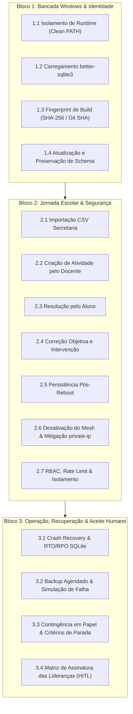

# Plano Executivo de Homologação H-01 — Áquila Pro

Este plano estabelece os testes práticos e evidências necessárias para liberação do Piloto H-01 na máquina de bancada, em conformidade com o manifesto Áquila Pro.

---

## 🎯 Escopo Estrito H-01

### O que está no escopo:
- Instalação Windows limpa (nó único, sem dependência de ferramentas de desenvolvimento).
- Jornada pedagógica completa via UI/IPC (Secretaria → Professor → Aluno → Intervenção).
- Recuperação transacional SQLite (Atomic Journal, WAL, integridade física e crash recovery).
- Segurança de login, autorização RBAC, proteção de rotas e mitigação de vulnerabilidades de rede (`private-ip`).
- Backup agendado, detecção de falha de destino e preservação de dados em atualização.
- Protocolo de contingência operacional e matriz de aceite humano (HITL).

### O que está explicitamente desativado/quarentenado (Fora do H-01):
- **Mesh / P2P**: Desativado por padrão via feature flag (`AQUILA_ENABLE_MESH=false`), eliminando superfície de ataque do `private-ip`.
- **LoRA / Colab A100**: Processamento local soberano apenas; nenhum dado escolar trafega para cloud.
- **Biometria / Catraca Física (H02-02)**: Fora do escopo do piloto pedagógico H-01.
- **Calibração TRI por LLM / Geração Autônoma de Mídia**: Desativados em produção.

---

## 📋 Três Blocos Práticos de Execução

---

## 🛠️ Matriz de Execução e Evidências

| Item | Ação Técnica | Script / Verificador | Evidência Requerida |
| :--- | :--- | :--- | :--- |
| **1. Instalação Limpa** | Executar binário com PATH sanitizado (sem Node/Git) | `scripts/h01/test_clean_runtime.ps1` | Inicialização limpa, native module OK, log sem erros |
| **2. Jornada Escolar** | Fluxo real Secretaria → Professor → Aluno → Intervenção | `scripts/h01/test_e2e_school_journey.ts` | 5 etapas concluídas, banco consistente pós-restart |
| **3. Recuperação SQLite** | Aborto durante escrita e restauração com WAL/SHM | `scripts/h01/test_crash_recovery_dr.ts` | Integridade `ok`, RTO < 2s, RPO = 0 dados corrompidos |
| **4. Segurança & RBAC** | Teste de força bruta, tokens HMAC, roles cruzadas | `scripts/h01/test_auth_security.ts` | Lockout pós 5 falhas, 0 tokens em logs, 403 em cross-role |
| **5. Mitigação `private-ip`** | Feature flag Mesh desligada + interceptor SSRF | `scripts/h01/test_network_target_guard.ts` | Mesh inativo, rejeição de IPs octais/hex/metadados |
| **6. Backup & Falha** | Backup rotineiro + simulação de disco cheio/bloqueado | `scripts/h01/test_backup_operational.ts` | Alerta registrado em auditoria sem travamento do app |
| **7. Schema & Rollback** | Migração e teste de compatibilidade de schema | `scripts/h01/test_schema_migration.ts` | Todos os dados sintéticos mantidos sem perda |
| **8. Aceite Humano** | Termo de homologação e protocolo de contingência | `dossie_homologacao_h01_final.md` | Campos para assinaturas: Pedagógico, Direção, DPO, TI |

